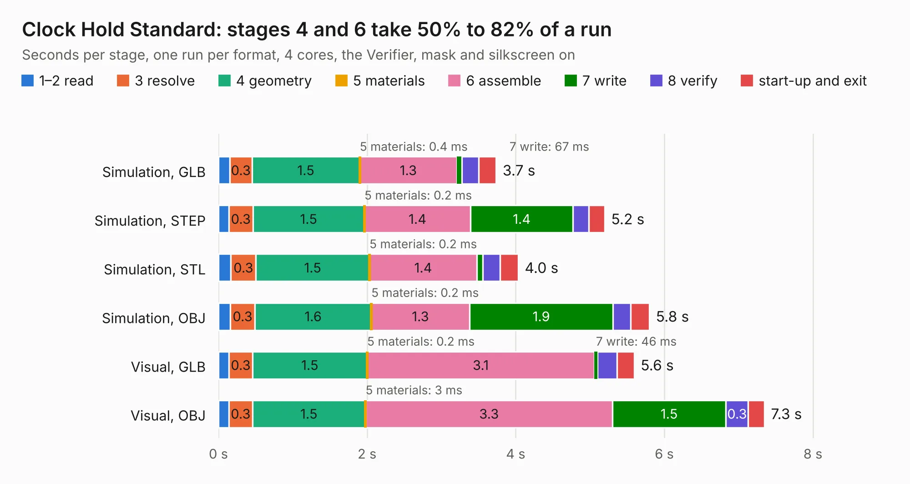

# 158. Clock Hold Standard

Board 158 of the 3,121 of [Corpus Testing](../Corpus-Testing.md), on [Corpus Page 2](../CorpusTestingPages/Corpus-Testing-02.md#158-clock-hold-standard).

| Mode and format | 1–2 read | 3 resolve | 4 geometry | 5 materials | 6 assemble | 7 write | 8 verify | start-up and exit | Total |
|---|---:|---:|---:|---:|---:|---:|---:|---:|---:|
| Simulation, GLB | 0.2 | 0.3 | 1.5 | 0.4&nbsp;ms | 1.3 | 67&nbsp;ms | 0.2 | 0.2 | 3.7 |
| Simulation, STEP | 0.1 | 0.3 | 1.5 | 0.2&nbsp;ms | 1.4 | 1.4 | 0.2 | 0.2 | 5.2 |
| Simulation, STL | 0.2 | 0.3 | 1.5 | 0.2&nbsp;ms | 1.4 | 82&nbsp;ms | 0.2 | 0.2 | 4.0 |
| Simulation, OBJ | 0.2 | 0.3 | 1.6 | 0.2&nbsp;ms | 1.3 | 1.9 | 0.2 | 0.3 | 5.8 |
| Visual, GLB | 0.1 | 0.3 | 1.5 | 0.2&nbsp;ms | 3.1 | 46&nbsp;ms | 0.3 | 0.2 | 5.6 |
| Visual, OBJ | 0.1 | 0.3 | 1.5 | 3&nbsp;ms | 3.3 | 1.5 | 0.3 | 0.2 | 7.3 |

<table align="center"><tr><td valign="top">

| Board | Repo: [andrewpaterson/658-Computer](https://github.com/andrewpaterson/658-Computer) Board: `Clock Hold Standard.kicad_pcb` |
|---|---|
| Folder | Kicad / Computer / Component Boards / Clock Hold Standard |
| Complexity | 219&nbsp;/&nbsp;1000 (size&nbsp;149, features&nbsp;70) |
| KESE&nbsp;features | through vias, rounded, trapezoid or chamfered pads, knockout text, stack-up, dielectric εr and tanδ |
| Tested | 9th November 2026 |
| Copper&nbsp;layers | 2 |
| File&nbsp;format | KiCad 9 (20241229) |
| Parts,&nbsp;tracks,&nbsp;vias | 12, 434, 55 |
| Triangles,&nbsp;simulation | 321,760 in 47 parts |
| Verifier | PASS in all six runs |

</td><td valign="top">

<table>
<tr><th>File type</th><th>File size</th><th>Peak memory used</th></tr>
<tr><th colspan="3" align="left">Simulation</th></tr>
<tr><td>GLB</td><td align="right">11&nbsp;MB</td><td align="right">242&nbsp;MB</td></tr>
<tr><td>STEP</td><td align="right">52&nbsp;MB</td><td align="right">286&nbsp;MB</td></tr>
<tr><td>STL</td><td align="right">16&nbsp;MB</td><td align="right">243&nbsp;MB</td></tr>
<tr><td>OBJ</td><td align="right">33&nbsp;MB</td><td align="right">262&nbsp;MB</td></tr>
<tr><th colspan="3" align="left">Visual</th></tr>
<tr><td>GLB</td><td align="right">9.0&nbsp;MB</td><td align="right">280&nbsp;MB</td></tr>
<tr><td>OBJ</td><td align="right">26&nbsp;MB</td><td align="right">282&nbsp;MB</td></tr>
</table>

</td></tr></table>

| Previous | Next |
|:---|---:|
| [157. Clock Hold Select](b0157b_658-Computer_Clock-Hold-Select.md) | [159. Clock Transition](b0159b_658-Computer_Clock-Transition.md) |
