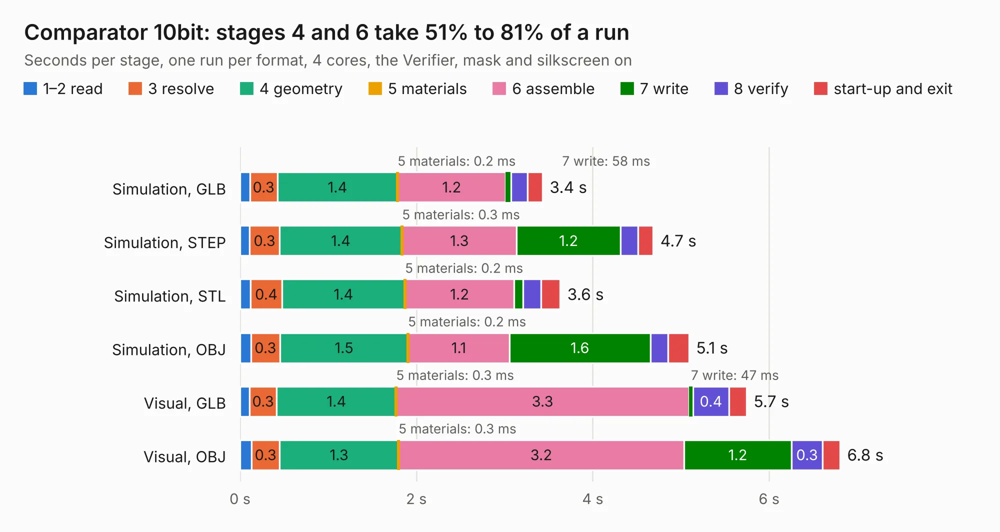

# 160. Comparator 10bit

Board 160 of the 3,124 of [Corpus Testing](../Corpus-Testing.md), on [Corpus Page 2](../CorpusTestingPages/Corpus-Testing-02.md#160-comparator-10bit).

| Mode and format | 1–2 read | 3 resolve | 4 geometry | 5 materials | 6 assemble | 7 write | 8 verify | start-up and exit | Total |
|---|---:|---:|---:|---:|---:|---:|---:|---:|---:|
| Simulation, GLB | 0.1 | 0.3 | 1.4 | 0.2&nbsp;ms | 1.2 | 58&nbsp;ms | 0.2 | 0.2 | 3.4 |
| Simulation, STEP | 0.1 | 0.3 | 1.4 | 0.3&nbsp;ms | 1.3 | 1.2 | 0.2 | 0.2 | 4.7 |
| Simulation, STL | 0.1 | 0.4 | 1.4 | 0.2&nbsp;ms | 1.2 | 0.1 | 0.2 | 0.2 | 3.6 |
| Simulation, OBJ | 0.1 | 0.3 | 1.5 | 0.2&nbsp;ms | 1.1 | 1.6 | 0.2 | 0.2 | 5.1 |
| Visual, GLB | 0.1 | 0.3 | 1.4 | 0.3&nbsp;ms | 3.3 | 47&nbsp;ms | 0.4 | 0.2 | 5.7 |
| Visual, OBJ | 0.1 | 0.3 | 1.3 | 0.3&nbsp;ms | 3.2 | 1.2 | 0.3 | 0.2 | 6.8 |

<table align="center"><tr><td valign="top">

| Board | Repo: [andrewpaterson/658-Computer](https://github.com/andrewpaterson/658-Computer) Board: `Comparator 10bit.kicad_pcb` |
|---|---|
| Folder | Kicad / Computer / Component Boards / Comparator 10bit |
| Complexity | 223&nbsp;/&nbsp;1000 (size&nbsp;153, features&nbsp;70) |
| KESE&nbsp;features | through vias, rounded, trapezoid or chamfered pads, knockout text, stack-up, dielectric εr and tanδ |
| Tested | 9th November 2026 |
| Copper&nbsp;layers | 2 |
| File&nbsp;format | KiCad 9 (20241229) |
| Parts,&nbsp;tracks,&nbsp;vias | 14, 485, 62 |
| Triangles,&nbsp;simulation | 393,638 in 59 parts |
| Verifier | PASS in all six runs |

</td><td valign="top">

<table>
<tr><th>File type</th><th>File size</th><th>Peak memory used</th></tr>
<tr><th colspan="3" align="left">Simulation</th></tr>
<tr><td>GLB</td><td align="right">14&nbsp;MB</td><td align="right">265&nbsp;MB</td></tr>
<tr><td>STEP</td><td align="right">64&nbsp;MB</td><td align="right">309&nbsp;MB</td></tr>
<tr><td>STL</td><td align="right">20&nbsp;MB</td><td align="right">266&nbsp;MB</td></tr>
<tr><td>OBJ</td><td align="right">40&nbsp;MB</td><td align="right">320&nbsp;MB</td></tr>
<tr><th colspan="3" align="left">Visual</th></tr>
<tr><td>GLB</td><td align="right">10&nbsp;MB</td><td align="right">322&nbsp;MB</td></tr>
<tr><td>OBJ</td><td align="right">31&nbsp;MB</td><td align="right">316&nbsp;MB</td></tr>
</table>

</td></tr></table>

| Previous | Next |
|:---|---:|
| [159. Clock Transition](b0159b_658-Computer_Clock-Transition.md) | [161. Comparator 16bit](b0161b_658-Computer_Comparator-16bit.md) |
