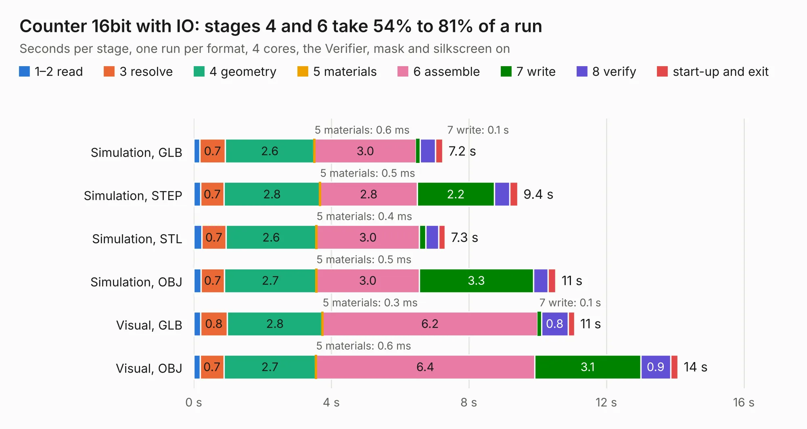

# 162. Counter 16bit with IO

Board 162 of the 3,120 of [Corpus Testing](../Corpus-Testing.md), on [Corpus Page 2](../CorpusTestingPages/Corpus-Testing-02.md#162-counter-16bit-with-io).

| Mode and format | 1–2 read | 3 resolve | 4 geometry | 5 materials | 6 assemble | 7 write | 8 verify | start-up and exit | Total |
|---|---:|---:|---:|---:|---:|---:|---:|---:|---:|
| Simulation, GLB | 0.2 | 0.7 | 2.6 | 0.6&nbsp;ms | 3.0 | 0.1 | 0.4 | 0.2 | 7.2 |
| Simulation, STEP | 0.2 | 0.7 | 2.8 | 0.5&nbsp;ms | 2.8 | 2.2 | 0.5 | 0.2 | 9.4 |
| Simulation, STL | 0.2 | 0.7 | 2.6 | 0.4&nbsp;ms | 3.0 | 0.2 | 0.4 | 0.2 | 7.3 |
| Simulation, OBJ | 0.2 | 0.7 | 2.7 | 0.5&nbsp;ms | 3.0 | 3.3 | 0.4 | 0.2 | 10.5 |
| Visual, GLB | 0.2 | 0.8 | 2.8 | 0.3&nbsp;ms | 6.2 | 0.1 | 0.8 | 0.2 | 11.1 |
| Visual, OBJ | 0.2 | 0.7 | 2.7 | 0.6&nbsp;ms | 6.4 | 3.1 | 0.9 | 0.2 | 14.1 |

<table align="center"><tr><td valign="top">

| Board | Repo: [andrewpaterson/658-Computer](https://github.com/andrewpaterson/658-Computer) Board: `Counter 16bit with IO.kicad_pcb` |
|---|---|
| Folder | Kicad / Computer / Component Boards / Counter 16bit with IO |
| Complexity | 246&nbsp;/&nbsp;1000 (size&nbsp;176, features&nbsp;70) |
| KESE&nbsp;features | through vias, rounded, trapezoid or chamfered pads, knockout text, stack-up, dielectric εr and tanδ |
| Tested | 9th November 2026 |
| Copper&nbsp;layers | 2 |
| File&nbsp;format | KiCad 9 (20241229) |
| Parts,&nbsp;tracks,&nbsp;vias | 24, 1,368, 199 |
| Triangles,&nbsp;simulation | 864,154 in 70 parts |
| Verifier | PASS in all six runs |

</td><td valign="top">

<table>
<tr><th>File type</th><th>File size</th><th>Peak memory used</th></tr>
<tr><th colspan="3" align="left">Simulation</th></tr>
<tr><td>GLB</td><td align="right">30&nbsp;MB</td><td align="right">436&nbsp;MB</td></tr>
<tr><td>STEP</td><td align="right">142&nbsp;MB</td><td align="right">501&nbsp;MB</td></tr>
<tr><td>STL</td><td align="right">43&nbsp;MB</td><td align="right">454&nbsp;MB</td></tr>
<tr><td>OBJ</td><td align="right">88&nbsp;MB</td><td align="right">623&nbsp;MB</td></tr>
<tr><th colspan="3" align="left">Visual</th></tr>
<tr><td>GLB</td><td align="right">25&nbsp;MB</td><td align="right">616&nbsp;MB</td></tr>
<tr><td>OBJ</td><td align="right">77&nbsp;MB</td><td align="right">649&nbsp;MB</td></tr>
</table>

</td></tr></table>

| Previous | Next |
|:---|---:|
| [161. Comparator 16bit](b0161b_658-Computer_Comparator-16bit.md) | [163. Counter 16bit](b0163b_658-Computer_Counter-16bit.md) |
