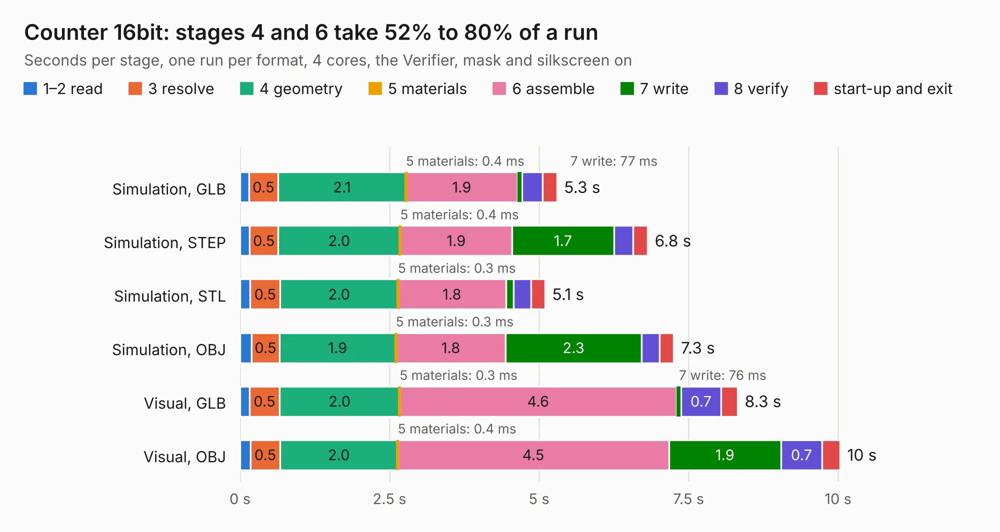

# 163. Counter 16bit

Board 163 of the 3,121 of [Corpus Testing](../Corpus-Testing.md), on [Corpus Page 2](../CorpusTestingPages/Corpus-Testing-02.md#163-counter-16bit).

| Mode and format | 1–2 read | 3 resolve | 4 geometry | 5 materials | 6 assemble | 7 write | 8 verify | start-up and exit | Total |
|---|---:|---:|---:|---:|---:|---:|---:|---:|---:|
| Simulation, GLB | 0.1 | 0.5 | 2.1 | 0.4&nbsp;ms | 1.9 | 77&nbsp;ms | 0.3 | 0.2 | 5.3 |
| Simulation, STEP | 0.2 | 0.5 | 2.0 | 0.4&nbsp;ms | 1.9 | 1.7 | 0.3 | 0.2 | 6.8 |
| Simulation, STL | 0.2 | 0.5 | 2.0 | 0.3&nbsp;ms | 1.8 | 0.1 | 0.3 | 0.2 | 5.1 |
| Simulation, OBJ | 0.2 | 0.5 | 1.9 | 0.3&nbsp;ms | 1.8 | 2.3 | 0.3 | 0.2 | 7.3 |
| Visual, GLB | 0.2 | 0.5 | 2.0 | 0.3&nbsp;ms | 4.6 | 76&nbsp;ms | 0.7 | 0.3 | 8.3 |
| Visual, OBJ | 0.2 | 0.5 | 2.0 | 0.4&nbsp;ms | 4.5 | 1.9 | 0.7 | 0.3 | 10.0 |

<table align="center"><tr><td valign="top">

| Board | Repo: [andrewpaterson/658-Computer](https://github.com/andrewpaterson/658-Computer) Board: `Counter 16bit.kicad_pcb` |
|---|---|
| Folder | Kicad / Computer / Component Boards / Counter 16bit |
| Complexity | 224&nbsp;/&nbsp;1000 (size&nbsp;154, features&nbsp;70) |
| KESE&nbsp;features | through vias, rounded, trapezoid or chamfered pads, knockout text, stack-up, dielectric εr and tanδ |
| Tested | 9th November 2026 |
| Copper&nbsp;layers | 2 |
| File&nbsp;format | KiCad 9 (20241229) |
| Parts,&nbsp;tracks,&nbsp;vias | 14, 508, 78 |
| Triangles,&nbsp;simulation | 468,570 in 52 parts |
| Verifier | PASS in all six runs |

</td><td valign="top">

<table>
<tr><th>File type</th><th>File size</th><th>Peak memory used</th></tr>
<tr><th colspan="3" align="left">Simulation</th></tr>
<tr><td>GLB</td><td align="right">16&nbsp;MB</td><td align="right">294&nbsp;MB</td></tr>
<tr><td>STEP</td><td align="right">74&nbsp;MB</td><td align="right">347&nbsp;MB</td></tr>
<tr><td>STL</td><td align="right">23&nbsp;MB</td><td align="right">308&nbsp;MB</td></tr>
<tr><td>OBJ</td><td align="right">47&nbsp;MB</td><td align="right">366&nbsp;MB</td></tr>
<tr><th colspan="3" align="left">Visual</th></tr>
<tr><td>GLB</td><td align="right">12&nbsp;MB</td><td align="right">353&nbsp;MB</td></tr>
<tr><td>OBJ</td><td align="right">37&nbsp;MB</td><td align="right">356&nbsp;MB</td></tr>
</table>

</td></tr></table>

| Previous | Next |
|:---|---:|
| [162. Counter 16bit with IO](b0162b_658-Computer_Counter-16bit-with-IO.md) | [164. Counter 24bit with IO](b0164b_658-Computer_Counter-24bit-with-IO.md) |
