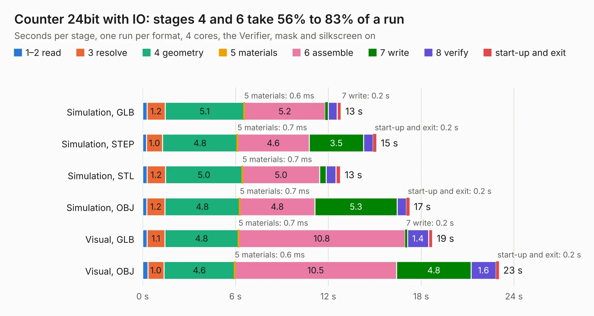

# 164. Counter 24bit with IO

Board 164 of the 3,121 of [Corpus Testing](../Corpus-Testing.md), on [Corpus Page 2](../CorpusTestingPages/Corpus-Testing-02.md#164-counter-24bit-with-io).

| Mode and format | 1–2 read | 3 resolve | 4 geometry | 5 materials | 6 assemble | 7 write | 8 verify | start-up and exit | Total |
|---|---:|---:|---:|---:|---:|---:|---:|---:|---:|
| Simulation, GLB | 0.3 | 1.2 | 5.1 | 0.6&nbsp;ms | 5.2 | 0.2 | 0.6 | 0.3 | 12.8 |
| Simulation, STEP | 0.2 | 1.0 | 4.8 | 0.7&nbsp;ms | 4.6 | 3.5 | 0.6 | 0.2 | 15.1 |
| Simulation, STL | 0.3 | 1.2 | 5.0 | 0.7&nbsp;ms | 5.0 | 0.4 | 0.6 | 0.3 | 12.8 |
| Simulation, OBJ | 0.3 | 1.2 | 4.8 | 0.7&nbsp;ms | 4.8 | 5.3 | 0.6 | 0.2 | 17.3 |
| Visual, GLB | 0.3 | 1.1 | 4.8 | 0.7&nbsp;ms | 10.8 | 0.2 | 1.4 | 0.2 | 18.7 |
| Visual, OBJ | 0.3 | 1.0 | 4.6 | 0.6&nbsp;ms | 10.5 | 4.8 | 1.6 | 0.2 | 23.0 |

<table align="center"><tr><td valign="top">

| Board | Repo: [andrewpaterson/658-Computer](https://github.com/andrewpaterson/658-Computer) Board: `Counter 24bit with IO.kicad_pcb` |
|---|---|
| Folder | Kicad / Computer / Component Boards / Counter 24bit with IO |
| Complexity | 256&nbsp;/&nbsp;1000 (size&nbsp;186, features&nbsp;70) |
| KESE&nbsp;features | through vias, rounded, trapezoid or chamfered pads, knockout text, stack-up, dielectric εr and tanδ |
| Tested | 9th November 2026 |
| Copper&nbsp;layers | 2 |
| File&nbsp;format | KiCad 9 (20241229) |
| Parts,&nbsp;tracks,&nbsp;vias | 32, 2,287, 246 |
| Triangles,&nbsp;simulation | 1,167,700 in 106 parts |
| Verifier | PASS in all six runs |

</td><td valign="top">

<table>
<tr><th>File type</th><th>File size</th><th>Peak memory used</th></tr>
<tr><th colspan="3" align="left">Simulation</th></tr>
<tr><td>GLB</td><td align="right">40&nbsp;MB</td><td align="right">551&nbsp;MB</td></tr>
<tr><td>STEP</td><td align="right">192&nbsp;MB</td><td align="right">635&nbsp;MB</td></tr>
<tr><td>STL</td><td align="right">58&nbsp;MB</td><td align="right">555&nbsp;MB</td></tr>
<tr><td>OBJ</td><td align="right">119&nbsp;MB</td><td align="right">824&nbsp;MB</td></tr>
<tr><th colspan="3" align="left">Visual</th></tr>
<tr><td>GLB</td><td align="right">34&nbsp;MB</td><td align="right">693&nbsp;MB</td></tr>
<tr><td>OBJ</td><td align="right">102&nbsp;MB</td><td align="right">771&nbsp;MB</td></tr>
</table>

</td></tr></table>

| Previous | Next |
|:---|---:|
| [163. Counter 16bit](b0163b_658-Computer_Counter-16bit.md) | [165. Counter 24bit](b0165b_658-Computer_Counter-24bit.md) |
