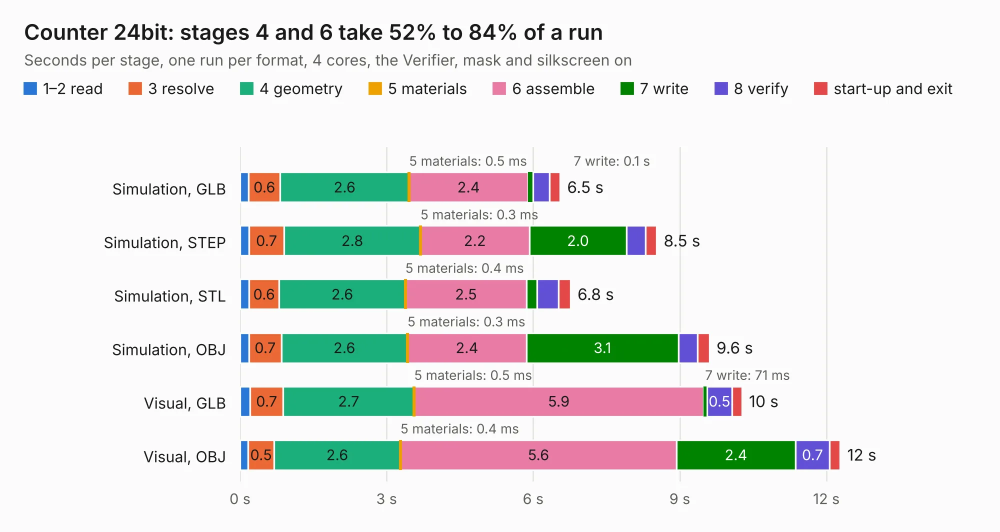

# 165. Counter 24bit

Board 165 of the 3,139 of [Corpus Testing](../Corpus-Testing.md), on [Corpus Page 2](../CorpusTestingPages/Corpus-Testing-02.md#165-counter-24bit).

| Mode and format | 1–2 read | 3 resolve | 4 geometry | 5 materials | 6 assemble | 7 write | 8 verify | start-up and exit | Total |
|---|---:|---:|---:|---:|---:|---:|---:|---:|---:|
| Simulation, GLB | 0.2 | 0.6 | 2.6 | 0.5&nbsp;ms | 2.4 | 0.1 | 0.3 | 0.2 | 6.5 |
| Simulation, STEP | 0.2 | 0.7 | 2.8 | 0.3&nbsp;ms | 2.2 | 2.0 | 0.4 | 0.2 | 8.5 |
| Simulation, STL | 0.2 | 0.6 | 2.6 | 0.4&nbsp;ms | 2.5 | 0.2 | 0.4 | 0.2 | 6.8 |
| Simulation, OBJ | 0.2 | 0.7 | 2.6 | 0.3&nbsp;ms | 2.4 | 3.1 | 0.4 | 0.2 | 9.6 |
| Visual, GLB | 0.2 | 0.7 | 2.7 | 0.5&nbsp;ms | 5.9 | 71&nbsp;ms | 0.5 | 0.2 | 10.3 |
| Visual, OBJ | 0.2 | 0.5 | 2.6 | 0.4&nbsp;ms | 5.6 | 2.4 | 0.7 | 0.2 | 12.3 |

<table align="center"><tr><td valign="top">

| Board | Repo: [andrewpaterson/658-Computer](https://github.com/andrewpaterson/658-Computer) Board: `Counter 24bit.kicad_pcb` |
|---|---|
| Folder | Kicad / Computer / Component Boards / Counter 24bit |
| Complexity | 234&nbsp;/&nbsp;1000 (size&nbsp;164, features&nbsp;70) |
| KESE&nbsp;features | through vias, rounded, trapezoid or chamfered pads, knockout text, stack-up, dielectric εr and tanδ |
| Tested | 9th November 2026 |
| Copper&nbsp;layers | 2 |
| File&nbsp;format | KiCad 9 (20241229) |
| Parts,&nbsp;tracks,&nbsp;vias | 18, 816, 114 |
| Triangles,&nbsp;simulation | 673,350 in 71 parts |
| Verifier | PASS in all six runs |

</td><td valign="top">

<table>
<tr><th>File type</th><th>File size</th><th>Peak memory used</th></tr>
<tr><th colspan="3" align="left">Simulation</th></tr>
<tr><td>GLB</td><td align="right">23&nbsp;MB</td><td align="right">375&nbsp;MB</td></tr>
<tr><td>STEP</td><td align="right">108&nbsp;MB</td><td align="right">421&nbsp;MB</td></tr>
<tr><td>STL</td><td align="right">34&nbsp;MB</td><td align="right">361&nbsp;MB</td></tr>
<tr><td>OBJ</td><td align="right">68&nbsp;MB</td><td align="right">496&nbsp;MB</td></tr>
<tr><th colspan="3" align="left">Visual</th></tr>
<tr><td>GLB</td><td align="right">18&nbsp;MB</td><td align="right">481&nbsp;MB</td></tr>
<tr><td>OBJ</td><td align="right">53&nbsp;MB</td><td align="right">466&nbsp;MB</td></tr>
</table>

</td></tr></table>

| Previous | Next |
|:---|---:|
| [164. Counter 24bit with IO](b0164b_658-Computer_Counter-24bit-with-IO.md) | [166. D Flip Flop 16bit](b0166b_658-Computer_D-Flip-Flop-16bit.md) |
