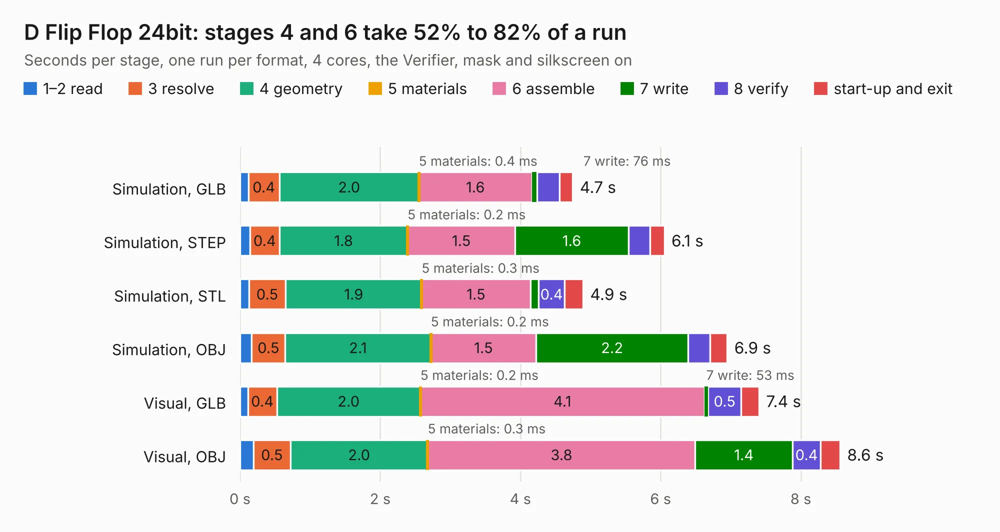

# 166. D Flip Flop 24bit

Board 166 of the 3,107 of [Corpus Testing](../Corpus-Testing.md), on [Corpus Page 2](../CorpusTestingPages/Corpus-Testing-02.md#166-d-flip-flop-24bit).

| Mode and format | 1–2 read | 3 resolve | 4 geometry | 5 materials | 6 assemble | 7 write | 8 verify | start-up and exit | Total |
|---|---:|---:|---:|---:|---:|---:|---:|---:|---:|
| Simulation, GLB | 0.1 | 0.4 | 2.0 | 0.4&nbsp;ms | 1.6 | 76&nbsp;ms | 0.3 | 0.2 | 4.7 |
| Simulation, STEP | 0.1 | 0.4 | 1.8 | 0.2&nbsp;ms | 1.5 | 1.6 | 0.3 | 0.2 | 6.1 |
| Simulation, STL | 0.1 | 0.5 | 1.9 | 0.3&nbsp;ms | 1.5 | 0.1 | 0.4 | 0.3 | 4.9 |
| Simulation, OBJ | 0.2 | 0.5 | 2.1 | 0.2&nbsp;ms | 1.5 | 2.2 | 0.3 | 0.2 | 6.9 |
| Visual, GLB | 0.1 | 0.4 | 2.0 | 0.2&nbsp;ms | 4.1 | 53&nbsp;ms | 0.5 | 0.3 | 7.4 |
| Visual, OBJ | 0.2 | 0.5 | 2.0 | 0.3&nbsp;ms | 3.8 | 1.4 | 0.4 | 0.3 | 8.6 |

<table align="center"><tr><td valign="top">

| Board | Repo: [andrewpaterson/658-Computer](https://github.com/andrewpaterson/658-Computer) Board: `D Flip Flop 24bit.kicad_pcb` |
|---|---|
| Folder | Kicad / Computer / Component Boards / D Flip Flop 24bit |
| Complexity | 215&nbsp;/&nbsp;1000 (size&nbsp;145, features&nbsp;70) |
| KESE&nbsp;features | through vias, rounded, trapezoid or chamfered pads, knockout text, stack-up, dielectric εr and tanδ |
| Tested | 9th November 2026 |
| Copper&nbsp;layers | 2 |
| File&nbsp;format | KiCad 9 (20241229) |
| Parts,&nbsp;tracks,&nbsp;vias | 10, 400, 39 |
| Triangles,&nbsp;simulation | 463,344 in 64 parts |
| Verifier | PASS in all six runs |

</td><td valign="top">

<table>
<tr><th>File type</th><th>File size</th><th>Peak memory used</th></tr>
<tr><th colspan="3" align="left">Simulation</th></tr>
<tr><td>GLB</td><td align="right">16&nbsp;MB</td><td align="right">277&nbsp;MB</td></tr>
<tr><td>STEP</td><td align="right">75&nbsp;MB</td><td align="right">334&nbsp;MB</td></tr>
<tr><td>STL</td><td align="right">23&nbsp;MB</td><td align="right">286&nbsp;MB</td></tr>
<tr><td>OBJ</td><td align="right">47&nbsp;MB</td><td align="right">361&nbsp;MB</td></tr>
<tr><th colspan="3" align="left">Visual</th></tr>
<tr><td>GLB</td><td align="right">11&nbsp;MB</td><td align="right">342&nbsp;MB</td></tr>
<tr><td>OBJ</td><td align="right">34&nbsp;MB</td><td align="right">348&nbsp;MB</td></tr>
</table>

</td></tr></table>

| Previous | Next |
|:---|---:|
| [165. D Flip Flop 16bit](b0165b_658-Computer_D-Flip-Flop-16bit.md) | [167. Data and Signal Buffer](b0167b_658-Computer_Data-and-Signal-Buffer.md) |
