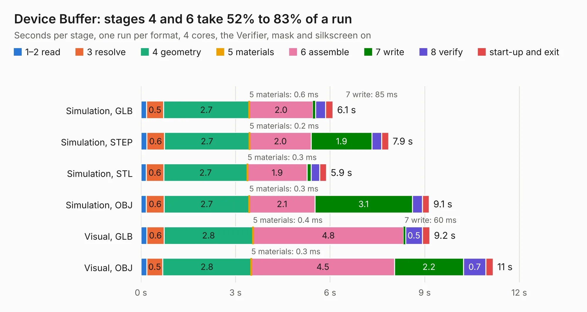

# 169. Device Buffer

Board 169 of the 3,123 of [Corpus Testing](../Corpus-Testing.md), on [Corpus Page 2](../CorpusTestingPages/Corpus-Testing-02.md#169-device-buffer).

| Mode and format | 1–2 read | 3 resolve | 4 geometry | 5 materials | 6 assemble | 7 write | 8 verify | start-up and exit | Total |
|---|---:|---:|---:|---:|---:|---:|---:|---:|---:|
| Simulation, GLB | 0.2 | 0.5 | 2.7 | 0.6&nbsp;ms | 2.0 | 85&nbsp;ms | 0.3 | 0.2 | 6.1 |
| Simulation, STEP | 0.2 | 0.6 | 2.7 | 0.2&nbsp;ms | 2.0 | 1.9 | 0.3 | 0.2 | 7.9 |
| Simulation, STL | 0.2 | 0.6 | 2.7 | 0.3&nbsp;ms | 1.9 | 0.1 | 0.3 | 0.2 | 5.9 |
| Simulation, OBJ | 0.2 | 0.6 | 2.7 | 0.3&nbsp;ms | 2.1 | 3.1 | 0.3 | 0.2 | 9.1 |
| Visual, GLB | 0.2 | 0.6 | 2.8 | 0.4&nbsp;ms | 4.8 | 60&nbsp;ms | 0.5 | 0.2 | 9.2 |
| Visual, OBJ | 0.2 | 0.5 | 2.8 | 0.3&nbsp;ms | 4.5 | 2.2 | 0.7 | 0.2 | 11.2 |

<table align="center"><tr><td valign="top">

| Board | Repo: [andrewpaterson/658-Computer](https://github.com/andrewpaterson/658-Computer) Board: `Device Buffer.kicad_pcb` |
|---|---|
| Folder | Kicad / Computer / Component Boards / Device Buffer |
| Complexity | 226&nbsp;/&nbsp;1000 (size&nbsp;156, features&nbsp;70) |
| KESE&nbsp;features | through vias, rounded, trapezoid or chamfered pads, knockout text, stack-up, dielectric εr and tanδ |
| Tested | 9th November 2026 |
| Copper&nbsp;layers | 2 |
| File&nbsp;format | KiCad 9 (20241229) |
| Parts,&nbsp;tracks,&nbsp;vias | 18, 571, 40 |
| Triangles,&nbsp;simulation | 557,548 in 75 parts |
| Verifier | PASS in all six runs |

</td><td valign="top">

<table>
<tr><th>File type</th><th>File size</th><th>Peak memory used</th></tr>
<tr><th colspan="3" align="left">Simulation</th></tr>
<tr><td>GLB</td><td align="right">19&nbsp;MB</td><td align="right">316&nbsp;MB</td></tr>
<tr><td>STEP</td><td align="right">98&nbsp;MB</td><td align="right">367&nbsp;MB</td></tr>
<tr><td>STL</td><td align="right">28&nbsp;MB</td><td align="right">310&nbsp;MB</td></tr>
<tr><td>OBJ</td><td align="right">57&nbsp;MB</td><td align="right">420&nbsp;MB</td></tr>
<tr><th colspan="3" align="left">Visual</th></tr>
<tr><td>GLB</td><td align="right">14&nbsp;MB</td><td align="right">412&nbsp;MB</td></tr>
<tr><td>OBJ</td><td align="right">41&nbsp;MB</td><td align="right">380&nbsp;MB</td></tr>
</table>

</td></tr></table>

| Previous | Next |
|:---|---:|
| [168. Data and Signal Buffer](b0168b_658-Computer_Data-and-Signal-Buffer.md) | [170. Device Decode stage A](b0170b_658-Computer_Device-Decode-stage-A.md) |
