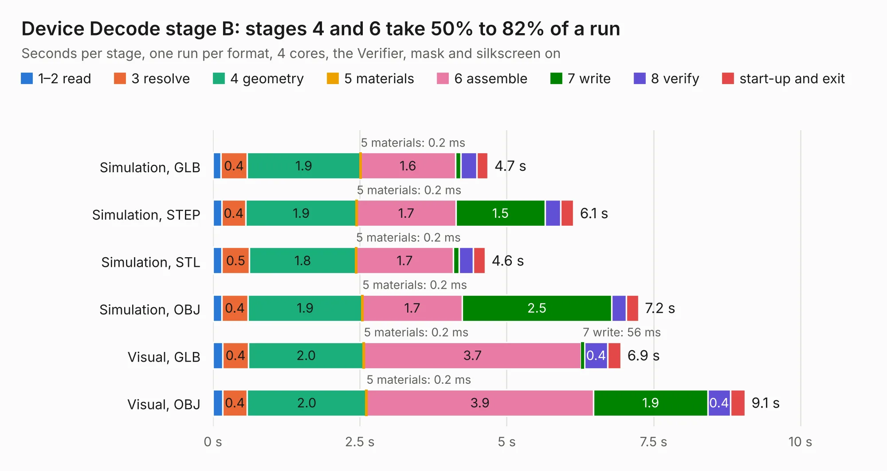

# 171. Device Decode stage B

Board 171 of the 3,131 of [Corpus Testing](../Corpus-Testing.md), on [Corpus Page 2](../CorpusTestingPages/Corpus-Testing-02.md#171-device-decode-stage-b).

| Mode and format | 1–2 read | 3 resolve | 4 geometry | 5 materials | 6 assemble | 7 write | 8 verify | start-up and exit | Total |
|---|---:|---:|---:|---:|---:|---:|---:|---:|---:|
| Simulation, GLB | 0.1 | 0.4 | 1.9 | 0.2&nbsp;ms | 1.6 | 93&nbsp;ms | 0.3 | 0.2 | 4.7 |
| Simulation, STEP | 0.1 | 0.4 | 1.9 | 0.2&nbsp;ms | 1.7 | 1.5 | 0.3 | 0.2 | 6.1 |
| Simulation, STL | 0.2 | 0.5 | 1.8 | 0.2&nbsp;ms | 1.7 | 95&nbsp;ms | 0.2 | 0.2 | 4.6 |
| Simulation, OBJ | 0.1 | 0.4 | 1.9 | 0.2&nbsp;ms | 1.7 | 2.5 | 0.3 | 0.2 | 7.2 |
| Visual, GLB | 0.2 | 0.4 | 2.0 | 0.2&nbsp;ms | 3.7 | 56&nbsp;ms | 0.4 | 0.2 | 6.9 |
| Visual, OBJ | 0.2 | 0.4 | 2.0 | 0.2&nbsp;ms | 3.9 | 1.9 | 0.4 | 0.3 | 9.1 |

<table align="center"><tr><td valign="top">

| Board | Repo: [andrewpaterson/658-Computer](https://github.com/andrewpaterson/658-Computer) Board: `Device Decode stage B.kicad_pcb` |
|---|---|
| Folder | Kicad / Computer / Component Boards / Device Decode stage B |
| Complexity | 227&nbsp;/&nbsp;1000 (size&nbsp;157, features&nbsp;70) |
| KESE&nbsp;features | through vias, rounded, trapezoid or chamfered pads, knockout text, stack-up, dielectric εr and tanδ |
| Tested | 9th November 2026 |
| Copper&nbsp;layers | 2 |
| File&nbsp;format | KiCad 9 (20241229) |
| Parts,&nbsp;tracks,&nbsp;vias | 16, 572, 78 |
| Triangles,&nbsp;simulation | 451,576 in 50 parts |
| Verifier | PASS in all six runs |

</td><td valign="top">

<table>
<tr><th>File type</th><th>File size</th><th>Peak memory used</th></tr>
<tr><th colspan="3" align="left">Simulation</th></tr>
<tr><td>GLB</td><td align="right">16&nbsp;MB</td><td align="right">318&nbsp;MB</td></tr>
<tr><td>STEP</td><td align="right">75&nbsp;MB</td><td align="right">334&nbsp;MB</td></tr>
<tr><td>STL</td><td align="right">23&nbsp;MB</td><td align="right">289&nbsp;MB</td></tr>
<tr><td>OBJ</td><td align="right">46&nbsp;MB</td><td align="right">311&nbsp;MB</td></tr>
<tr><th colspan="3" align="left">Visual</th></tr>
<tr><td>GLB</td><td align="right">13&nbsp;MB</td><td align="right">358&nbsp;MB</td></tr>
<tr><td>OBJ</td><td align="right">37&nbsp;MB</td><td align="right">359&nbsp;MB</td></tr>
</table>

</td></tr></table>

| Previous | Next |
|:---|---:|
| [170. Device Decode stage A](b0170b_658-Computer_Device-Decode-stage-A.md) | [172. Dual Comparator 8bit](b0172b_658-Computer_Dual-Comparator-8bit.md) |
