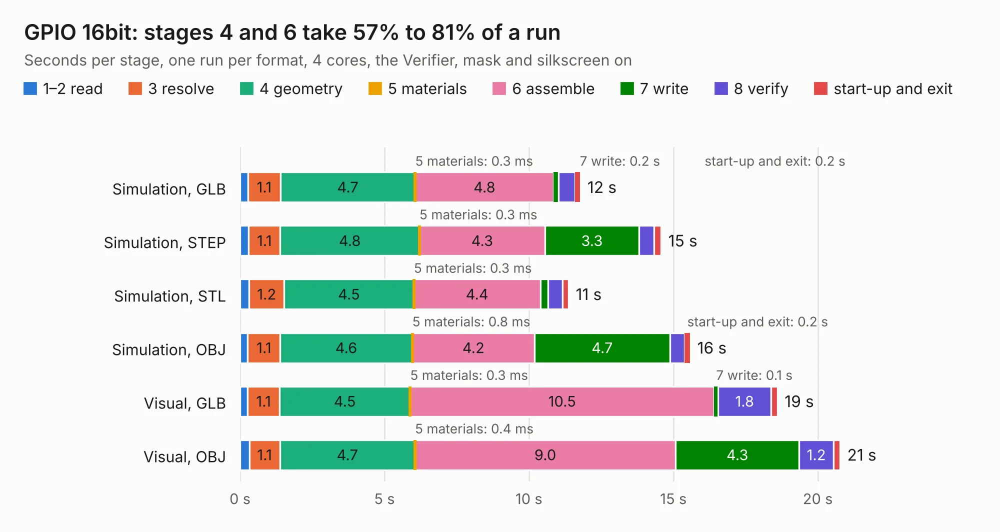

# 174. GPIO 16bit

Board 174 of the 3,138 of [Corpus Testing](../Corpus-Testing.md), on [Corpus Page 2](../CorpusTestingPages/Corpus-Testing-02.md#174-gpio-16bit).

| Mode and format | 1–2 read | 3 resolve | 4 geometry | 5 materials | 6 assemble | 7 write | 8 verify | start-up and exit | Total |
|---|---:|---:|---:|---:|---:|---:|---:|---:|---:|
| Simulation, GLB | 0.3 | 1.1 | 4.7 | 0.3&nbsp;ms | 4.8 | 0.2 | 0.6 | 0.2 | 11.8 |
| Simulation, STEP | 0.3 | 1.1 | 4.8 | 0.3&nbsp;ms | 4.3 | 3.3 | 0.5 | 0.2 | 14.6 |
| Simulation, STL | 0.3 | 1.2 | 4.5 | 0.3&nbsp;ms | 4.4 | 0.3 | 0.5 | 0.2 | 11.4 |
| Simulation, OBJ | 0.3 | 1.1 | 4.6 | 0.8&nbsp;ms | 4.2 | 4.7 | 0.5 | 0.2 | 15.6 |
| Visual, GLB | 0.3 | 1.1 | 4.5 | 0.3&nbsp;ms | 10.5 | 0.1 | 1.8 | 0.2 | 18.6 |
| Visual, OBJ | 0.3 | 1.1 | 4.7 | 0.4&nbsp;ms | 9.0 | 4.3 | 1.2 | 0.2 | 20.8 |

<table align="center"><tr><td valign="top">

| Board | Repo: [andrewpaterson/658-Computer](https://github.com/andrewpaterson/658-Computer) Board: `GPIO 16bit.kicad_pcb` |
|---|---|
| Folder | Kicad / Computer / Component Boards / GPIO 16bit |
| Complexity | 268&nbsp;/&nbsp;1000 (size&nbsp;188, features&nbsp;80) |
| KESE&nbsp;features | through vias, rounded, trapezoid or chamfered pads, curved board outline, knockout text, stack-up, dielectric εr and tanδ |
| Tested | 9th November 2026 |
| Copper&nbsp;layers | 2 |
| File&nbsp;format | KiCad 10 (20260206) |
| Parts,&nbsp;tracks,&nbsp;vias | 43, 2,026, 281 |
| Triangles,&nbsp;simulation | 1,188,690 in 130 parts |
| Verifier | PASS in all six runs |

</td><td valign="top">

<table>
<tr><th>File type</th><th>File size</th><th>Peak memory used</th></tr>
<tr><th colspan="3" align="left">Simulation</th></tr>
<tr><td>GLB</td><td align="right">41&nbsp;MB</td><td align="right">528&nbsp;MB</td></tr>
<tr><td>STEP</td><td align="right">200&nbsp;MB</td><td align="right">651&nbsp;MB</td></tr>
<tr><td>STL</td><td align="right">59&nbsp;MB</td><td align="right">514&nbsp;MB</td></tr>
<tr><td>OBJ</td><td align="right">122&nbsp;MB</td><td align="right">810&nbsp;MB</td></tr>
<tr><th colspan="3" align="left">Visual</th></tr>
<tr><td>GLB</td><td align="right">37&nbsp;MB</td><td align="right">831&nbsp;MB</td></tr>
<tr><td>OBJ</td><td align="right">111&nbsp;MB</td><td align="right">845&nbsp;MB</td></tr>
</table>

</td></tr></table>

| Previous | Next |
|:---|---:|
| [173. Flags Enable Interrupt](b0173b_658-Computer_Flags-Enable-Interrupt.md) | [175. GPIO 4bit](b0175b_658-Computer_GPIO-4bit.md) |
