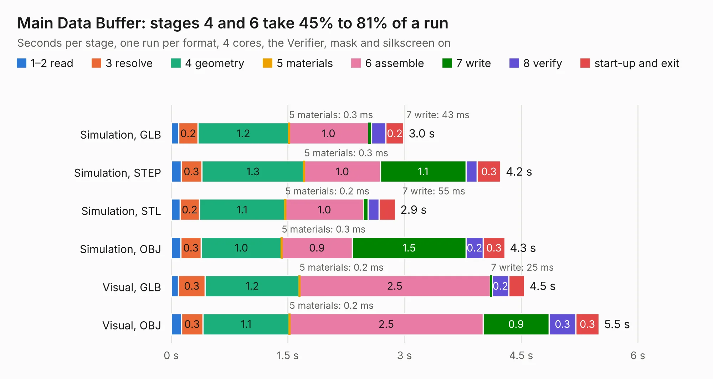

# 177. Main Data Buffer

Board 177 of the 3,126 of [Corpus Testing](../Corpus-Testing.md), on [Corpus Page 2](../CorpusTestingPages/Corpus-Testing-02.md#177-main-data-buffer).

| Mode and format | 1–2 read | 3 resolve | 4 geometry | 5 materials | 6 assemble | 7 write | 8 verify | start-up and exit | Total |
|---|---:|---:|---:|---:|---:|---:|---:|---:|---:|
| Simulation, GLB | 94&nbsp;ms | 0.2 | 1.2 | 0.3&nbsp;ms | 1.0 | 43&nbsp;ms | 0.2 | 0.2 | 3.0 |
| Simulation, STEP | 0.1 | 0.3 | 1.3 | 0.3&nbsp;ms | 1.0 | 1.1 | 0.1 | 0.3 | 4.2 |
| Simulation, STL | 0.1 | 0.2 | 1.1 | 0.2&nbsp;ms | 1.0 | 55&nbsp;ms | 0.1 | 0.2 | 2.9 |
| Simulation, OBJ | 0.1 | 0.3 | 1.0 | 0.3&nbsp;ms | 0.9 | 1.5 | 0.2 | 0.3 | 4.3 |
| Visual, GLB | 93&nbsp;ms | 0.3 | 1.2 | 0.2&nbsp;ms | 2.5 | 25&nbsp;ms | 0.2 | 0.2 | 4.5 |
| Visual, OBJ | 0.1 | 0.3 | 1.1 | 0.2&nbsp;ms | 2.5 | 0.9 | 0.3 | 0.3 | 5.5 |

<table align="center"><tr><td valign="top">

| Board | Repo: [andrewpaterson/658-Computer](https://github.com/andrewpaterson/658-Computer) Board: `Main Data Buffer.kicad_pcb` |
|---|---|
| Folder | Kicad / Computer / Component Boards / Main Data Buffer |
| Complexity | 198&nbsp;/&nbsp;1000 (size&nbsp;128, features&nbsp;70) |
| KESE&nbsp;features | through vias, rounded, trapezoid or chamfered pads, knockout text, stack-up, dielectric εr and tanδ |
| Tested | 9th November 2026 |
| Copper&nbsp;layers | 2 |
| File&nbsp;format | KiCad 9 (20241229) |
| Parts,&nbsp;tracks,&nbsp;vias | 8, 155, 19 |
| Triangles,&nbsp;simulation | 251,780 in 40 parts |
| Verifier | PASS in all six runs |

</td><td valign="top">

<table>
<tr><th>File type</th><th>File size</th><th>Peak memory used</th></tr>
<tr><th colspan="3" align="left">Simulation</th></tr>
<tr><td>GLB</td><td align="right">8.7&nbsp;MB</td><td align="right">222&nbsp;MB</td></tr>
<tr><td>STEP</td><td align="right">38&nbsp;MB</td><td align="right">246&nbsp;MB</td></tr>
<tr><td>STL</td><td align="right">13&nbsp;MB</td><td align="right">247&nbsp;MB</td></tr>
<tr><td>OBJ</td><td align="right">25&nbsp;MB</td><td align="right">234&nbsp;MB</td></tr>
<tr><th colspan="3" align="left">Visual</th></tr>
<tr><td>GLB</td><td align="right">6.1&nbsp;MB</td><td align="right">218&nbsp;MB</td></tr>
<tr><td>OBJ</td><td align="right">18&nbsp;MB</td><td align="right">219&nbsp;MB</td></tr>
</table>

</td></tr></table>

| Previous | Next |
|:---|---:|
| [176. Main Address Buffer](b0176b_658-Computer_Main-Address-Buffer.md) | [178. Memory 32KB with Output](b0178b_658-Computer_Memory-32KB-with-Output.md) |
