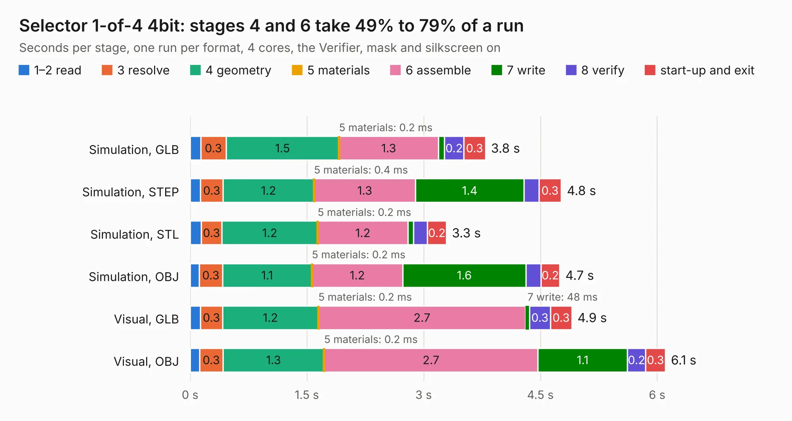

# 179. Selector 1-of-4 4bit

Board 179 of the 3,100 of [Corpus Testing](../Corpus-Testing.md), on [Corpus Page 2](../CorpusTestingPages/Corpus-Testing-02.md#179-selector-1-of-4-4bit).

| Mode and format | 1–2 read | 3 resolve | 4 geometry | 5 materials | 6 assemble | 7 write | 8 verify | start-up and exit | Total |
|---|---:|---:|---:|---:|---:|---:|---:|---:|---:|
| Simulation, GLB | 0.1 | 0.3 | 1.5 | 0.2&nbsp;ms | 1.3 | 78&nbsp;ms | 0.2 | 0.3 | 3.8 |
| Simulation, STEP | 0.1 | 0.3 | 1.2 | 0.4&nbsp;ms | 1.3 | 1.4 | 0.2 | 0.3 | 4.8 |
| Simulation, STL | 0.1 | 0.3 | 1.2 | 0.2&nbsp;ms | 1.2 | 67&nbsp;ms | 0.2 | 0.2 | 3.3 |
| Simulation, OBJ | 0.1 | 0.3 | 1.1 | 0.2&nbsp;ms | 1.2 | 1.6 | 0.2 | 0.2 | 4.7 |
| Visual, GLB | 0.1 | 0.3 | 1.2 | 0.2&nbsp;ms | 2.7 | 48&nbsp;ms | 0.3 | 0.3 | 4.9 |
| Visual, OBJ | 0.1 | 0.3 | 1.3 | 0.2&nbsp;ms | 2.7 | 1.1 | 0.2 | 0.3 | 6.1 |

<table align="center"><tr><td valign="top">

| Board | Repo: [andrewpaterson/658-Computer](https://github.com/andrewpaterson/658-Computer) Board: `Selector 1-of-4 4bit.kicad_pcb` |
|---|---|
| Folder | Kicad / Computer / Component Boards / Selector 1-of-4 4bit |
| Complexity | 202&nbsp;/&nbsp;1000 (size&nbsp;132, features&nbsp;70) |
| KESE&nbsp;features | through vias, rounded, trapezoid or chamfered pads, knockout text, stack-up, dielectric εr and tanδ |
| Tested | 9th November 2026 |
| Copper&nbsp;layers | 2 |
| File&nbsp;format | KiCad 9 (20241229) |
| Parts,&nbsp;tracks,&nbsp;vias | 5, 253, 30 |
| Triangles,&nbsp;simulation | 267,396 in 38 parts |
| Verifier | PASS in all six runs |

</td><td valign="top">

<table>
<tr><th>File type</th><th>File size</th><th>Peak memory used</th></tr>
<tr><th colspan="3" align="left">Simulation</th></tr>
<tr><td>GLB</td><td align="right">9.2&nbsp;MB</td><td align="right">226&nbsp;MB</td></tr>
<tr><td>STEP</td><td align="right">41&nbsp;MB</td><td align="right">251&nbsp;MB</td></tr>
<tr><td>STL</td><td align="right">13&nbsp;MB</td><td align="right">227&nbsp;MB</td></tr>
<tr><td>OBJ</td><td align="right">27&nbsp;MB</td><td align="right">237&nbsp;MB</td></tr>
<tr><th colspan="3" align="left">Visual</th></tr>
<tr><td>GLB</td><td align="right">6.4&nbsp;MB</td><td align="right">223&nbsp;MB</td></tr>
<tr><td>OBJ</td><td align="right">19&nbsp;MB</td><td align="right">222&nbsp;MB</td></tr>
</table>

</td></tr></table>

| Previous | Next |
|:---|---:|
| [178. Selector 1-of-4 4bit with Input](b0178b_658-Computer_Selector-1-of-4-4bit-with-Input.md) | [180. Selector 12bit](b0180b_658-Computer_Selector-12bit.md) |
