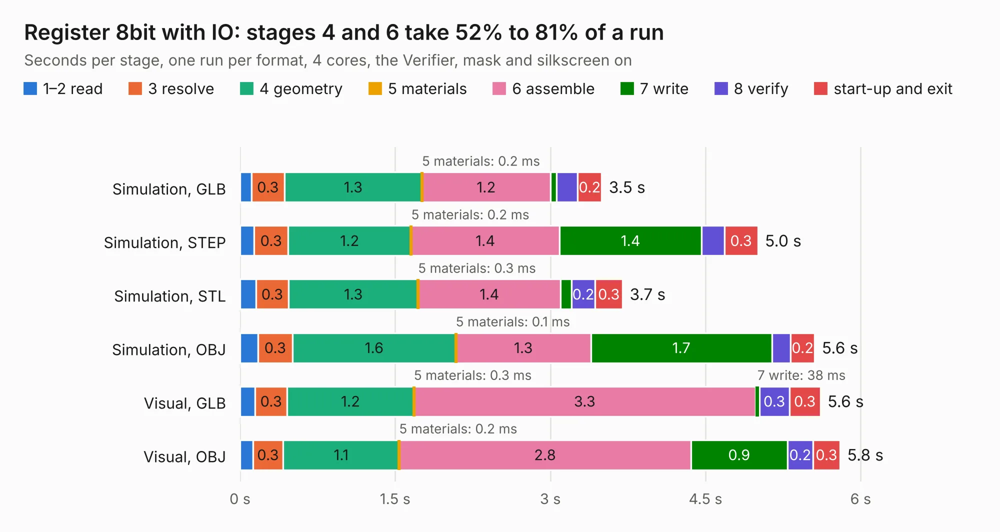

# 180. Register 8bit with IO

Board 180 of the 3,130 of [Corpus Testing](../Corpus-Testing.md), on [Corpus Page 2](../CorpusTestingPages/Corpus-Testing-02.md#180-register-8bit-with-io).

| Mode and format | 1–2 read | 3 resolve | 4 geometry | 5 materials | 6 assemble | 7 write | 8 verify | start-up and exit | Total |
|---|---:|---:|---:|---:|---:|---:|---:|---:|---:|
| Simulation, GLB | 0.1 | 0.3 | 1.3 | 0.2&nbsp;ms | 1.2 | 59&nbsp;ms | 0.2 | 0.2 | 3.5 |
| Simulation, STEP | 0.1 | 0.3 | 1.2 | 0.2&nbsp;ms | 1.4 | 1.4 | 0.2 | 0.3 | 5.0 |
| Simulation, STL | 0.2 | 0.3 | 1.3 | 0.3&nbsp;ms | 1.4 | 0.1 | 0.2 | 0.3 | 3.7 |
| Simulation, OBJ | 0.2 | 0.3 | 1.6 | 0.1&nbsp;ms | 1.3 | 1.7 | 0.2 | 0.2 | 5.6 |
| Visual, GLB | 0.1 | 0.3 | 1.2 | 0.3&nbsp;ms | 3.3 | 38&nbsp;ms | 0.3 | 0.3 | 5.6 |
| Visual, OBJ | 0.1 | 0.3 | 1.1 | 0.2&nbsp;ms | 2.8 | 0.9 | 0.2 | 0.3 | 5.8 |

<table align="center"><tr><td valign="top">

| Board | Repo: [andrewpaterson/658-Computer](https://github.com/andrewpaterson/658-Computer) Board: `Register 8bit with IO.kicad_pcb` |
|---|---|
| Folder | Kicad / Computer / Component Boards / Register 8bit with IO |
| Complexity | 210&nbsp;/&nbsp;1000 (size&nbsp;140, features&nbsp;70) |
| KESE&nbsp;features | through vias, rounded, trapezoid or chamfered pads, knockout text, stack-up, dielectric εr and tanδ |
| Tested | 9th November 2026 |
| Copper&nbsp;layers | 2 |
| File&nbsp;format | KiCad 9 (20241229) |
| Parts,&nbsp;tracks,&nbsp;vias | 10, 289, 30 |
| Triangles,&nbsp;simulation | 290,342 in 42 parts |
| Verifier | PASS in all six runs |

</td><td valign="top">

<table>
<tr><th>File type</th><th>File size</th><th>Peak memory used</th></tr>
<tr><th colspan="3" align="left">Simulation</th></tr>
<tr><td>GLB</td><td align="right">10&nbsp;MB</td><td align="right">241&nbsp;MB</td></tr>
<tr><td>STEP</td><td align="right">46&nbsp;MB</td><td align="right">265&nbsp;MB</td></tr>
<tr><td>STL</td><td align="right">15&nbsp;MB</td><td align="right">228&nbsp;MB</td></tr>
<tr><td>OBJ</td><td align="right">29&nbsp;MB</td><td align="right">251&nbsp;MB</td></tr>
<tr><th colspan="3" align="left">Visual</th></tr>
<tr><td>GLB</td><td align="right">7.3&nbsp;MB</td><td align="right">251&nbsp;MB</td></tr>
<tr><td>OBJ</td><td align="right">21&nbsp;MB</td><td align="right">249&nbsp;MB</td></tr>
</table>

</td></tr></table>

| Previous | Next |
|:---|---:|
| [179. Register 24bit with IO](b0179b_658-Computer_Register-24bit-with-IO.md) | [181. Selector 1-of-4 4bit with Input](b0181b_658-Computer_Selector-1-of-4-4bit-with-Input.md) |
