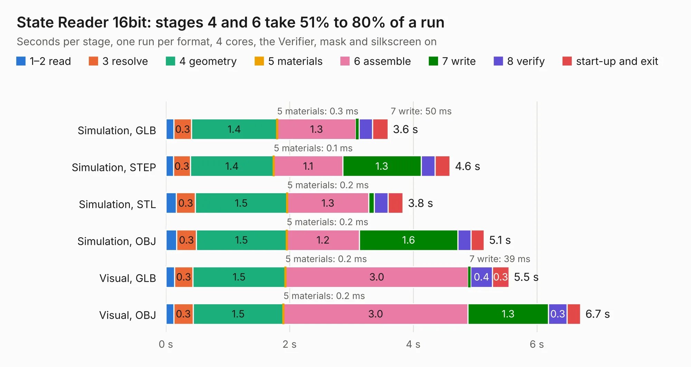

# 185. State Reader 16bit

Board 185 of the 3,121 of [Corpus Testing](../Corpus-Testing.md), on [Corpus Page 2](../CorpusTestingPages/Corpus-Testing-02.md#185-state-reader-16bit).

| Mode and format | 1–2 read | 3 resolve | 4 geometry | 5 materials | 6 assemble | 7 write | 8 verify | start-up and exit | Total |
|---|---:|---:|---:|---:|---:|---:|---:|---:|---:|
| Simulation, GLB | 0.1 | 0.3 | 1.4 | 0.3&nbsp;ms | 1.3 | 50&nbsp;ms | 0.2 | 0.2 | 3.6 |
| Simulation, STEP | 0.1 | 0.3 | 1.4 | 0.1&nbsp;ms | 1.1 | 1.3 | 0.2 | 0.2 | 4.6 |
| Simulation, STL | 0.2 | 0.3 | 1.5 | 0.2&nbsp;ms | 1.3 | 91&nbsp;ms | 0.2 | 0.2 | 3.8 |
| Simulation, OBJ | 0.2 | 0.3 | 1.5 | 0.2&nbsp;ms | 1.2 | 1.6 | 0.2 | 0.2 | 5.1 |
| Visual, GLB | 0.1 | 0.3 | 1.5 | 0.2&nbsp;ms | 3.0 | 39&nbsp;ms | 0.4 | 0.3 | 5.5 |
| Visual, OBJ | 0.1 | 0.3 | 1.5 | 0.2&nbsp;ms | 3.0 | 1.3 | 0.3 | 0.2 | 6.7 |

<table align="center"><tr><td valign="top">

| Board | Repo: [andrewpaterson/658-Computer](https://github.com/andrewpaterson/658-Computer) Board: `State Reader 16bit.kicad_pcb` |
|---|---|
| Folder | Kicad / Computer / Component Boards / State Reader 16bit |
| Complexity | 212&nbsp;/&nbsp;1000 (size&nbsp;142, features&nbsp;70) |
| KESE&nbsp;features | through vias, rounded, trapezoid or chamfered pads, knockout text, stack-up, dielectric εr and tanδ |
| Tested | 9th November 2026 |
| Copper&nbsp;layers | 2 |
| File&nbsp;format | KiCad 9 (20241229) |
| Parts,&nbsp;tracks,&nbsp;vias | 10, 350, 26 |
| Triangles,&nbsp;simulation | 298,626 in 42 parts |
| Verifier | PASS in all six runs |

</td><td valign="top">

<table>
<tr><th>File type</th><th>File size</th><th>Peak memory used</th></tr>
<tr><th colspan="3" align="left">Simulation</th></tr>
<tr><td>GLB</td><td align="right">10&nbsp;MB</td><td align="right">236&nbsp;MB</td></tr>
<tr><td>STEP</td><td align="right">50&nbsp;MB</td><td align="right">270&nbsp;MB</td></tr>
<tr><td>STL</td><td align="right">15&nbsp;MB</td><td align="right">230&nbsp;MB</td></tr>
<tr><td>OBJ</td><td align="right">30&nbsp;MB</td><td align="right">235&nbsp;MB</td></tr>
<tr><th colspan="3" align="left">Visual</th></tr>
<tr><td>GLB</td><td align="right">7.7&nbsp;MB</td><td align="right">255&nbsp;MB</td></tr>
<tr><td>OBJ</td><td align="right">22&nbsp;MB</td><td align="right">256&nbsp;MB</td></tr>
</table>

</td></tr></table>

| Previous | Next |
|:---|---:|
| [184. Selector 18bit](b0184b_658-Computer_Selector-18bit.md) | [186. State Reader 8bit](b0186b_658-Computer_State-Reader-8bit.md) |
