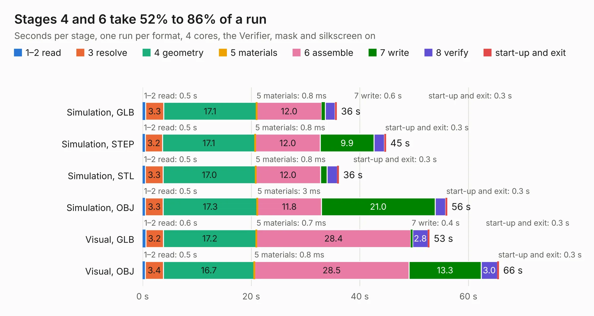

# 187. Coprocessor Board - Additional

Board 187 of the 3,119 of [Corpus Testing](../Corpus-Testing.md), on [Corpus Page 2](../CorpusTestingPages/Corpus-Testing-02.md#187-coprocessor-board---additional).

| Mode and format | 1–2 read | 3 resolve | 4 geometry | 5 materials | 6 assemble | 7 write | 8 verify | start-up and exit | Total |
|---|---:|---:|---:|---:|---:|---:|---:|---:|---:|
| Simulation, GLB | 0.5 | 3.3 | 17.1 | 0.8&nbsp;ms | 12.0 | 0.6 | 1.8 | 0.3 | 35.8 |
| Simulation, STEP | 0.5 | 3.2 | 17.1 | 0.8&nbsp;ms | 12.0 | 9.9 | 2.0 | 0.3 | 44.8 |
| Simulation, STL | 0.5 | 3.3 | 17.0 | 0.8&nbsp;ms | 12.0 | 1.2 | 1.9 | 0.3 | 36.2 |
| Simulation, OBJ | 0.5 | 3.3 | 17.3 | 3&nbsp;ms | 11.8 | 21.0 | 1.9 | 0.3 | 56.1 |
| Visual, GLB | 0.6 | 3.2 | 17.2 | 0.7&nbsp;ms | 28.4 | 0.4 | 2.8 | 0.3 | 52.8 |
| Visual, OBJ | 0.5 | 3.4 | 16.7 | 0.8&nbsp;ms | 28.5 | 13.3 | 3.0 | 0.3 | 65.6 |

<table align="center"><tr><td valign="top">

| Board | Repo: [andrewpaterson/658-Computer](https://github.com/andrewpaterson/658-Computer) Board: `Coprocessor Board - Additional.kicad_pcb` |
|---|---|
| Folder | Kicad / Computer / Coprocessor / Coprocessor Board - Additional |
| Complexity | 264&nbsp;/&nbsp;1000 (size&nbsp;184, features&nbsp;80) |
| KESE&nbsp;features | through vias, rounded, trapezoid or chamfered pads, curved board outline, knockout text, stack-up, dielectric εr and tanδ |
| Tested | 9th November 2026 |
| Copper&nbsp;layers | 2 |
| File&nbsp;format | KiCad 9 (20241229) |
| Parts,&nbsp;tracks,&nbsp;vias | 27, 2,198, 268 |
| Triangles,&nbsp;simulation | 3,637,522 in 233 parts |
| Verifier | PASS in all six runs |

</td><td valign="top">

<table>
<tr><th>File type</th><th>File size</th><th>Peak memory used</th></tr>
<tr><th colspan="3" align="left">Simulation</th></tr>
<tr><td>GLB</td><td align="right">124&nbsp;MB</td><td align="right">1.3&nbsp;GB</td></tr>
<tr><td>STEP</td><td align="right">583&nbsp;MB</td><td align="right">1.4&nbsp;GB</td></tr>
<tr><td>STL</td><td align="right">182&nbsp;MB</td><td align="right">1.3&nbsp;GB</td></tr>
<tr><td>OBJ</td><td align="right">388&nbsp;MB</td><td align="right">2.3&nbsp;GB</td></tr>
<tr><th colspan="3" align="left">Visual</th></tr>
<tr><td>GLB</td><td align="right">79&nbsp;MB</td><td align="right">1.5&nbsp;GB</td></tr>
<tr><td>OBJ</td><td align="right">249&nbsp;MB</td><td align="right">1.8&nbsp;GB</td></tr>
</table>

</td></tr></table>

| Previous | Next |
|:---|---:|
| [186. State Reader 8bit](b0186b_658-Computer_State-Reader-8bit.md) | [188. Coprocessor Board - Main](b0188b_658-Computer_Coprocessor-Board-Main.md) |
