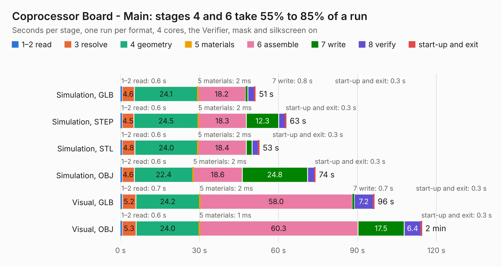

# 188. Coprocessor Board - Main

Board 188 of the 3,118 of [Corpus Testing](../Corpus-Testing.md), on [Corpus Page 2](../CorpusTestingPages/Corpus-Testing-02.md#188-coprocessor-board---main).

| Mode and format | 1–2 read | 3 resolve | 4 geometry | 5 materials | 6 assemble | 7 write | 8 verify | start-up and exit | Total |
|---|---:|---:|---:|---:|---:|---:|---:|---:|---:|
| Simulation, GLB | 0.6 | 4.6 | 24.1 | 2&nbsp;ms | 18.2 | 0.8 | 2.5 | 0.3 | 51.2 |
| Simulation, STEP | 0.6 | 4.5 | 24.5 | 2&nbsp;ms | 18.3 | 12.3 | 2.6 | 0.3 | 62.9 |
| Simulation, STL | 0.6 | 4.8 | 24.0 | 2&nbsp;ms | 18.4 | 2.2 | 2.4 | 0.3 | 52.7 |
| Simulation, OBJ | 0.6 | 4.6 | 22.4 | 2&nbsp;ms | 18.6 | 24.8 | 2.7 | 0.3 | 74.0 |
| Visual, GLB | 0.7 | 5.2 | 24.2 | 2&nbsp;ms | 58.0 | 0.7 | 7.2 | 0.3 | 96.4 |
| Visual, OBJ | 0.6 | 5.3 | 24.0 | 1&nbsp;ms | 60.3 | 17.5 | 6.4 | 0.3 | 114.4 |

<table align="center"><tr><td valign="top">

| Board | Repo: [andrewpaterson/658-Computer](https://github.com/andrewpaterson/658-Computer) Board: `Coprocessor Board - Main.kicad_pcb` |
|---|---|
| Folder | Kicad / Computer / Coprocessor / Coprocessor Board - Main |
| Complexity | 279&nbsp;/&nbsp;1000 (size&nbsp;199, features&nbsp;80) |
| KESE&nbsp;features | through vias, rounded, trapezoid or chamfered pads, curved board outline, knockout text, stack-up, dielectric εr and tanδ |
| Tested | 9th November 2026 |
| Copper&nbsp;layers | 2 |
| File&nbsp;format | KiCad 9 (20241229) |
| Parts,&nbsp;tracks,&nbsp;vias | 42, 3,940, 516 |
| Triangles,&nbsp;simulation | 5,772,242 in 394 parts |
| Verifier | PASS in all six runs |

</td><td valign="top">

<table>
<tr><th>File type</th><th>File size</th><th>Peak memory used</th></tr>
<tr><th colspan="3" align="left">Simulation</th></tr>
<tr><td>GLB</td><td align="right">194&nbsp;MB</td><td align="right">1.8&nbsp;GB</td></tr>
<tr><td>STEP</td><td align="right">831&nbsp;MB</td><td align="right">2.2&nbsp;GB</td></tr>
<tr><td>STL</td><td align="right">289&nbsp;MB</td><td align="right">1.7&nbsp;GB</td></tr>
<tr><td>OBJ</td><td align="right">610&nbsp;MB</td><td align="right">3.6&nbsp;GB</td></tr>
<tr><th colspan="3" align="left">Visual</th></tr>
<tr><td>GLB</td><td align="right">132&nbsp;MB</td><td align="right">2.1&nbsp;GB</td></tr>
<tr><td>OBJ</td><td align="right">425&nbsp;MB</td><td align="right">2.7&nbsp;GB</td></tr>
</table>

</td></tr></table>

| Previous | Next |
|:---|---:|
| [187. Coprocessor Board - Additional](b0187b_658-Computer_Coprocessor-Board-Additional.md) | [189. Coprocessor Clock](b0189b_658-Computer_Coprocessor-Clock.md) |
