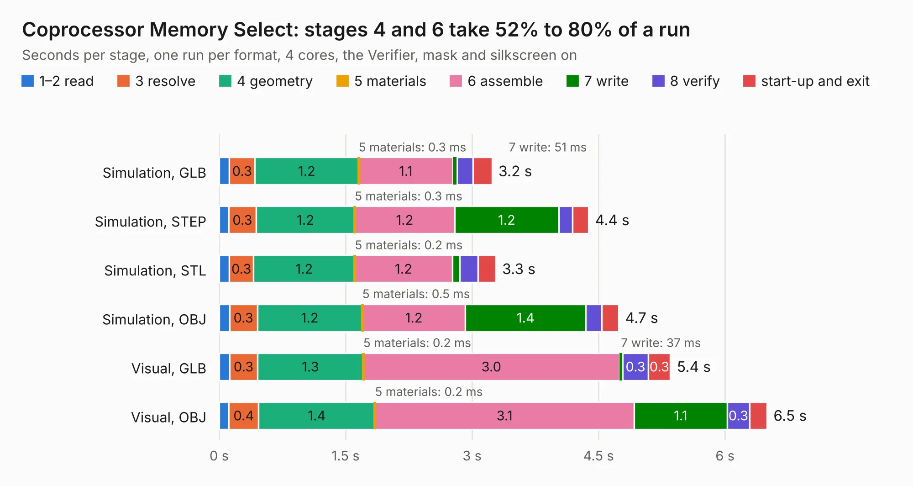

# 190. Coprocessor Memory Select

Board 190 of the 3,125 of [Corpus Testing](../Corpus-Testing.md), on [Corpus Page 2](../CorpusTestingPages/Corpus-Testing-02.md#190-coprocessor-memory-select).

| Mode and format | 1–2 read | 3 resolve | 4 geometry | 5 materials | 6 assemble | 7 write | 8 verify | start-up and exit | Total |
|---|---:|---:|---:|---:|---:|---:|---:|---:|---:|
| Simulation, GLB | 0.1 | 0.3 | 1.2 | 0.3&nbsp;ms | 1.1 | 51&nbsp;ms | 0.2 | 0.2 | 3.2 |
| Simulation, STEP | 0.1 | 0.3 | 1.2 | 0.3&nbsp;ms | 1.2 | 1.2 | 0.2 | 0.2 | 4.4 |
| Simulation, STL | 0.1 | 0.3 | 1.2 | 0.2&nbsp;ms | 1.2 | 87&nbsp;ms | 0.2 | 0.2 | 3.3 |
| Simulation, OBJ | 0.1 | 0.3 | 1.2 | 0.5&nbsp;ms | 1.2 | 1.4 | 0.2 | 0.2 | 4.7 |
| Visual, GLB | 0.1 | 0.3 | 1.3 | 0.2&nbsp;ms | 3.0 | 37&nbsp;ms | 0.3 | 0.3 | 5.4 |
| Visual, OBJ | 0.1 | 0.4 | 1.4 | 0.2&nbsp;ms | 3.1 | 1.1 | 0.3 | 0.2 | 6.5 |

<table align="center"><tr><td valign="top">

| Board | Repo: [andrewpaterson/658-Computer](https://github.com/andrewpaterson/658-Computer) Board: `Coprocessor Memory Select.kicad_pcb` |
|---|---|
| Folder | Kicad / Computer / Coprocessor / Coprocessor Memory Select |
| Complexity | 217&nbsp;/&nbsp;1000 (size&nbsp;147, features&nbsp;70) |
| KESE&nbsp;features | through vias, rounded, trapezoid or chamfered pads, knockout text, stack-up, dielectric εr and tanδ |
| Tested | 9th November 2026 |
| Copper&nbsp;layers | 2 |
| File&nbsp;format | KiCad 9 (20241229) |
| Parts,&nbsp;tracks,&nbsp;vias | 16, 304, 44 |
| Triangles,&nbsp;simulation | 348,694 in 53 parts |
| Verifier | PASS in all six runs |

</td><td valign="top">

<table>
<tr><th>File type</th><th>File size</th><th>Peak memory used</th></tr>
<tr><th colspan="3" align="left">Simulation</th></tr>
<tr><td>GLB</td><td align="right">12&nbsp;MB</td><td align="right">284&nbsp;MB</td></tr>
<tr><td>STEP</td><td align="right">52&nbsp;MB</td><td align="right">288&nbsp;MB</td></tr>
<tr><td>STL</td><td align="right">17&nbsp;MB</td><td align="right">278&nbsp;MB</td></tr>
<tr><td>OBJ</td><td align="right">35&nbsp;MB</td><td align="right">272&nbsp;MB</td></tr>
<tr><th colspan="3" align="left">Visual</th></tr>
<tr><td>GLB</td><td align="right">9.4&nbsp;MB</td><td align="right">296&nbsp;MB</td></tr>
<tr><td>OBJ</td><td align="right">28&nbsp;MB</td><td align="right">292&nbsp;MB</td></tr>
</table>

</td></tr></table>

| Previous | Next |
|:---|---:|
| [189. Coprocessor Clock](b0189b_658-Computer_Coprocessor-Clock.md) | [191. Coprocessor Support](b0191b_658-Computer_Coprocessor-Support.md) |
