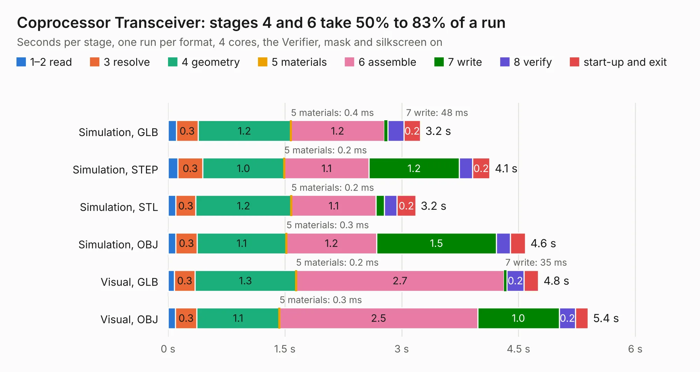

# 192. Coprocessor Transceiver

Board 192 of the 3,125 of [Corpus Testing](../Corpus-Testing.md), on [Corpus Page 2](../CorpusTestingPages/Corpus-Testing-02.md#192-coprocessor-transceiver).

| Mode and format | 1–2 read | 3 resolve | 4 geometry | 5 materials | 6 assemble | 7 write | 8 verify | start-up and exit | Total |
|---|---:|---:|---:|---:|---:|---:|---:|---:|---:|
| Simulation, GLB | 0.1 | 0.3 | 1.2 | 0.4&nbsp;ms | 1.2 | 48&nbsp;ms | 0.2 | 0.2 | 3.2 |
| Simulation, STEP | 0.1 | 0.3 | 1.0 | 0.2&nbsp;ms | 1.1 | 1.2 | 0.2 | 0.2 | 4.1 |
| Simulation, STL | 0.1 | 0.3 | 1.2 | 0.2&nbsp;ms | 1.1 | 0.1 | 0.2 | 0.2 | 3.2 |
| Simulation, OBJ | 0.1 | 0.3 | 1.1 | 0.3&nbsp;ms | 1.2 | 1.5 | 0.2 | 0.2 | 4.6 |
| Visual, GLB | 83&nbsp;ms | 0.3 | 1.3 | 0.2&nbsp;ms | 2.7 | 35&nbsp;ms | 0.2 | 0.2 | 4.8 |
| Visual, OBJ | 96&nbsp;ms | 0.3 | 1.1 | 0.3&nbsp;ms | 2.5 | 1.0 | 0.2 | 0.2 | 5.4 |

<table align="center"><tr><td valign="top">

| Board | Repo: [andrewpaterson/658-Computer](https://github.com/andrewpaterson/658-Computer) Board: `Coprocessor Transceiver.kicad_pcb` |
|---|---|
| Folder | Kicad / Computer / Coprocessor / Coprocessor Transceiver |
| Complexity | 208&nbsp;/&nbsp;1000 (size&nbsp;138, features&nbsp;70) |
| KESE&nbsp;features | through vias, rounded, trapezoid or chamfered pads, knockout text, stack-up, dielectric εr and tanδ |
| Tested | 9th November 2026 |
| Copper&nbsp;layers | 2 |
| File&nbsp;format | KiCad 9 (20241229) |
| Parts,&nbsp;tracks,&nbsp;vias | 6, 284, 52 |
| Triangles,&nbsp;simulation | 315,966 in 38 parts |
| Verifier | PASS in all six runs |

</td><td valign="top">

<table>
<tr><th>File type</th><th>File size</th><th>Peak memory used</th></tr>
<tr><th colspan="3" align="left">Simulation</th></tr>
<tr><td>GLB</td><td align="right">11&nbsp;MB</td><td align="right">235&nbsp;MB</td></tr>
<tr><td>STEP</td><td align="right">48&nbsp;MB</td><td align="right">273&nbsp;MB</td></tr>
<tr><td>STL</td><td align="right">16&nbsp;MB</td><td align="right">241&nbsp;MB</td></tr>
<tr><td>OBJ</td><td align="right">32&nbsp;MB</td><td align="right">265&nbsp;MB</td></tr>
<tr><th colspan="3" align="left">Visual</th></tr>
<tr><td>GLB</td><td align="right">7.8&nbsp;MB</td><td align="right">254&nbsp;MB</td></tr>
<tr><td>OBJ</td><td align="right">23&nbsp;MB</td><td align="right">256&nbsp;MB</td></tr>
</table>

</td></tr></table>

| Previous | Next |
|:---|---:|
| [191. Coprocessor Support](b0191b_658-Computer_Coprocessor-Support.md) | [193. Graphics Board](b0193b_658-Computer_Graphics-Board.md) |
