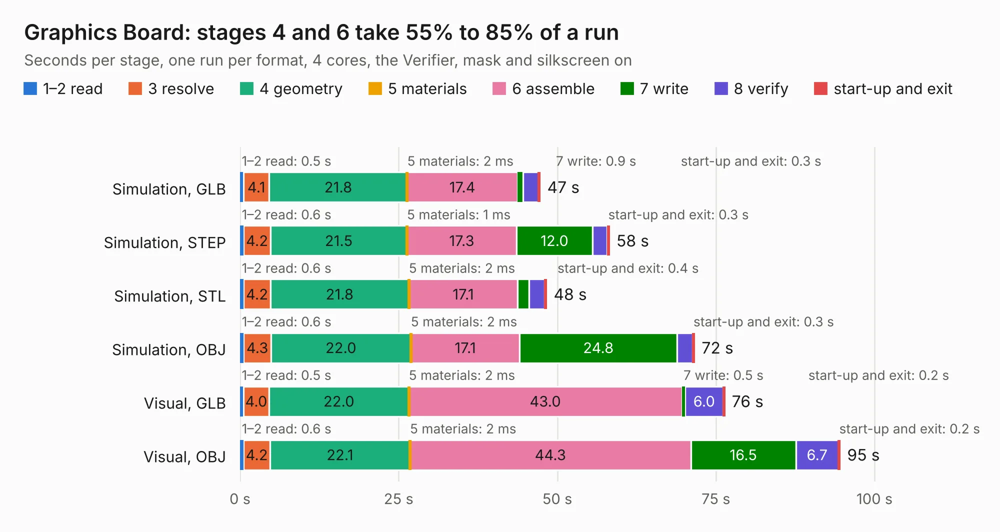

# 193. Graphics Board

Board 193 of the 3,124 of [Corpus Testing](../Corpus-Testing.md), on [Corpus Page 2](../CorpusTestingPages/Corpus-Testing-02.md#193-graphics-board).

| Mode and format | 1–2 read | 3 resolve | 4 geometry | 5 materials | 6 assemble | 7 write | 8 verify | start-up and exit | Total |
|---|---:|---:|---:|---:|---:|---:|---:|---:|---:|
| Simulation, GLB | 0.5 | 4.1 | 21.8 | 2&nbsp;ms | 17.4 | 0.9 | 2.4 | 0.3 | 47.3 |
| Simulation, STEP | 0.6 | 4.2 | 21.5 | 1&nbsp;ms | 17.3 | 12.0 | 2.3 | 0.3 | 58.2 |
| Simulation, STL | 0.6 | 4.2 | 21.8 | 2&nbsp;ms | 17.1 | 1.8 | 2.4 | 0.4 | 48.3 |
| Simulation, OBJ | 0.6 | 4.3 | 22.0 | 2&nbsp;ms | 17.1 | 24.8 | 2.4 | 0.3 | 71.6 |
| Visual, GLB | 0.5 | 4.0 | 22.0 | 2&nbsp;ms | 43.0 | 0.5 | 6.0 | 0.2 | 76.4 |
| Visual, OBJ | 0.6 | 4.2 | 22.1 | 2&nbsp;ms | 44.3 | 16.5 | 6.7 | 0.2 | 94.6 |

<table align="center"><tr><td valign="top">

| Board | Repo: [andrewpaterson/658-Computer](https://github.com/andrewpaterson/658-Computer) Board: `Graphics Board.kicad_pcb` |
|---|---|
| Folder | Kicad / Computer / Graphics / Graphics Board |
| Complexity | 274&nbsp;/&nbsp;1000 (size&nbsp;194, features&nbsp;80) |
| KESE&nbsp;features | through vias, rounded, trapezoid or chamfered pads, curved board outline, knockout text, stack-up, dielectric εr and tanδ |
| Tested | 9th November 2026 |
| Copper&nbsp;layers | 2 |
| File&nbsp;format | KiCad 10 (20260206) |
| Parts,&nbsp;tracks,&nbsp;vias | 28, 4,219, 433 |
| Triangles,&nbsp;simulation | 5,741,322 in 422 parts |
| Verifier | PASS in all six runs |

</td><td valign="top">

<table>
<tr><th>File type</th><th>File size</th><th>Peak memory used</th></tr>
<tr><th colspan="3" align="left">Simulation</th></tr>
<tr><td>GLB</td><td align="right">189&nbsp;MB</td><td align="right">1.7&nbsp;GB</td></tr>
<tr><td>STEP</td><td align="right">816&nbsp;MB</td><td align="right">2.1&nbsp;GB</td></tr>
<tr><td>STL</td><td align="right">287&nbsp;MB</td><td align="right">1.7&nbsp;GB</td></tr>
<tr><td>OBJ</td><td align="right">606&nbsp;MB</td><td align="right">3.6&nbsp;GB</td></tr>
<tr><th colspan="3" align="left">Visual</th></tr>
<tr><td>GLB</td><td align="right">127&nbsp;MB</td><td align="right">2.1&nbsp;GB</td></tr>
<tr><td>OBJ</td><td align="right">409&nbsp;MB</td><td align="right">2.7&nbsp;GB</td></tr>
</table>

</td></tr></table>

| Previous | Next |
|:---|---:|
| [192. Coprocessor Transceiver](b0192b_658-Computer_Coprocessor-Transceiver.md) | [194. Graphics Main Data](b0194b_658-Computer_Graphics-Main-Data.md) |
