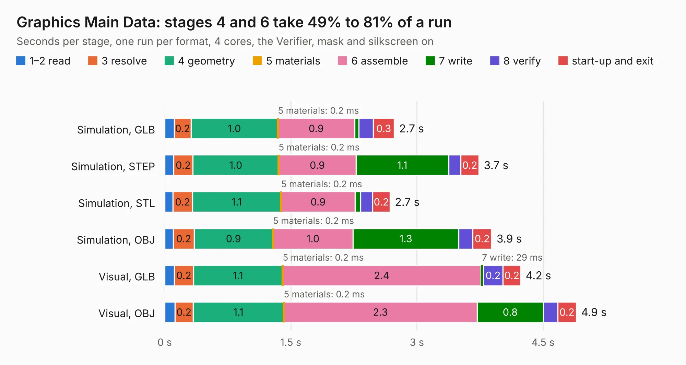

# 194. Graphics Main Data

Board 194 of the 3,128 of [Corpus Testing](../Corpus-Testing.md), on [Corpus Page 2](../CorpusTestingPages/Corpus-Testing-02.md#194-graphics-main-data).

| Mode and format | 1–2 read | 3 resolve | 4 geometry | 5 materials | 6 assemble | 7 write | 8 verify | start-up and exit | Total |
|---|---:|---:|---:|---:|---:|---:|---:|---:|---:|
| Simulation, GLB | 0.1 | 0.2 | 1.0 | 0.2&nbsp;ms | 0.9 | 50&nbsp;ms | 0.2 | 0.3 | 2.7 |
| Simulation, STEP | 0.1 | 0.2 | 1.0 | 0.2&nbsp;ms | 0.9 | 1.1 | 0.1 | 0.2 | 3.7 |
| Simulation, STL | 99&nbsp;ms | 0.2 | 1.1 | 0.2&nbsp;ms | 0.9 | 65&nbsp;ms | 0.1 | 0.2 | 2.7 |
| Simulation, OBJ | 0.1 | 0.2 | 0.9 | 0.2&nbsp;ms | 1.0 | 1.3 | 0.2 | 0.2 | 3.9 |
| Visual, GLB | 0.1 | 0.2 | 1.1 | 0.2&nbsp;ms | 2.4 | 29&nbsp;ms | 0.2 | 0.2 | 4.2 |
| Visual, OBJ | 0.1 | 0.2 | 1.1 | 0.2&nbsp;ms | 2.3 | 0.8 | 0.2 | 0.2 | 4.9 |

<table align="center"><tr><td valign="top">

| Board | Repo: [andrewpaterson/658-Computer](https://github.com/andrewpaterson/658-Computer) Board: `Graphics Main Data.kicad_pcb` |
|---|---|
| Folder | Kicad / Computer / Graphics / Graphics Main Data |
| Complexity | 203&nbsp;/&nbsp;1000 (size&nbsp;133, features&nbsp;70) |
| KESE&nbsp;features | through vias, rounded, trapezoid or chamfered pads, knockout text, stack-up, dielectric εr and tanδ |
| Tested | 9th November 2026 |
| Copper&nbsp;layers | 2 |
| File&nbsp;format | KiCad 9 (20241229) |
| Parts,&nbsp;tracks,&nbsp;vias | 8, 227, 20 |
| Triangles,&nbsp;simulation | 254,212 in 44 parts |
| Verifier | PASS in all six runs |

</td><td valign="top">

<table>
<tr><th>File type</th><th>File size</th><th>Peak memory used</th></tr>
<tr><th colspan="3" align="left">Simulation</th></tr>
<tr><td>GLB</td><td align="right">8.7&nbsp;MB</td><td align="right">238&nbsp;MB</td></tr>
<tr><td>STEP</td><td align="right">39&nbsp;MB</td><td align="right">249&nbsp;MB</td></tr>
<tr><td>STL</td><td align="right">13&nbsp;MB</td><td align="right">229&nbsp;MB</td></tr>
<tr><td>OBJ</td><td align="right">25&nbsp;MB</td><td align="right">233&nbsp;MB</td></tr>
<tr><th colspan="3" align="left">Visual</th></tr>
<tr><td>GLB</td><td align="right">6.2&nbsp;MB</td><td align="right">223&nbsp;MB</td></tr>
<tr><td>OBJ</td><td align="right">18&nbsp;MB</td><td align="right">216&nbsp;MB</td></tr>
</table>

</td></tr></table>

| Previous | Next |
|:---|---:|
| [193. Graphics Board](b0193b_658-Computer_Graphics-Board.md) | [195. Graphics Signals](b0195b_658-Computer_Graphics-Signals.md) |
