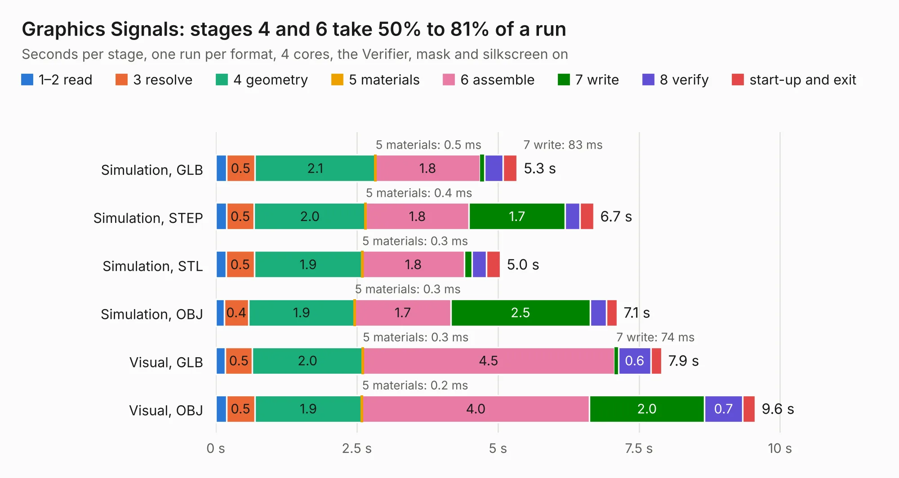

# 195. Graphics Signals

Board 195 of the 3,138 of [Corpus Testing](../Corpus-Testing.md), on [Corpus Page 2](../CorpusTestingPages/Corpus-Testing-02.md#195-graphics-signals).

| Mode and format | 1–2 read | 3 resolve | 4 geometry | 5 materials | 6 assemble | 7 write | 8 verify | start-up and exit | Total |
|---|---:|---:|---:|---:|---:|---:|---:|---:|---:|
| Simulation, GLB | 0.2 | 0.5 | 2.1 | 0.5&nbsp;ms | 1.8 | 83&nbsp;ms | 0.3 | 0.2 | 5.3 |
| Simulation, STEP | 0.2 | 0.5 | 2.0 | 0.4&nbsp;ms | 1.8 | 1.7 | 0.3 | 0.2 | 6.7 |
| Simulation, STL | 0.2 | 0.5 | 1.9 | 0.3&nbsp;ms | 1.8 | 0.1 | 0.3 | 0.2 | 5.0 |
| Simulation, OBJ | 0.1 | 0.4 | 1.9 | 0.3&nbsp;ms | 1.7 | 2.5 | 0.3 | 0.2 | 7.1 |
| Visual, GLB | 0.2 | 0.5 | 2.0 | 0.3&nbsp;ms | 4.5 | 74&nbsp;ms | 0.6 | 0.2 | 7.9 |
| Visual, OBJ | 0.2 | 0.5 | 1.9 | 0.2&nbsp;ms | 4.0 | 2.0 | 0.7 | 0.2 | 9.6 |

<table align="center"><tr><td valign="top">

| Board | Repo: [andrewpaterson/658-Computer](https://github.com/andrewpaterson/658-Computer) Board: `Graphics Signals.kicad_pcb` |
|---|---|
| Folder | Kicad / Computer / Graphics / Graphics Signals |
| Complexity | 234&nbsp;/&nbsp;1000 (size&nbsp;164, features&nbsp;70) |
| KESE&nbsp;features | through vias, rounded, trapezoid or chamfered pads, knockout text, stack-up, dielectric εr and tanδ |
| Tested | 9th November 2026 |
| Copper&nbsp;layers | 2 |
| File&nbsp;format | KiCad 9 (20241229) |
| Parts,&nbsp;tracks,&nbsp;vias | 28, 597, 84 |
| Triangles,&nbsp;simulation | 491,460 in 57 parts |
| Verifier | PASS in all six runs |

</td><td valign="top">

<table>
<tr><th>File type</th><th>File size</th><th>Peak memory used</th></tr>
<tr><th colspan="3" align="left">Simulation</th></tr>
<tr><td>GLB</td><td align="right">17&nbsp;MB</td><td align="right">320&nbsp;MB</td></tr>
<tr><td>STEP</td><td align="right">78&nbsp;MB</td><td align="right">358&nbsp;MB</td></tr>
<tr><td>STL</td><td align="right">25&nbsp;MB</td><td align="right">297&nbsp;MB</td></tr>
<tr><td>OBJ</td><td align="right">50&nbsp;MB</td><td align="right">377&nbsp;MB</td></tr>
<tr><th colspan="3" align="left">Visual</th></tr>
<tr><td>GLB</td><td align="right">14&nbsp;MB</td><td align="right">381&nbsp;MB</td></tr>
<tr><td>OBJ</td><td align="right">41&nbsp;MB</td><td align="right">409&nbsp;MB</td></tr>
</table>

</td></tr></table>

| Previous | Next |
|:---|---:|
| [194. Graphics Main Data](b0194b_658-Computer_Graphics-Main-Data.md) | [196. Graphics Transparency](b0196b_658-Computer_Graphics-Transparency.md) |
