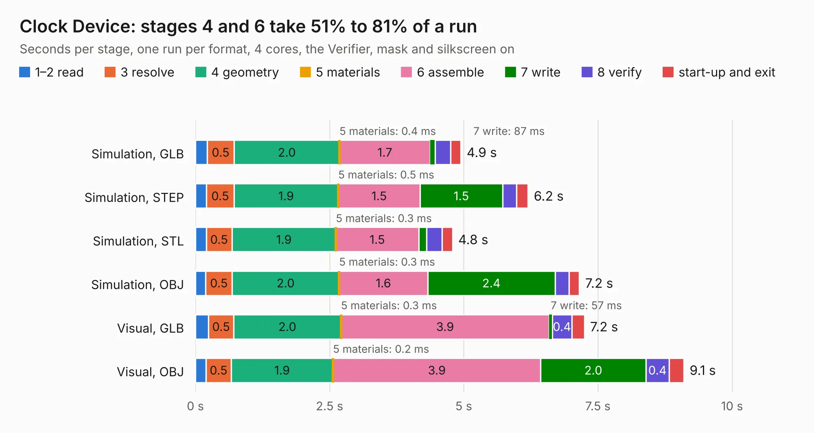

# 196. Clock Device

Board 196 of the 3,101 of [Corpus Testing](../Corpus-Testing.md), on [Corpus Page 2](../CorpusTestingPages/Corpus-Testing-02.md#196-clock-device).

| Mode and format | 1–2 read | 3 resolve | 4 geometry | 5 materials | 6 assemble | 7 write | 8 verify | start-up and exit | Total |
|---|---:|---:|---:|---:|---:|---:|---:|---:|---:|
| Simulation, GLB | 0.2 | 0.5 | 2.0 | 0.4&nbsp;ms | 1.7 | 87&nbsp;ms | 0.3 | 0.2 | 4.9 |
| Simulation, STEP | 0.2 | 0.5 | 1.9 | 0.5&nbsp;ms | 1.5 | 1.5 | 0.3 | 0.2 | 6.2 |
| Simulation, STL | 0.2 | 0.5 | 1.9 | 0.3&nbsp;ms | 1.5 | 0.2 | 0.3 | 0.2 | 4.8 |
| Simulation, OBJ | 0.2 | 0.5 | 2.0 | 0.3&nbsp;ms | 1.6 | 2.4 | 0.3 | 0.2 | 7.2 |
| Visual, GLB | 0.2 | 0.5 | 2.0 | 0.3&nbsp;ms | 3.9 | 57&nbsp;ms | 0.4 | 0.2 | 7.2 |
| Visual, OBJ | 0.2 | 0.5 | 1.9 | 0.2&nbsp;ms | 3.9 | 2.0 | 0.4 | 0.3 | 9.1 |

<table align="center"><tr><td valign="top">

| Board | Repo: [andrewpaterson/658-Computer](https://github.com/andrewpaterson/658-Computer) Board: `Clock Device.kicad_pcb` |
|---|---|
| Folder | Kicad / Computer / Main / Clock Device |
| Complexity | 236&nbsp;/&nbsp;1000 (size&nbsp;156, features&nbsp;80) |
| KESE&nbsp;features | through vias, rounded, trapezoid or chamfered pads, curved board outline, knockout text, stack-up, dielectric εr and tanδ |
| Tested | 9th November 2026 |
| Copper&nbsp;layers | 2 |
| File&nbsp;format | KiCad 9 (20241229) |
| Parts,&nbsp;tracks,&nbsp;vias | 18, 446, 79 |
| Triangles,&nbsp;simulation | 474,398 in 72 parts |
| Verifier | PASS in all six runs |

</td><td valign="top">

<table>
<tr><th>File type</th><th>File size</th><th>Peak memory used</th></tr>
<tr><th colspan="3" align="left">Simulation</th></tr>
<tr><td>GLB</td><td align="right">16&nbsp;MB</td><td align="right">280&nbsp;MB</td></tr>
<tr><td>STEP</td><td align="right">73&nbsp;MB</td><td align="right">346&nbsp;MB</td></tr>
<tr><td>STL</td><td align="right">24&nbsp;MB</td><td align="right">278&nbsp;MB</td></tr>
<tr><td>OBJ</td><td align="right">48&nbsp;MB</td><td align="right">369&nbsp;MB</td></tr>
<tr><th colspan="3" align="left">Visual</th></tr>
<tr><td>GLB</td><td align="right">12&nbsp;MB</td><td align="right">351&nbsp;MB</td></tr>
<tr><td>OBJ</td><td align="right">37&nbsp;MB</td><td align="right">342&nbsp;MB</td></tr>
</table>

</td></tr></table>

| Previous | Next |
|:---|---:|
| [195. LCD Display](b0195b_658-Computer_LCD-Display.md) | [197. Clock LTC6903](b0197b_658-Computer_Clock-LTC6903.md) |
