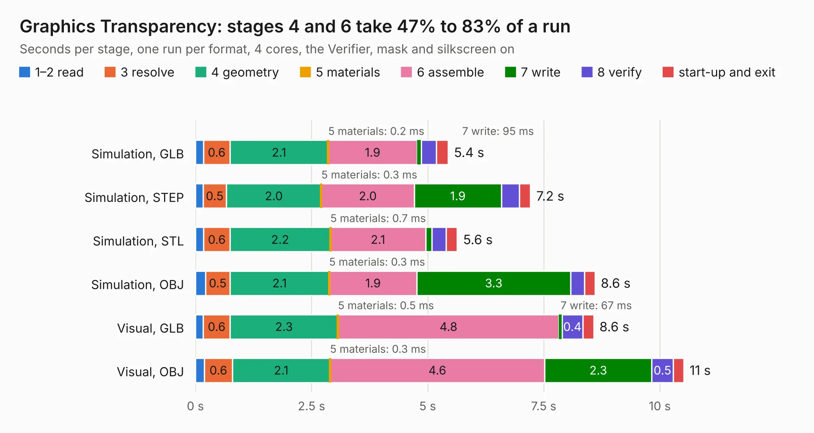

# 196. Graphics Transparency

Board 196 of the 3,132 of [Corpus Testing](../Corpus-Testing.md), on [Corpus Page 2](../CorpusTestingPages/Corpus-Testing-02.md#196-graphics-transparency).

| Mode and format | 1–2 read | 3 resolve | 4 geometry | 5 materials | 6 assemble | 7 write | 8 verify | start-up and exit | Total |
|---|---:|---:|---:|---:|---:|---:|---:|---:|---:|
| Simulation, GLB | 0.2 | 0.6 | 2.1 | 0.2&nbsp;ms | 1.9 | 95&nbsp;ms | 0.3 | 0.3 | 5.4 |
| Simulation, STEP | 0.2 | 0.5 | 2.0 | 0.3&nbsp;ms | 2.0 | 1.9 | 0.4 | 0.2 | 7.2 |
| Simulation, STL | 0.2 | 0.6 | 2.2 | 0.7&nbsp;ms | 2.1 | 0.1 | 0.3 | 0.2 | 5.6 |
| Simulation, OBJ | 0.2 | 0.5 | 2.1 | 0.3&nbsp;ms | 1.9 | 3.3 | 0.3 | 0.2 | 8.6 |
| Visual, GLB | 0.2 | 0.6 | 2.3 | 0.5&nbsp;ms | 4.8 | 67&nbsp;ms | 0.4 | 0.2 | 8.6 |
| Visual, OBJ | 0.2 | 0.6 | 2.1 | 0.3&nbsp;ms | 4.6 | 2.3 | 0.5 | 0.2 | 10.5 |

<table align="center"><tr><td valign="top">

| Board | Repo: [andrewpaterson/658-Computer](https://github.com/andrewpaterson/658-Computer) Board: `Graphics Transparency.kicad_pcb` |
|---|---|
| Folder | Kicad / Computer / Graphics / Graphics Transparency |
| Complexity | 227&nbsp;/&nbsp;1000 (size&nbsp;157, features&nbsp;70) |
| KESE&nbsp;features | through vias, rounded, trapezoid or chamfered pads, knockout text, stack-up, dielectric εr and tanδ |
| Tested | 9th November 2026 |
| Copper&nbsp;layers | 2 |
| File&nbsp;format | KiCad 9 (20241229) |
| Parts,&nbsp;tracks,&nbsp;vias | 16, 545, 89 |
| Triangles,&nbsp;simulation | 469,960 in 55 parts |
| Verifier | PASS in all six runs |

</td><td valign="top">

<table>
<tr><th>File type</th><th>File size</th><th>Peak memory used</th></tr>
<tr><th colspan="3" align="left">Simulation</th></tr>
<tr><td>GLB</td><td align="right">16&nbsp;MB</td><td align="right">283&nbsp;MB</td></tr>
<tr><td>STEP</td><td align="right">73&nbsp;MB</td><td align="right">348&nbsp;MB</td></tr>
<tr><td>STL</td><td align="right">24&nbsp;MB</td><td align="right">293&nbsp;MB</td></tr>
<tr><td>OBJ</td><td align="right">47&nbsp;MB</td><td align="right">353&nbsp;MB</td></tr>
<tr><th colspan="3" align="left">Visual</th></tr>
<tr><td>GLB</td><td align="right">13&nbsp;MB</td><td align="right">373&nbsp;MB</td></tr>
<tr><td>OBJ</td><td align="right">39&nbsp;MB</td><td align="right">367&nbsp;MB</td></tr>
</table>

</td></tr></table>

| Previous | Next |
|:---|---:|
| [195. Graphics Signals](b0195b_658-Computer_Graphics-Signals.md) | [197. LCD Board](b0197b_658-Computer_LCD-Board.md) |
