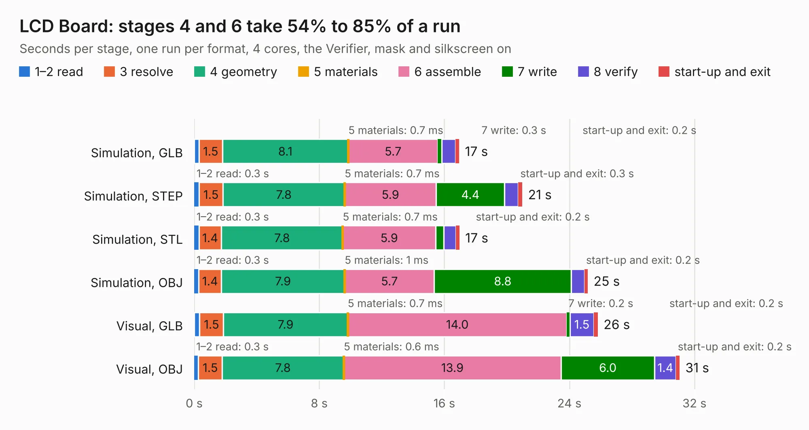

# 197. LCD Board

Board 197 of the 3,132 of [Corpus Testing](../Corpus-Testing.md), on [Corpus Page 2](../CorpusTestingPages/Corpus-Testing-02.md#197-lcd-board).

| Mode and format | 1–2 read | 3 resolve | 4 geometry | 5 materials | 6 assemble | 7 write | 8 verify | start-up and exit | Total |
|---|---:|---:|---:|---:|---:|---:|---:|---:|---:|
| Simulation, GLB | 0.3 | 1.5 | 8.1 | 0.7&nbsp;ms | 5.7 | 0.3 | 0.9 | 0.2 | 16.9 |
| Simulation, STEP | 0.3 | 1.5 | 7.8 | 0.7&nbsp;ms | 5.9 | 4.4 | 0.9 | 0.3 | 21.0 |
| Simulation, STL | 0.3 | 1.4 | 7.8 | 0.7&nbsp;ms | 5.9 | 0.5 | 0.8 | 0.2 | 17.0 |
| Simulation, OBJ | 0.3 | 1.4 | 7.9 | 1&nbsp;ms | 5.7 | 8.8 | 0.8 | 0.2 | 25.2 |
| Visual, GLB | 0.3 | 1.5 | 7.9 | 0.7&nbsp;ms | 14.0 | 0.2 | 1.5 | 0.2 | 25.8 |
| Visual, OBJ | 0.3 | 1.5 | 7.8 | 0.6&nbsp;ms | 13.9 | 6.0 | 1.4 | 0.2 | 31.0 |

<table align="center"><tr><td valign="top">

| Board | Repo: [andrewpaterson/658-Computer](https://github.com/andrewpaterson/658-Computer) Board: `LCD Board.kicad_pcb` |
|---|---|
| Folder | Kicad / Computer / LCD / LCD Board |
| Complexity | 248&nbsp;/&nbsp;1000 (size&nbsp;168, features&nbsp;80) |
| KESE&nbsp;features | through vias, rounded, trapezoid or chamfered pads, curved board outline, knockout text, stack-up, dielectric εr and tanδ |
| Tested | 9th November 2026 |
| Copper&nbsp;layers | 2 |
| File&nbsp;format | KiCad 9 (20241229) |
| Parts,&nbsp;tracks,&nbsp;vias | 17, 1,151, 117 |
| Triangles,&nbsp;simulation | 1,760,916 in 194 parts |
| Verifier | PASS in all six runs |

</td><td valign="top">

<table>
<tr><th>File type</th><th>File size</th><th>Peak memory used</th></tr>
<tr><th colspan="3" align="left">Simulation</th></tr>
<tr><td>GLB</td><td align="right">59&nbsp;MB</td><td align="right">680&nbsp;MB</td></tr>
<tr><td>STEP</td><td align="right">246&nbsp;MB</td><td align="right">795&nbsp;MB</td></tr>
<tr><td>STL</td><td align="right">88&nbsp;MB</td><td align="right">628&nbsp;MB</td></tr>
<tr><td>OBJ</td><td align="right">181&nbsp;MB</td><td align="right">1.2&nbsp;GB</td></tr>
<tr><th colspan="3" align="left">Visual</th></tr>
<tr><td>GLB</td><td align="right">39&nbsp;MB</td><td align="right">891&nbsp;MB</td></tr>
<tr><td>OBJ</td><td align="right">120&nbsp;MB</td><td align="right">923&nbsp;MB</td></tr>
</table>

</td></tr></table>

| Previous | Next |
|:---|---:|
| [196. Graphics Transparency](b0196b_658-Computer_Graphics-Transparency.md) | [198. LCD Display](b0198b_658-Computer_LCD-Display.md) |
