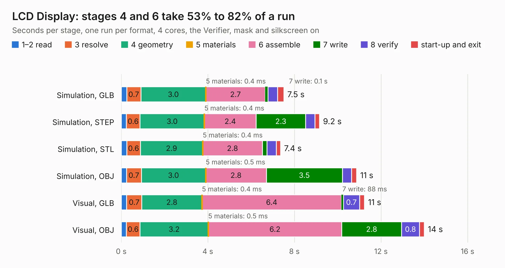

# 198 LCD Display

Board 198 of the 3,138 of [Corpus Testing](../Corpus-Testing.md), on [Corpus Page 2](../CorpusTestingPages/Corpus-Testing-02.md#198-lcd-display).

| Mode and format | 1–2 read | 3 resolve | 4 geometry | 5 materials | 6 assemble | 7 write | 8 verify | start-up and exit | Total |
|---|---:|---:|---:|---:|---:|---:|---:|---:|---:|
| Simulation, GLB | 0.3 | 0.7 | 3.0 | 0.4&nbsp;ms | 2.7 | 0.1 | 0.4 | 0.3 | 7.5 |
| Simulation, STEP | 0.2 | 0.6 | 3.0 | 0.4&nbsp;ms | 2.4 | 2.3 | 0.4 | 0.2 | 9.2 |
| Simulation, STL | 0.3 | 0.6 | 2.9 | 0.4&nbsp;ms | 2.8 | 0.2 | 0.4 | 0.2 | 7.4 |
| Simulation, OBJ | 0.2 | 0.7 | 3.0 | 0.5&nbsp;ms | 2.8 | 3.5 | 0.4 | 0.2 | 10.9 |
| Visual, GLB | 0.2 | 0.7 | 2.8 | 0.4&nbsp;ms | 6.4 | 88&nbsp;ms | 0.7 | 0.2 | 11.2 |
| Visual, OBJ | 0.2 | 0.6 | 3.2 | 0.5&nbsp;ms | 6.2 | 2.8 | 0.8 | 0.2 | 14.0 |

<table align="center"><tr><td valign="top">

| Board | Repo: [andrewpaterson/658-Computer](https://github.com/andrewpaterson/658-Computer) Board: `LCD Display.kicad_pcb` |
|---|---|
| Folder | Kicad / Computer / LCD / LCD Display |
| Complexity | 246&nbsp;/&nbsp;1000 (size&nbsp;166, features&nbsp;80) |
| KESE&nbsp;features | through vias, rounded, trapezoid or chamfered pads, curved board outline, knockout text, stack-up, dielectric εr and tanδ |
| Tested | 9th November 2026 |
| Copper&nbsp;layers | 2 |
| File&nbsp;format | KiCad 9 (20241229) |
| Parts,&nbsp;tracks,&nbsp;vias | 20, 878, 107 |
| Triangles,&nbsp;simulation | 720,300 in 101 parts |
| Verifier | PASS in all six runs |

</td><td valign="top">

<table>
<tr><th>File type</th><th>File size</th><th>Peak memory used</th></tr>
<tr><th colspan="3" align="left">Simulation</th></tr>
<tr><td>GLB</td><td align="right">25&nbsp;MB</td><td align="right">348&nbsp;MB</td></tr>
<tr><td>STEP</td><td align="right">111&nbsp;MB</td><td align="right">442&nbsp;MB</td></tr>
<tr><td>STL</td><td align="right">36&nbsp;MB</td><td align="right">358&nbsp;MB</td></tr>
<tr><td>OBJ</td><td align="right">73&nbsp;MB</td><td align="right">527&nbsp;MB</td></tr>
<tr><th colspan="3" align="left">Visual</th></tr>
<tr><td>GLB</td><td align="right">19&nbsp;MB</td><td align="right">510&nbsp;MB</td></tr>
<tr><td>OBJ</td><td align="right">57&nbsp;MB</td><td align="right">514&nbsp;MB</td></tr>
</table>

</td></tr></table>

| Previous | Next |
|:---|---:|
| [197 LCD Board](b0197b_658-Computer_LCD-Board.md) | [199 Clock Device](b0199b_658-Computer_Clock-Device.md) |
