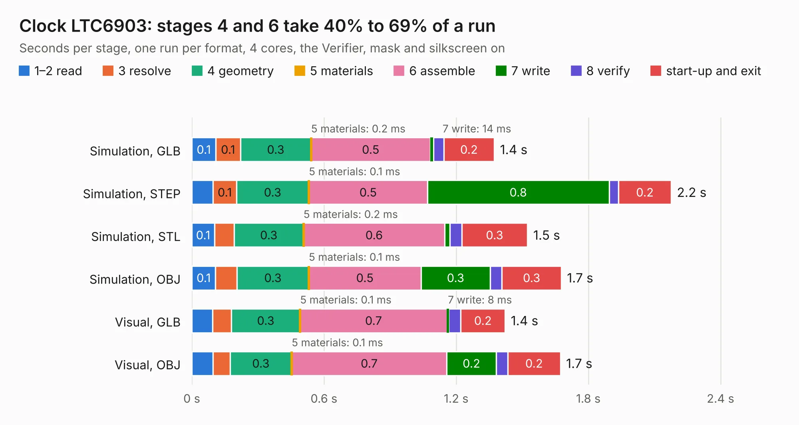

# 200. Clock LTC6903

Board 200 of the 3,122 of [Corpus Testing](../Corpus-Testing.md), on [Corpus Page 2](../CorpusTestingPages/Corpus-Testing-02.md#200-clock-ltc6903).

| Mode and format | 1–2 read | 3 resolve | 4 geometry | 5 materials | 6 assemble | 7 write | 8 verify | start-up and exit | Total |
|---|---:|---:|---:|---:|---:|---:|---:|---:|---:|
| Simulation, GLB | 0.1 | 0.1 | 0.3 | 0.2&nbsp;ms | 0.5 | 14&nbsp;ms | 47&nbsp;ms | 0.2 | 1.4 |
| Simulation, STEP | 97&nbsp;ms | 0.1 | 0.3 | 0.1&nbsp;ms | 0.5 | 0.8 | 43&nbsp;ms | 0.2 | 2.2 |
| Simulation, STL | 0.1 | 89&nbsp;ms | 0.3 | 0.2&nbsp;ms | 0.6 | 23&nbsp;ms | 54&nbsp;ms | 0.3 | 1.5 |
| Simulation, OBJ | 0.1 | 98&nbsp;ms | 0.3 | 0.1&nbsp;ms | 0.5 | 0.3 | 53&nbsp;ms | 0.3 | 1.7 |
| Visual, GLB | 94&nbsp;ms | 85&nbsp;ms | 0.3 | 0.1&nbsp;ms | 0.7 | 8&nbsp;ms | 54&nbsp;ms | 0.2 | 1.4 |
| Visual, OBJ | 97&nbsp;ms | 77&nbsp;ms | 0.3 | 0.1&nbsp;ms | 0.7 | 0.2 | 53&nbsp;ms | 0.2 | 1.7 |

<table align="center"><tr><td valign="top">

| Board | Repo: [andrewpaterson/658-Computer](https://github.com/andrewpaterson/658-Computer) Board: `Clock LTC6903.kicad_pcb` |
|---|---|
| Folder | Kicad / Computer / Main / Clock LTC6903 |
| Complexity | 156&nbsp;/&nbsp;1000 (size&nbsp;86, features&nbsp;70) |
| KESE&nbsp;features | rounded, trapezoid or chamfered pads, filled zones, curved board outline, stack-up, dielectric εr and tanδ |
| Tested | 9th November 2026 |
| Copper&nbsp;layers | 2 |
| File&nbsp;format | KiCad 9 (20241229) |
| Parts,&nbsp;tracks,&nbsp;vias | 5, 20, 0 |
| Triangles,&nbsp;simulation | 54,786 in 21 parts |
| Verifier | PASS in all six runs |

</td><td valign="top">

<table>
<tr><th>File type</th><th>File size</th><th>Peak memory used</th></tr>
<tr><th colspan="3" align="left">Simulation</th></tr>
<tr><td>GLB</td><td align="right">1.9&nbsp;MB</td><td align="right">70&nbsp;MB</td></tr>
<tr><td>STEP</td><td align="right">7.5&nbsp;MB</td><td align="right">174&nbsp;MB</td></tr>
<tr><td>STL</td><td align="right">2.7&nbsp;MB</td><td align="right">71&nbsp;MB</td></tr>
<tr><td>OBJ</td><td align="right">5.3&nbsp;MB</td><td align="right">82&nbsp;MB</td></tr>
<tr><th colspan="3" align="left">Visual</th></tr>
<tr><td>GLB</td><td align="right">1.3&nbsp;MB</td><td align="right">103&nbsp;MB</td></tr>
<tr><td>OBJ</td><td align="right">3.7&nbsp;MB</td><td align="right">104&nbsp;MB</td></tr>
</table>

</td></tr></table>

| Previous | Next |
|:---|---:|
| [199. Clock Device](b0199b_658-Computer_Clock-Device.md) | [201. Clock Oscillator](b0201b_658-Computer_Clock-Oscillator.md) |
