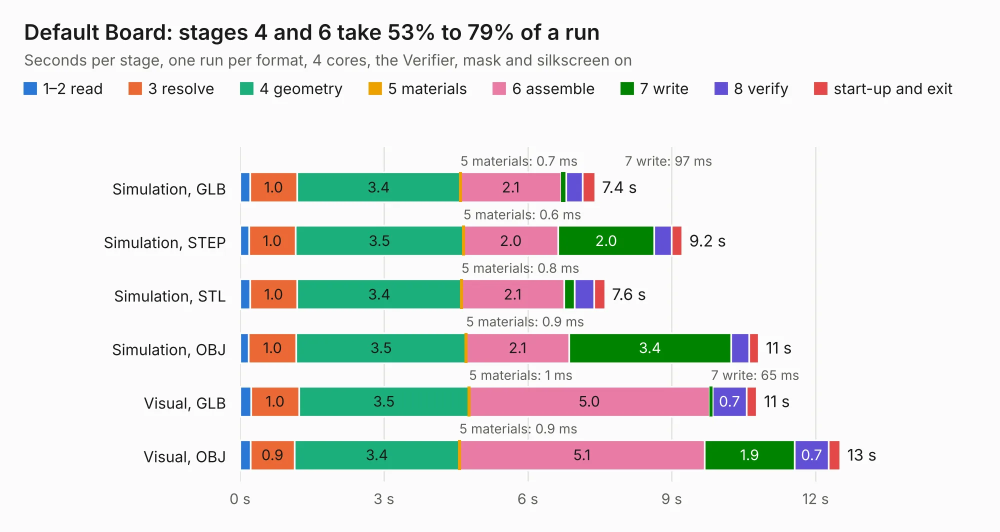

# 200. Default Board

Board 200 of the 3,100 of [Corpus Testing](../Corpus-Testing.md), on [Corpus Page 2](../CorpusTestingPages/Corpus-Testing-02.md#200-default-board).

| Mode and format | 1–2 read | 3 resolve | 4 geometry | 5 materials | 6 assemble | 7 write | 8 verify | start-up and exit | Total |
|---|---:|---:|---:|---:|---:|---:|---:|---:|---:|
| Simulation, GLB | 0.2 | 1.0 | 3.4 | 0.7&nbsp;ms | 2.1 | 97&nbsp;ms | 0.4 | 0.3 | 7.4 |
| Simulation, STEP | 0.2 | 1.0 | 3.5 | 0.6&nbsp;ms | 2.0 | 2.0 | 0.4 | 0.2 | 9.2 |
| Simulation, STL | 0.2 | 1.0 | 3.4 | 0.8&nbsp;ms | 2.1 | 0.2 | 0.4 | 0.2 | 7.6 |
| Simulation, OBJ | 0.2 | 1.0 | 3.5 | 0.9&nbsp;ms | 2.1 | 3.4 | 0.4 | 0.2 | 10.8 |
| Visual, GLB | 0.2 | 1.0 | 3.5 | 1&nbsp;ms | 5.0 | 65&nbsp;ms | 0.7 | 0.2 | 10.8 |
| Visual, OBJ | 0.2 | 0.9 | 3.4 | 0.9&nbsp;ms | 5.1 | 1.9 | 0.7 | 0.2 | 12.5 |

<table align="center"><tr><td valign="top">

| Board | Repo: [andrewpaterson/658-Computer](https://github.com/andrewpaterson/658-Computer) Board: `Default Board.kicad_pcb` |
|---|---|
| Folder | Kicad / Computer / Main / Default Board |
| Complexity | 167&nbsp;/&nbsp;1000 (size&nbsp;82, features&nbsp;85) |
| KESE&nbsp;features | rounded, trapezoid or chamfered pads, filled zones, curved board outline, knockout text, stack-up, dielectric εr and tanδ |
| Tested | 9th November 2026 |
| Copper&nbsp;layers | 2 |
| File&nbsp;format | KiCad 9 (20241229) |
| Parts,&nbsp;tracks,&nbsp;vias | 10, 10, 0 |
| Triangles,&nbsp;simulation | 768,296 in 146 parts |
| Verifier | PASS in all six runs |

</td><td valign="top">

<table>
<tr><th>File type</th><th>File size</th><th>Peak memory used</th></tr>
<tr><th colspan="3" align="left">Simulation</th></tr>
<tr><td>GLB</td><td align="right">25&nbsp;MB</td><td align="right">349&nbsp;MB</td></tr>
<tr><td>STEP</td><td align="right">82&nbsp;MB</td><td align="right">406&nbsp;MB</td></tr>
<tr><td>STL</td><td align="right">38&nbsp;MB</td><td align="right">357&nbsp;MB</td></tr>
<tr><td>OBJ</td><td align="right">78&nbsp;MB</td><td align="right">545&nbsp;MB</td></tr>
<tr><th colspan="3" align="left">Visual</th></tr>
<tr><td>GLB</td><td align="right">14&nbsp;MB</td><td align="right">433&nbsp;MB</td></tr>
<tr><td>OBJ</td><td align="right">42&nbsp;MB</td><td align="right">421&nbsp;MB</td></tr>
</table>

</td></tr></table>

| Previous | Next |
|:---|---:|
| [199. Clock Push Button](b0199b_658-Computer_Clock-Push-Button.md) | [201. Main Memory Channel](b0201b_658-Computer_Main-Memory-Channel.md) |
