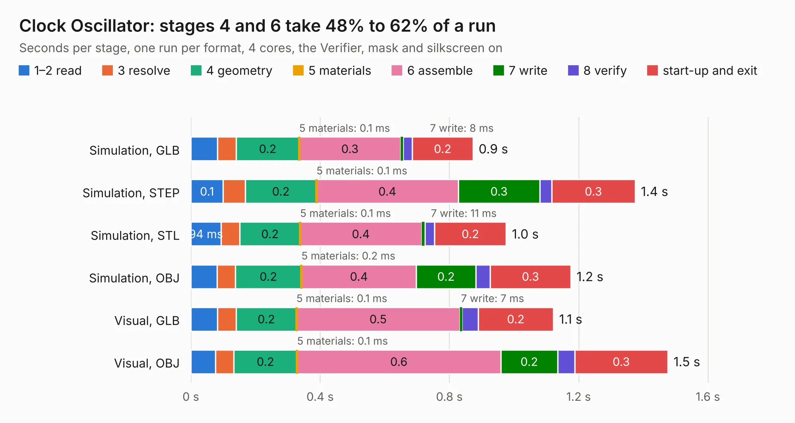

# 201. Clock Oscillator

Board 201 of the 3,128 of [Corpus Testing](../Corpus-Testing.md), on [Corpus Page 2](../CorpusTestingPages/Corpus-Testing-02.md#201-clock-oscillator).

| Mode and format | 1–2 read | 3 resolve | 4 geometry | 5 materials | 6 assemble | 7 write | 8 verify | start-up and exit | Total |
|---|---:|---:|---:|---:|---:|---:|---:|---:|---:|
| Simulation, GLB | 82&nbsp;ms | 58&nbsp;ms | 0.2 | 0.1&nbsp;ms | 0.3 | 8&nbsp;ms | 28&nbsp;ms | 0.2 | 0.9 |
| Simulation, STEP | 0.1 | 68&nbsp;ms | 0.2 | 0.1&nbsp;ms | 0.4 | 0.3 | 36&nbsp;ms | 0.3 | 1.4 |
| Simulation, STL | 94&nbsp;ms | 58&nbsp;ms | 0.2 | 0.1&nbsp;ms | 0.4 | 11&nbsp;ms | 29&nbsp;ms | 0.2 | 1.0 |
| Simulation, OBJ | 81&nbsp;ms | 56&nbsp;ms | 0.2 | 0.2&nbsp;ms | 0.4 | 0.2 | 45&nbsp;ms | 0.3 | 1.2 |
| Visual, GLB | 82&nbsp;ms | 59&nbsp;ms | 0.2 | 0.1&nbsp;ms | 0.5 | 7&nbsp;ms | 50&nbsp;ms | 0.2 | 1.1 |
| Visual, OBJ | 77&nbsp;ms | 57&nbsp;ms | 0.2 | 0.1&nbsp;ms | 0.6 | 0.2 | 52&nbsp;ms | 0.3 | 1.5 |

<table align="center"><tr><td valign="top">

| Board | Repo: [andrewpaterson/658-Computer](https://github.com/andrewpaterson/658-Computer) Board: `Clock Oscillator.kicad_pcb` |
|---|---|
| Folder | Kicad / Computer / Main / Clock Oscillator |
| Complexity | 122&nbsp;/&nbsp;1000 (size&nbsp;72, features&nbsp;50) |
| KESE&nbsp;features | rounded, trapezoid or chamfered pads, curved board outline, stack-up, dielectric εr and tanδ |
| Tested | 9th November 2026 |
| Copper&nbsp;layers | 2 |
| File&nbsp;format | KiCad 9 (20241229) |
| Parts,&nbsp;tracks,&nbsp;vias | 4, 9, 0 |
| Triangles,&nbsp;simulation | 39,040 in 20 parts |
| Verifier | PASS in all six runs |

</td><td valign="top">

<table>
<tr><th>File type</th><th>File size</th><th>Peak memory used</th></tr>
<tr><th colspan="3" align="left">Simulation</th></tr>
<tr><td>GLB</td><td align="right">1.4&nbsp;MB</td><td align="right">66&nbsp;MB</td></tr>
<tr><td>STEP</td><td align="right">4.9&nbsp;MB</td><td align="right">71&nbsp;MB</td></tr>
<tr><td>STL</td><td align="right">2.0&nbsp;MB</td><td align="right">68&nbsp;MB</td></tr>
<tr><td>OBJ</td><td align="right">3.7&nbsp;MB</td><td align="right">74&nbsp;MB</td></tr>
<tr><th colspan="3" align="left">Visual</th></tr>
<tr><td>GLB</td><td align="right">977&nbsp;kB</td><td align="right">98&nbsp;MB</td></tr>
<tr><td>OBJ</td><td align="right">2.7&nbsp;MB</td><td align="right">98&nbsp;MB</td></tr>
</table>

</td></tr></table>

| Previous | Next |
|:---|---:|
| [200. Clock LTC6903](b0200b_658-Computer_Clock-LTC6903.md) | [202. Clock Push Button](b0202b_658-Computer_Clock-Push-Button.md) |
