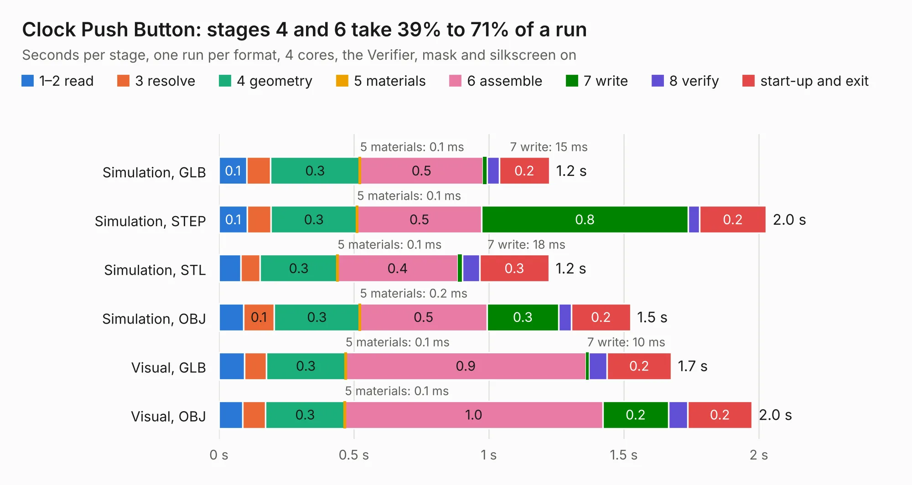

# 202. Clock Push Button

Board 202 of the 3,138 of [Corpus Testing](../Corpus-Testing.md), on [Corpus Page 2](../CorpusTestingPages/Corpus-Testing-02.md#202-clock-push-button).

| Mode and format | 1–2 read | 3 resolve | 4 geometry | 5 materials | 6 assemble | 7 write | 8 verify | start-up and exit | Total |
|---|---:|---:|---:|---:|---:|---:|---:|---:|---:|
| Simulation, GLB | 0.1 | 87&nbsp;ms | 0.3 | 0.1&nbsp;ms | 0.5 | 15&nbsp;ms | 45&nbsp;ms | 0.2 | 1.2 |
| Simulation, STEP | 0.1 | 87&nbsp;ms | 0.3 | 0.1&nbsp;ms | 0.5 | 0.8 | 43&nbsp;ms | 0.2 | 2.0 |
| Simulation, STL | 80&nbsp;ms | 72&nbsp;ms | 0.3 | 0.1&nbsp;ms | 0.4 | 18&nbsp;ms | 63&nbsp;ms | 0.3 | 1.2 |
| Simulation, OBJ | 91&nbsp;ms | 0.1 | 0.3 | 0.2&nbsp;ms | 0.5 | 0.3 | 48&nbsp;ms | 0.2 | 1.5 |
| Visual, GLB | 95&nbsp;ms | 80&nbsp;ms | 0.3 | 0.1&nbsp;ms | 0.9 | 10&nbsp;ms | 69&nbsp;ms | 0.2 | 1.7 |
| Visual, OBJ | 88&nbsp;ms | 84&nbsp;ms | 0.3 | 0.1&nbsp;ms | 1.0 | 0.2 | 71&nbsp;ms | 0.2 | 2.0 |

<table align="center"><tr><td valign="top">

| Board | Repo: [andrewpaterson/658-Computer](https://github.com/andrewpaterson/658-Computer) Board: `Clock Push Button.kicad_pcb` |
|---|---|
| Folder | Kicad / Computer / Main / Clock Push Button |
| Complexity | 159&nbsp;/&nbsp;1000 (size&nbsp;109, features&nbsp;50) |
| KESE&nbsp;features | rounded, trapezoid or chamfered pads, curved board outline, stack-up, dielectric εr and tanδ |
| Tested | 9th November 2026 |
| Copper&nbsp;layers | 2 |
| File&nbsp;format | KiCad 9 (20241229) |
| Parts,&nbsp;tracks,&nbsp;vias | 7, 69, 0 |
| Triangles,&nbsp;simulation | 68,818 in 22 parts |
| Verifier | PASS in all six runs |

</td><td valign="top">

<table>
<tr><th>File type</th><th>File size</th><th>Peak memory used</th></tr>
<tr><th colspan="3" align="left">Simulation</th></tr>
<tr><td>GLB</td><td align="right">2.4&nbsp;MB</td><td align="right">170&nbsp;MB</td></tr>
<tr><td>STEP</td><td align="right">9.7&nbsp;MB</td><td align="right">177&nbsp;MB</td></tr>
<tr><td>STL</td><td align="right">3.4&nbsp;MB</td><td align="right">168&nbsp;MB</td></tr>
<tr><td>OBJ</td><td align="right">6.7&nbsp;MB</td><td align="right">174&nbsp;MB</td></tr>
<tr><th colspan="3" align="left">Visual</th></tr>
<tr><td>GLB</td><td align="right">1.8&nbsp;MB</td><td align="right">151&nbsp;MB</td></tr>
<tr><td>OBJ</td><td align="right">5.0&nbsp;MB</td><td align="right">151&nbsp;MB</td></tr>
</table>

</td></tr></table>

| Previous | Next |
|:---|---:|
| [201. Clock Oscillator](b0201b_658-Computer_Clock-Oscillator.md) | [203. Default Board](b0203b_658-Computer_Default-Board.md) |
