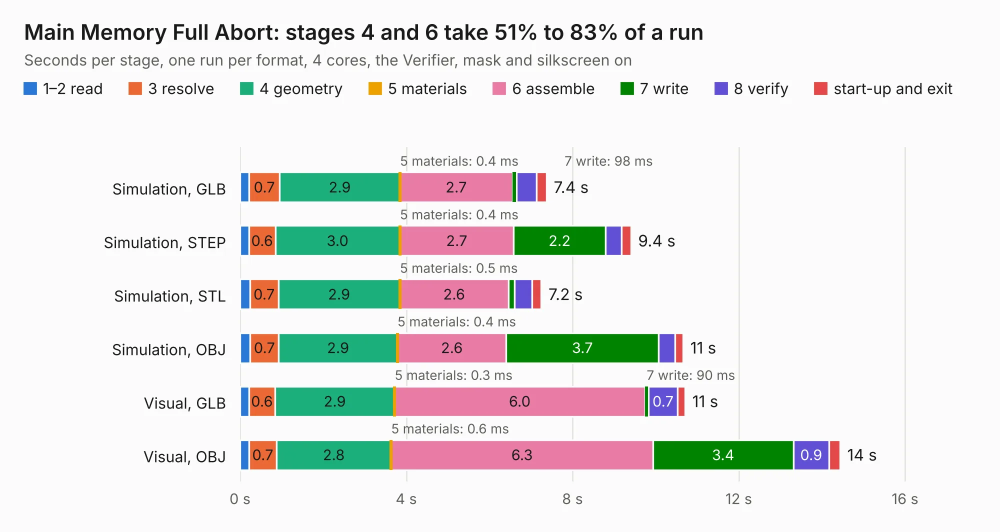

# 202. Main Memory Full Abort

Board 202 of the 3,102 of [Corpus Testing](../Corpus-Testing.md), on [Corpus Page 2](../CorpusTestingPages/Corpus-Testing-02.md#202-main-memory-full-abort).

| Mode and format | 1–2 read | 3 resolve | 4 geometry | 5 materials | 6 assemble | 7 write | 8 verify | start-up and exit | Total |
|---|---:|---:|---:|---:|---:|---:|---:|---:|---:|
| Simulation, GLB | 0.2 | 0.7 | 2.9 | 0.4&nbsp;ms | 2.7 | 98&nbsp;ms | 0.5 | 0.2 | 7.4 |
| Simulation, STEP | 0.2 | 0.6 | 3.0 | 0.4&nbsp;ms | 2.7 | 2.2 | 0.4 | 0.2 | 9.4 |
| Simulation, STL | 0.2 | 0.7 | 2.9 | 0.5&nbsp;ms | 2.6 | 0.2 | 0.4 | 0.2 | 7.2 |
| Simulation, OBJ | 0.2 | 0.7 | 2.9 | 0.4&nbsp;ms | 2.6 | 3.7 | 0.4 | 0.2 | 10.7 |
| Visual, GLB | 0.2 | 0.6 | 2.9 | 0.3&nbsp;ms | 6.0 | 90&nbsp;ms | 0.7 | 0.2 | 10.7 |
| Visual, OBJ | 0.2 | 0.7 | 2.8 | 0.6&nbsp;ms | 6.3 | 3.4 | 0.9 | 0.3 | 14.4 |

<table align="center"><tr><td valign="top">

| Board | Repo: [andrewpaterson/658-Computer](https://github.com/andrewpaterson/658-Computer) Board: `Main Memory Full Abort.kicad_pcb` |
|---|---|
| Folder | Kicad / Computer / Main / Main Memory Full Abort |
| Complexity | 254&nbsp;/&nbsp;1000 (size&nbsp;174, features&nbsp;80) |
| KESE&nbsp;features | through vias, rounded, trapezoid or chamfered pads, curved board outline, knockout text, stack-up, dielectric εr and tanδ |
| Tested | 9th November 2026 |
| Copper&nbsp;layers | 2 |
| File&nbsp;format | KiCad 9 (20241229) |
| Parts,&nbsp;tracks,&nbsp;vias | 31, 1,062, 127 |
| Triangles,&nbsp;simulation | 649,398 in 97 parts |
| Verifier | PASS in all six runs |

</td><td valign="top">

<table>
<tr><th>File type</th><th>File size</th><th>Peak memory used</th></tr>
<tr><th colspan="3" align="left">Simulation</th></tr>
<tr><td>GLB</td><td align="right">22&nbsp;MB</td><td align="right">344&nbsp;MB</td></tr>
<tr><td>STEP</td><td align="right">107&nbsp;MB</td><td align="right">436&nbsp;MB</td></tr>
<tr><td>STL</td><td align="right">32&nbsp;MB</td><td align="right">345&nbsp;MB</td></tr>
<tr><td>OBJ</td><td align="right">66&nbsp;MB</td><td align="right">488&nbsp;MB</td></tr>
<tr><th colspan="3" align="left">Visual</th></tr>
<tr><td>GLB</td><td align="right">19&nbsp;MB</td><td align="right">533&nbsp;MB</td></tr>
<tr><td>OBJ</td><td align="right">58&nbsp;MB</td><td align="right">530&nbsp;MB</td></tr>
</table>

</td></tr></table>

| Previous | Next |
|:---|---:|
| [201. Main Memory Channel](b0201b_658-Computer_Main-Memory-Channel.md) | [203. Main Memory Full Enable](b0203b_658-Computer_Main-Memory-Full-Enable.md) |
