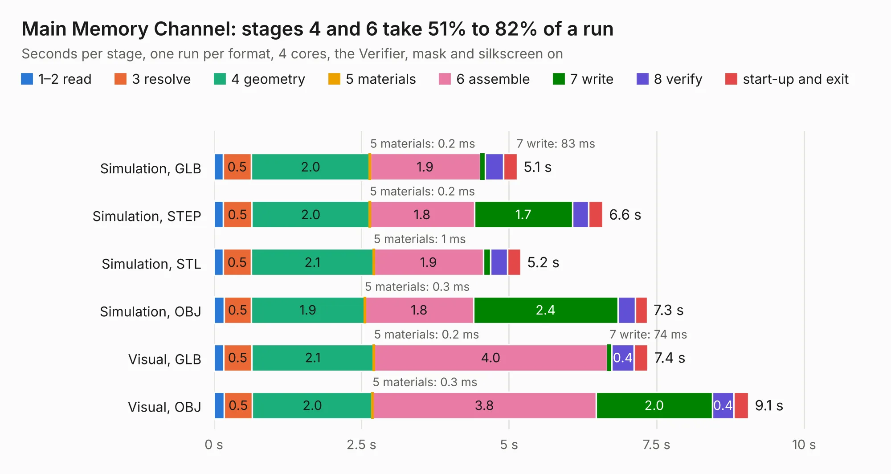

# 203. Main Memory Channel

Board 203 of the 3,104 of [Corpus Testing](../Corpus-Testing.md), on [Corpus Page 2](../CorpusTestingPages/Corpus-Testing-02.md#203-main-memory-channel).

| Mode and format | 1–2 read | 3 resolve | 4 geometry | 5 materials | 6 assemble | 7 write | 8 verify | start-up and exit | Total |
|---|---:|---:|---:|---:|---:|---:|---:|---:|---:|
| Simulation, GLB | 0.2 | 0.5 | 2.0 | 0.2&nbsp;ms | 1.9 | 83&nbsp;ms | 0.3 | 0.2 | 5.1 |
| Simulation, STEP | 0.2 | 0.5 | 2.0 | 0.2&nbsp;ms | 1.8 | 1.7 | 0.3 | 0.2 | 6.6 |
| Simulation, STL | 0.2 | 0.5 | 2.1 | 1&nbsp;ms | 1.9 | 0.1 | 0.3 | 0.2 | 5.2 |
| Simulation, OBJ | 0.2 | 0.5 | 1.9 | 0.3&nbsp;ms | 1.8 | 2.4 | 0.3 | 0.2 | 7.3 |
| Visual, GLB | 0.2 | 0.5 | 2.1 | 0.2&nbsp;ms | 4.0 | 74&nbsp;ms | 0.4 | 0.2 | 7.4 |
| Visual, OBJ | 0.2 | 0.5 | 2.0 | 0.3&nbsp;ms | 3.8 | 2.0 | 0.4 | 0.2 | 9.1 |

<table align="center"><tr><td valign="top">

| Board | Repo: [andrewpaterson/658-Computer](https://github.com/andrewpaterson/658-Computer) Board: `Main Memory Channel.kicad_pcb` |
|---|---|
| Folder | Kicad / Computer / Main / Main Memory Channel |
| Complexity | 225&nbsp;/&nbsp;1000 (size&nbsp;155, features&nbsp;70) |
| KESE&nbsp;features | through vias, rounded, trapezoid or chamfered pads, knockout text, stack-up, dielectric εr and tanδ |
| Tested | 9th November 2026 |
| Copper&nbsp;layers | 2 |
| File&nbsp;format | KiCad 9 (20241229) |
| Parts,&nbsp;tracks,&nbsp;vias | 14, 541, 71 |
| Triangles,&nbsp;simulation | 461,016 in 65 parts |
| Verifier | PASS in all six runs |

</td><td valign="top">

<table>
<tr><th>File type</th><th>File size</th><th>Peak memory used</th></tr>
<tr><th colspan="3" align="left">Simulation</th></tr>
<tr><td>GLB</td><td align="right">16&nbsp;MB</td><td align="right">275&nbsp;MB</td></tr>
<tr><td>STEP</td><td align="right">75&nbsp;MB</td><td align="right">337&nbsp;MB</td></tr>
<tr><td>STL</td><td align="right">23&nbsp;MB</td><td align="right">289&nbsp;MB</td></tr>
<tr><td>OBJ</td><td align="right">47&nbsp;MB</td><td align="right">336&nbsp;MB</td></tr>
<tr><th colspan="3" align="left">Visual</th></tr>
<tr><td>GLB</td><td align="right">12&nbsp;MB</td><td align="right">339&nbsp;MB</td></tr>
<tr><td>OBJ</td><td align="right">36&nbsp;MB</td><td align="right">348&nbsp;MB</td></tr>
</table>

</td></tr></table>

| Previous | Next |
|:---|---:|
| [202. Default Board](b0202b_658-Computer_Default-Board.md) | [204. Main Memory Full Abort](b0204b_658-Computer_Main-Memory-Full-Abort.md) |
