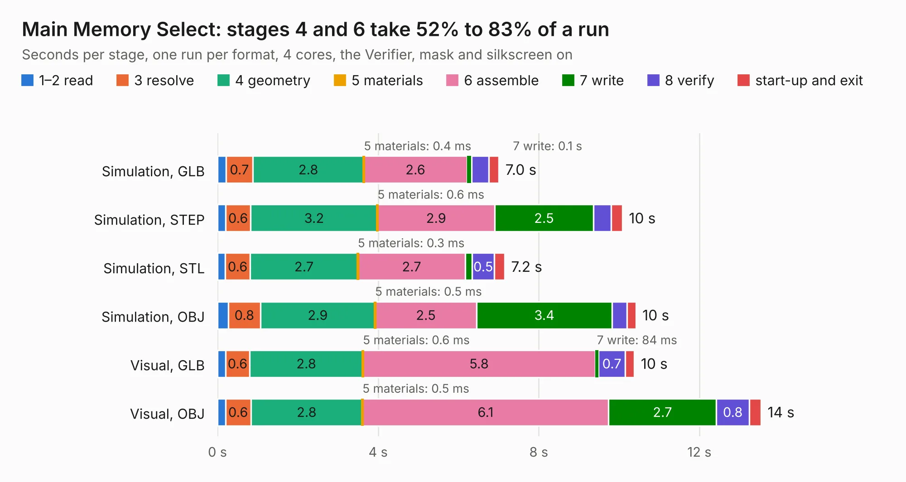

# 207. Main Memory Select

Board 207 of the 3,119 of [Corpus Testing](../Corpus-Testing.md), on [Corpus Page 2](../CorpusTestingPages/Corpus-Testing-02.md#207-main-memory-select).

| Mode and format | 1–2 read | 3 resolve | 4 geometry | 5 materials | 6 assemble | 7 write | 8 verify | start-up and exit | Total |
|---|---:|---:|---:|---:|---:|---:|---:|---:|---:|
| Simulation, GLB | 0.2 | 0.7 | 2.8 | 0.4&nbsp;ms | 2.6 | 0.1 | 0.4 | 0.3 | 7.0 |
| Simulation, STEP | 0.2 | 0.6 | 3.2 | 0.6&nbsp;ms | 2.9 | 2.5 | 0.4 | 0.3 | 10.1 |
| Simulation, STL | 0.2 | 0.6 | 2.7 | 0.3&nbsp;ms | 2.7 | 0.2 | 0.5 | 0.3 | 7.2 |
| Simulation, OBJ | 0.3 | 0.8 | 2.9 | 0.5&nbsp;ms | 2.5 | 3.4 | 0.4 | 0.2 | 10.4 |
| Visual, GLB | 0.2 | 0.6 | 2.8 | 0.6&nbsp;ms | 5.8 | 84&nbsp;ms | 0.7 | 0.2 | 10.4 |
| Visual, OBJ | 0.2 | 0.6 | 2.8 | 0.5&nbsp;ms | 6.1 | 2.7 | 0.8 | 0.3 | 13.5 |

<table align="center"><tr><td valign="top">

| Board | Repo: [andrewpaterson/658-Computer](https://github.com/andrewpaterson/658-Computer) Board: `Main Memory Select.kicad_pcb` |
|---|---|
| Folder | Kicad / Computer / Main / Main Memory Select |
| Complexity | 230&nbsp;/&nbsp;1000 (size&nbsp;160, features&nbsp;70) |
| KESE&nbsp;features | through vias, rounded, trapezoid or chamfered pads, knockout text, stack-up, dielectric εr and tanδ |
| Tested | 9th November 2026 |
| Copper&nbsp;layers | 2 |
| File&nbsp;format | KiCad 9 (20241229) |
| Parts,&nbsp;tracks,&nbsp;vias | 16, 668, 91 |
| Triangles,&nbsp;simulation | 588,794 in 96 parts |
| Verifier | PASS in all six runs |

</td><td valign="top">

<table>
<tr><th>File type</th><th>File size</th><th>Peak memory used</th></tr>
<tr><th colspan="3" align="left">Simulation</th></tr>
<tr><td>GLB</td><td align="right">20&nbsp;MB</td><td align="right">311&nbsp;MB</td></tr>
<tr><td>STEP</td><td align="right">89&nbsp;MB</td><td align="right">390&nbsp;MB</td></tr>
<tr><td>STL</td><td align="right">29&nbsp;MB</td><td align="right">316&nbsp;MB</td></tr>
<tr><td>OBJ</td><td align="right">60&nbsp;MB</td><td align="right">433&nbsp;MB</td></tr>
<tr><th colspan="3" align="left">Visual</th></tr>
<tr><td>GLB</td><td align="right">15&nbsp;MB</td><td align="right">440&nbsp;MB</td></tr>
<tr><td>OBJ</td><td align="right">45&nbsp;MB</td><td align="right">430&nbsp;MB</td></tr>
</table>

</td></tr></table>

| Previous | Next |
|:---|---:|
| [206. Main Memory Full Enable](b0206b_658-Computer_Main-Memory-Full-Enable.md) | [208. Main Memory Small Abort](b0208b_658-Computer_Main-Memory-Small-Abort.md) |
