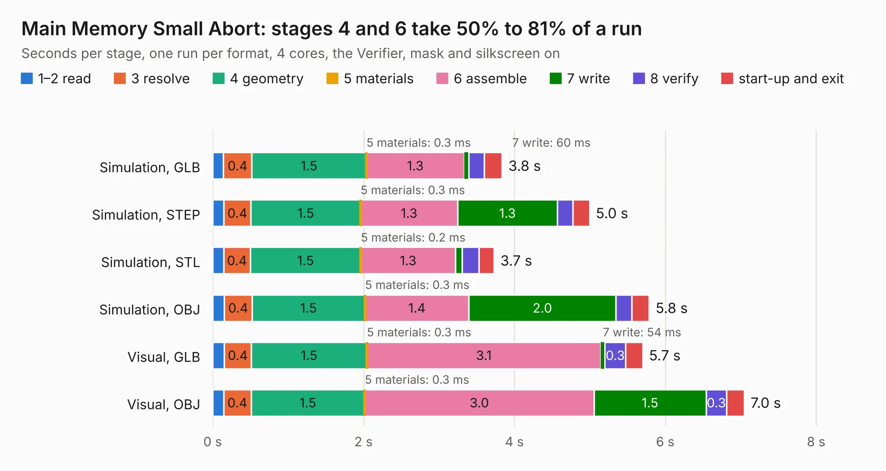

# 208. Main Memory Small Abort

Board 208 of the 3,129 of [Corpus Testing](../Corpus-Testing.md), on [Corpus Page 2](../CorpusTestingPages/Corpus-Testing-02.md#208-main-memory-small-abort).

| Mode and format | 1–2 read | 3 resolve | 4 geometry | 5 materials | 6 assemble | 7 write | 8 verify | start-up and exit | Total |
|---|---:|---:|---:|---:|---:|---:|---:|---:|---:|
| Simulation, GLB | 0.1 | 0.4 | 1.5 | 0.3&nbsp;ms | 1.3 | 60&nbsp;ms | 0.2 | 0.2 | 3.8 |
| Simulation, STEP | 0.1 | 0.4 | 1.5 | 0.3&nbsp;ms | 1.3 | 1.3 | 0.2 | 0.2 | 5.0 |
| Simulation, STL | 0.1 | 0.4 | 1.5 | 0.2&nbsp;ms | 1.3 | 89&nbsp;ms | 0.2 | 0.2 | 3.7 |
| Simulation, OBJ | 0.2 | 0.4 | 1.5 | 0.3&nbsp;ms | 1.4 | 2.0 | 0.2 | 0.2 | 5.8 |
| Visual, GLB | 0.2 | 0.4 | 1.5 | 0.3&nbsp;ms | 3.1 | 54&nbsp;ms | 0.3 | 0.2 | 5.7 |
| Visual, OBJ | 0.1 | 0.4 | 1.5 | 0.3&nbsp;ms | 3.0 | 1.5 | 0.3 | 0.2 | 7.0 |

<table align="center"><tr><td valign="top">

| Board | Repo: [andrewpaterson/658-Computer](https://github.com/andrewpaterson/658-Computer) Board: `Main Memory Small Abort.kicad_pcb` |
|---|---|
| Folder | Kicad / Computer / Main / Main Memory Small Abort |
| Complexity | 219&nbsp;/&nbsp;1000 (size&nbsp;149, features&nbsp;70) |
| KESE&nbsp;features | through vias, rounded, trapezoid or chamfered pads, knockout text, stack-up, dielectric εr and tanδ |
| Tested | 9th November 2026 |
| Copper&nbsp;layers | 2 |
| File&nbsp;format | KiCad 9 (20241229) |
| Parts,&nbsp;tracks,&nbsp;vias | 16, 339, 49 |
| Triangles,&nbsp;simulation | 348,420 in 61 parts |
| Verifier | PASS in all six runs |

</td><td valign="top">

<table>
<tr><th>File type</th><th>File size</th><th>Peak memory used</th></tr>
<tr><th colspan="3" align="left">Simulation</th></tr>
<tr><td>GLB</td><td align="right">12&nbsp;MB</td><td align="right">247&nbsp;MB</td></tr>
<tr><td>STEP</td><td align="right">51&nbsp;MB</td><td align="right">290&nbsp;MB</td></tr>
<tr><td>STL</td><td align="right">17&nbsp;MB</td><td align="right">245&nbsp;MB</td></tr>
<tr><td>OBJ</td><td align="right">35&nbsp;MB</td><td align="right">289&nbsp;MB</td></tr>
<tr><th colspan="3" align="left">Visual</th></tr>
<tr><td>GLB</td><td align="right">9.3&nbsp;MB</td><td align="right">290&nbsp;MB</td></tr>
<tr><td>OBJ</td><td align="right">27&nbsp;MB</td><td align="right">292&nbsp;MB</td></tr>
</table>

</td></tr></table>

| Previous | Next |
|:---|---:|
| [207. Main Memory Select](b0207b_658-Computer_Main-Memory-Select.md) | [209. Main Memory Small Enable](b0209b_658-Computer_Main-Memory-Small-Enable.md) |
