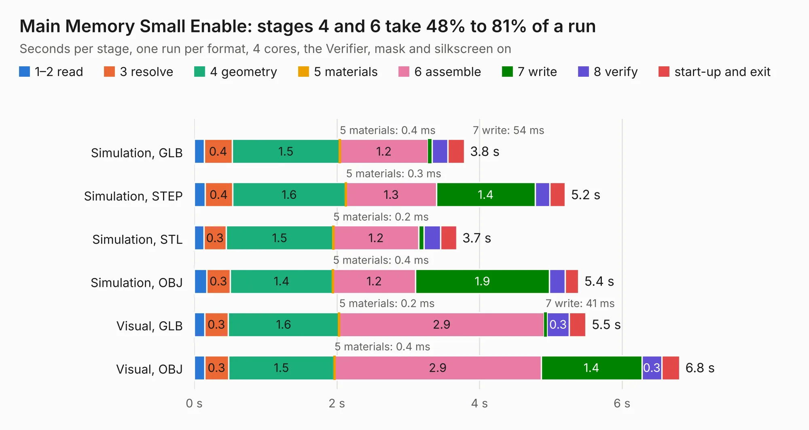

# 208. Main Memory Small Enable

Board 208 of the 3,116 of [Corpus Testing](../Corpus-Testing.md), on [Corpus Page 2](../CorpusTestingPages/Corpus-Testing-02.md#208-main-memory-small-enable).

| Mode and format | 1–2 read | 3 resolve | 4 geometry | 5 materials | 6 assemble | 7 write | 8 verify | start-up and exit | Total |
|---|---:|---:|---:|---:|---:|---:|---:|---:|---:|
| Simulation, GLB | 0.1 | 0.4 | 1.5 | 0.4&nbsp;ms | 1.2 | 54&nbsp;ms | 0.2 | 0.2 | 3.8 |
| Simulation, STEP | 0.2 | 0.4 | 1.6 | 0.3&nbsp;ms | 1.3 | 1.4 | 0.2 | 0.2 | 5.2 |
| Simulation, STL | 0.1 | 0.3 | 1.5 | 0.2&nbsp;ms | 1.2 | 76&nbsp;ms | 0.2 | 0.2 | 3.7 |
| Simulation, OBJ | 0.2 | 0.3 | 1.4 | 0.4&nbsp;ms | 1.2 | 1.9 | 0.2 | 0.2 | 5.4 |
| Visual, GLB | 0.1 | 0.3 | 1.6 | 0.2&nbsp;ms | 2.9 | 41&nbsp;ms | 0.3 | 0.2 | 5.5 |
| Visual, OBJ | 0.1 | 0.3 | 1.5 | 0.4&nbsp;ms | 2.9 | 1.4 | 0.3 | 0.3 | 6.8 |

<table align="center"><tr><td valign="top">

| Board | Repo: [andrewpaterson/658-Computer](https://github.com/andrewpaterson/658-Computer) Board: `Main Memory Small Enable.kicad_pcb` |
|---|---|
| Folder | Kicad / Computer / Main / Main Memory Small Enable |
| Complexity | 216&nbsp;/&nbsp;1000 (size&nbsp;146, features&nbsp;70) |
| KESE&nbsp;features | through vias, rounded, trapezoid or chamfered pads, knockout text, stack-up, dielectric εr and tanδ |
| Tested | 9th November 2026 |
| Copper&nbsp;layers | 2 |
| File&nbsp;format | KiCad 9 (20241229) |
| Parts,&nbsp;tracks,&nbsp;vias | 14, 330, 35 |
| Triangles,&nbsp;simulation | 314,936 in 51 parts |
| Verifier | PASS in all six runs |

</td><td valign="top">

<table>
<tr><th>File type</th><th>File size</th><th>Peak memory used</th></tr>
<tr><th colspan="3" align="left">Simulation</th></tr>
<tr><td>GLB</td><td align="right">11&nbsp;MB</td><td align="right">240&nbsp;MB</td></tr>
<tr><td>STEP</td><td align="right">49&nbsp;MB</td><td align="right">280&nbsp;MB</td></tr>
<tr><td>STL</td><td align="right">16&nbsp;MB</td><td align="right">246&nbsp;MB</td></tr>
<tr><td>OBJ</td><td align="right">32&nbsp;MB</td><td align="right">258&nbsp;MB</td></tr>
<tr><th colspan="3" align="left">Visual</th></tr>
<tr><td>GLB</td><td align="right">8.2&nbsp;MB</td><td align="right">271&nbsp;MB</td></tr>
<tr><td>OBJ</td><td align="right">24&nbsp;MB</td><td align="right">263&nbsp;MB</td></tr>
</table>

</td></tr></table>

| Previous | Next |
|:---|---:|
| [207. Main Memory Small Abort](b0207b_658-Computer_Main-Memory-Small-Abort.md) | [209. Mainboard Full](b0209b_658-Computer_Mainboard-Full.md) |
