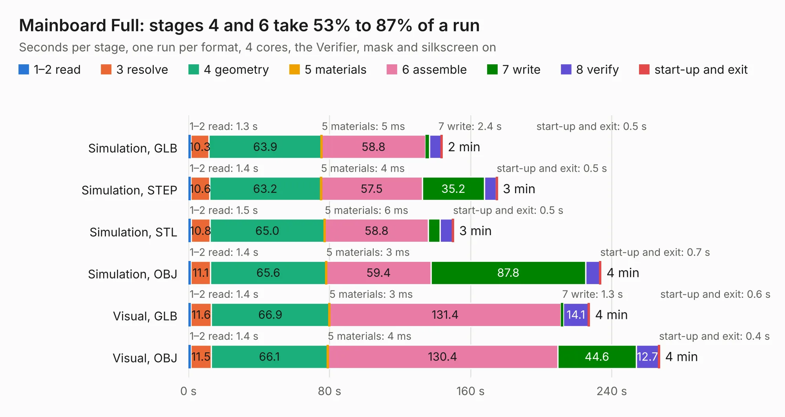

# 210. Mainboard Full

Board 210 of the 3,119 of [Corpus Testing](../Corpus-Testing.md), on [Corpus Page 2](../CorpusTestingPages/Corpus-Testing-02.md#210-mainboard-full).

| Mode and format | 1–2 read | 3 resolve | 4 geometry | 5 materials | 6 assemble | 7 write | 8 verify | start-up and exit | Total |
|---|---:|---:|---:|---:|---:|---:|---:|---:|---:|
| Simulation, GLB | 1.3 | 10.3 | 63.9 | 5&nbsp;ms | 58.8 | 2.4 | 6.6 | 0.5 | 143.9 |
| Simulation, STEP | 1.4 | 10.6 | 63.2 | 4&nbsp;ms | 57.5 | 35.2 | 6.8 | 0.5 | 175.1 |
| Simulation, STL | 1.5 | 10.8 | 65.0 | 6&nbsp;ms | 58.8 | 6.6 | 7.1 | 0.5 | 150.3 |
| Simulation, OBJ | 1.4 | 11.1 | 65.6 | 3&nbsp;ms | 59.4 | 87.8 | 7.9 | 0.7 | 233.8 |
| Visual, GLB | 1.4 | 11.6 | 66.9 | 3&nbsp;ms | 131.4 | 1.3 | 14.1 | 0.6 | 227.3 |
| Visual, OBJ | 1.4 | 11.5 | 66.1 | 4&nbsp;ms | 130.4 | 44.6 | 12.7 | 0.4 | 267.0 |

<table align="center"><tr><td valign="top">

| Board | Repo: [andrewpaterson/658-Computer](https://github.com/andrewpaterson/658-Computer) Board: `Mainboard Full.kicad_pcb` |
|---|---|
| Folder | Kicad / Computer / Main / Mainboard Full |
| Complexity | 298&nbsp;/&nbsp;1000 (size&nbsp;218, features&nbsp;80) |
| KESE&nbsp;features | through vias, rounded, trapezoid or chamfered pads, curved board outline, knockout text, stack-up, dielectric εr and tanδ |
| Tested | 9th November 2026 |
| Copper&nbsp;layers | 2 |
| File&nbsp;format | KiCad 9 (20241229) |
| Parts,&nbsp;tracks,&nbsp;vias | 87, 9,120, 576 |
| Triangles,&nbsp;simulation | 12,987,450 in 878 parts |
| Verifier | PASS in all six runs |

</td><td valign="top">

<table>
<tr><th>File type</th><th>File size</th><th>Peak memory used</th></tr>
<tr><th colspan="3" align="left">Simulation</th></tr>
<tr><td>GLB</td><td align="right">429&nbsp;MB</td><td align="right">3.2&nbsp;GB</td></tr>
<tr><td>STEP</td><td align="right">1.8&nbsp;GB</td><td align="right">4.5&nbsp;GB</td></tr>
<tr><td>STL</td><td align="right">649&nbsp;MB</td><td align="right">3.3&nbsp;GB</td></tr>
<tr><td>OBJ</td><td align="right">1.4&nbsp;GB</td><td align="right">8.0&nbsp;GB</td></tr>
<tr><th colspan="3" align="left">Visual</th></tr>
<tr><td>GLB</td><td align="right">245&nbsp;MB</td><td align="right">3.8&nbsp;GB</td></tr>
<tr><td>OBJ</td><td align="right">795&nbsp;MB</td><td align="right">4.9&nbsp;GB</td></tr>
</table>

</td></tr></table>

| Previous | Next |
|:---|---:|
| [209. Main Memory Small Enable](b0209b_658-Computer_Main-Memory-Small-Enable.md) | [211. Mainboard Small](b0211b_658-Computer_Mainboard-Small.md) |
