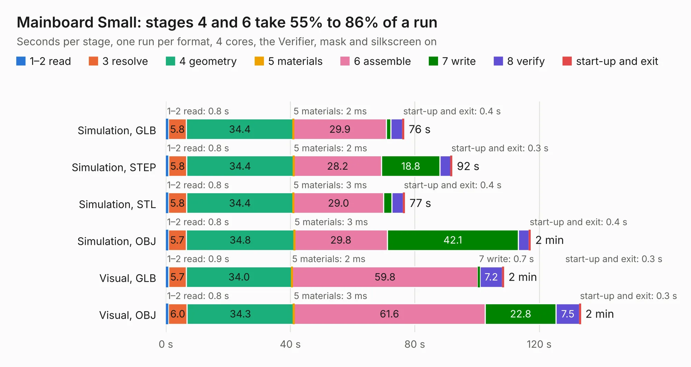

# 210. Mainboard Small

Board 210 of the 3,108 of [Corpus Testing](../Corpus-Testing.md), on [Corpus Page 2](../CorpusTestingPages/Corpus-Testing-02.md#210-mainboard-small).

| Mode and format | 1–2 read | 3 resolve | 4 geometry | 5 materials | 6 assemble | 7 write | 8 verify | start-up and exit | Total |
|---|---:|---:|---:|---:|---:|---:|---:|---:|---:|
| Simulation, GLB | 0.8 | 5.8 | 34.4 | 2&nbsp;ms | 29.9 | 1.4 | 3.8 | 0.4 | 76.5 |
| Simulation, STEP | 0.8 | 5.8 | 34.4 | 2&nbsp;ms | 28.2 | 18.8 | 3.5 | 0.3 | 92.0 |
| Simulation, STL | 0.8 | 5.8 | 34.4 | 3&nbsp;ms | 29.0 | 2.7 | 3.7 | 0.4 | 76.7 |
| Simulation, OBJ | 0.8 | 5.7 | 34.8 | 3&nbsp;ms | 29.8 | 42.1 | 3.5 | 0.4 | 117.1 |
| Visual, GLB | 0.9 | 5.7 | 34.0 | 2&nbsp;ms | 59.8 | 0.7 | 7.2 | 0.3 | 108.5 |
| Visual, OBJ | 0.8 | 6.0 | 34.3 | 3&nbsp;ms | 61.6 | 22.8 | 7.5 | 0.3 | 133.3 |

<table align="center"><tr><td valign="top">

| Board | Repo: [andrewpaterson/658-Computer](https://github.com/andrewpaterson/658-Computer) Board: `Mainboard Small.kicad_pcb` |
|---|---|
| Folder | Kicad / Computer / Main / Mainboard Small |
| Complexity | 281&nbsp;/&nbsp;1000 (size&nbsp;201, features&nbsp;80) |
| KESE&nbsp;features | through vias, rounded, trapezoid or chamfered pads, curved board outline, knockout text, stack-up, dielectric εr and tanδ |
| Tested | 9th November 2026 |
| Copper&nbsp;layers | 2 |
| File&nbsp;format | KiCad 9 (20241229) |
| Parts,&nbsp;tracks,&nbsp;vias | 51, 4,728, 253 |
| Triangles,&nbsp;simulation | 6,784,078 in 504 parts |
| Verifier | PASS in all six runs |

</td><td valign="top">

<table>
<tr><th>File type</th><th>File size</th><th>Peak memory used</th></tr>
<tr><th colspan="3" align="left">Simulation</th></tr>
<tr><td>GLB</td><td align="right">224&nbsp;MB</td><td align="right">1.9&nbsp;GB</td></tr>
<tr><td>STEP</td><td align="right">930&nbsp;MB</td><td align="right">2.5&nbsp;GB</td></tr>
<tr><td>STL</td><td align="right">339&nbsp;MB</td><td align="right">1.9&nbsp;GB</td></tr>
<tr><td>OBJ</td><td align="right">714&nbsp;MB</td><td align="right">4.2&nbsp;GB</td></tr>
<tr><th colspan="3" align="left">Visual</th></tr>
<tr><td>GLB</td><td align="right">128&nbsp;MB</td><td align="right">2.1&nbsp;GB</td></tr>
<tr><td>OBJ</td><td align="right">409&nbsp;MB</td><td align="right">2.7&nbsp;GB</td></tr>
</table>

</td></tr></table>

| Previous | Next |
|:---|---:|
| [209. Mainboard Full](b0209b_658-Computer_Mainboard-Full.md) | [211. Processor Full Device](b0211b_658-Computer_Processor-Full-Device.md) |
