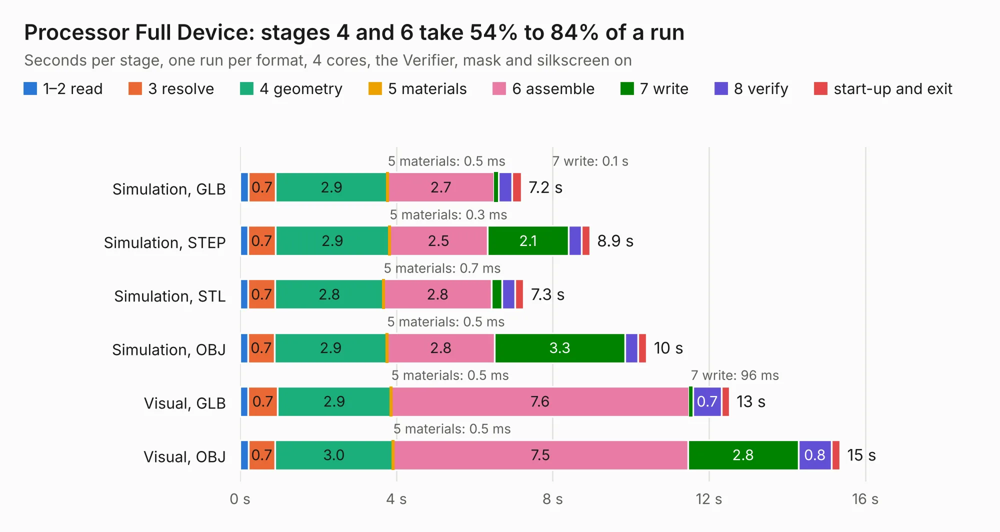

# 212. Processor Full Device

Board 212 of the 3,128 of [Corpus Testing](../Corpus-Testing.md), on [Corpus Page 2](../CorpusTestingPages/Corpus-Testing-02.md#212-processor-full-device).

| Mode and format | 1–2 read | 3 resolve | 4 geometry | 5 materials | 6 assemble | 7 write | 8 verify | start-up and exit | Total |
|---|---:|---:|---:|---:|---:|---:|---:|---:|---:|
| Simulation, GLB | 0.2 | 0.7 | 2.9 | 0.5&nbsp;ms | 2.7 | 0.1 | 0.3 | 0.2 | 7.2 |
| Simulation, STEP | 0.2 | 0.7 | 2.9 | 0.3&nbsp;ms | 2.5 | 2.1 | 0.3 | 0.2 | 8.9 |
| Simulation, STL | 0.2 | 0.7 | 2.8 | 0.7&nbsp;ms | 2.8 | 0.3 | 0.3 | 0.2 | 7.3 |
| Simulation, OBJ | 0.2 | 0.7 | 2.9 | 0.5&nbsp;ms | 2.8 | 3.3 | 0.3 | 0.2 | 10.4 |
| Visual, GLB | 0.2 | 0.7 | 2.9 | 0.5&nbsp;ms | 7.6 | 96&nbsp;ms | 0.7 | 0.2 | 12.5 |
| Visual, OBJ | 0.2 | 0.7 | 3.0 | 0.5&nbsp;ms | 7.5 | 2.8 | 0.8 | 0.2 | 15.3 |

<table align="center"><tr><td valign="top">

| Board | Repo: [andrewpaterson/658-Computer](https://github.com/andrewpaterson/658-Computer) Board: `Processor Full Device.kicad_pcb` |
|---|---|
| Folder | Kicad / Computer / Main / Processor Full Device |
| Complexity | 247&nbsp;/&nbsp;1000 (size&nbsp;177, features&nbsp;70) |
| KESE&nbsp;features | through vias, rounded, trapezoid or chamfered pads, knockout text, stack-up, dielectric εr and tanδ |
| Tested | 9th November 2026 |
| Copper&nbsp;layers | 2 |
| File&nbsp;format | KiCad 9 (20241229) |
| Parts,&nbsp;tracks,&nbsp;vias | 34, 1,154, 160 |
| Triangles,&nbsp;simulation | 802,414 in 111 parts |
| Verifier | PASS in all six runs |

</td><td valign="top">

<table>
<tr><th>File type</th><th>File size</th><th>Peak memory used</th></tr>
<tr><th colspan="3" align="left">Simulation</th></tr>
<tr><td>GLB</td><td align="right">28&nbsp;MB</td><td align="right">428&nbsp;MB</td></tr>
<tr><td>STEP</td><td align="right">132&nbsp;MB</td><td align="right">509&nbsp;MB</td></tr>
<tr><td>STL</td><td align="right">40&nbsp;MB</td><td align="right">433&nbsp;MB</td></tr>
<tr><td>OBJ</td><td align="right">82&nbsp;MB</td><td align="right">568&nbsp;MB</td></tr>
<tr><th colspan="3" align="left">Visual</th></tr>
<tr><td>GLB</td><td align="right">24&nbsp;MB</td><td align="right">612&nbsp;MB</td></tr>
<tr><td>OBJ</td><td align="right">74&nbsp;MB</td><td align="right">609&nbsp;MB</td></tr>
</table>

</td></tr></table>

| Previous | Next |
|:---|---:|
| [211. Mainboard Small](b0211b_658-Computer_Mainboard-Small.md) | [213. Processor Reset Device](b0213b_658-Computer_Processor-Reset-Device.md) |
