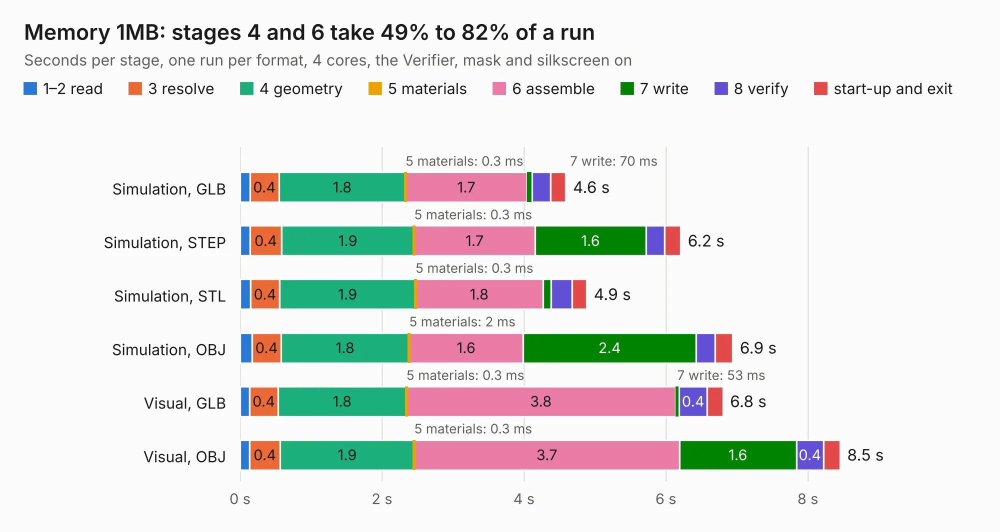

# 214. Memory 1MB

Board 214 of the 3,102 of [Corpus Testing](../Corpus-Testing.md), on [Corpus Page 2](../CorpusTestingPages/Corpus-Testing-02.md#214-memory-1mb).

| Mode and format | 1–2 read | 3 resolve | 4 geometry | 5 materials | 6 assemble | 7 write | 8 verify | start-up and exit | Total |
|---|---:|---:|---:|---:|---:|---:|---:|---:|---:|
| Simulation, GLB | 0.1 | 0.4 | 1.8 | 0.3&nbsp;ms | 1.7 | 70&nbsp;ms | 0.3 | 0.2 | 4.6 |
| Simulation, STEP | 0.1 | 0.4 | 1.9 | 0.3&nbsp;ms | 1.7 | 1.6 | 0.3 | 0.2 | 6.2 |
| Simulation, STL | 0.1 | 0.4 | 1.9 | 0.3&nbsp;ms | 1.8 | 0.1 | 0.3 | 0.2 | 4.9 |
| Simulation, OBJ | 0.2 | 0.4 | 1.8 | 2&nbsp;ms | 1.6 | 2.4 | 0.3 | 0.2 | 6.9 |
| Visual, GLB | 0.1 | 0.4 | 1.8 | 0.3&nbsp;ms | 3.8 | 53&nbsp;ms | 0.4 | 0.2 | 6.8 |
| Visual, OBJ | 0.1 | 0.4 | 1.9 | 0.3&nbsp;ms | 3.7 | 1.6 | 0.4 | 0.2 | 8.5 |

<table align="center"><tr><td valign="top">

| Board | Repo: [andrewpaterson/658-Computer](https://github.com/andrewpaterson/658-Computer) Board: `Memory 1MB.kicad_pcb` |
|---|---|
| Folder | Kicad / Computer / Memory / Memory 1MB |
| Complexity | 220&nbsp;/&nbsp;1000 (size&nbsp;150, features&nbsp;70) |
| KESE&nbsp;features | through vias, rounded, trapezoid or chamfered pads, knockout text, stack-up, dielectric εr and tanδ |
| Tested | 9th November 2026 |
| Copper&nbsp;layers | 2 |
| File&nbsp;format | KiCad 9 (20241229) |
| Parts,&nbsp;tracks,&nbsp;vias | 10, 493, 74 |
| Triangles,&nbsp;simulation | 449,086 in 68 parts |
| Verifier | PASS in all six runs |

</td><td valign="top">

<table>
<tr><th>File type</th><th>File size</th><th>Peak memory used</th></tr>
<tr><th colspan="3" align="left">Simulation</th></tr>
<tr><td>GLB</td><td align="right">15&nbsp;MB</td><td align="right">271&nbsp;MB</td></tr>
<tr><td>STEP</td><td align="right">67&nbsp;MB</td><td align="right">331&nbsp;MB</td></tr>
<tr><td>STL</td><td align="right">22&nbsp;MB</td><td align="right">268&nbsp;MB</td></tr>
<tr><td>OBJ</td><td align="right">45&nbsp;MB</td><td align="right">349&nbsp;MB</td></tr>
<tr><th colspan="3" align="left">Visual</th></tr>
<tr><td>GLB</td><td align="right">12&nbsp;MB</td><td align="right">339&nbsp;MB</td></tr>
<tr><td>OBJ</td><td align="right">35&nbsp;MB</td><td align="right">340&nbsp;MB</td></tr>
</table>

</td></tr></table>

| Previous | Next |
|:---|---:|
| [213. Triple MPU Clock Generator](b0213b_658-Computer_Triple-MPU-Clock-Generator.md) | [215. Memory 4MB](b0215b_658-Computer_Memory-4MB.md) |
