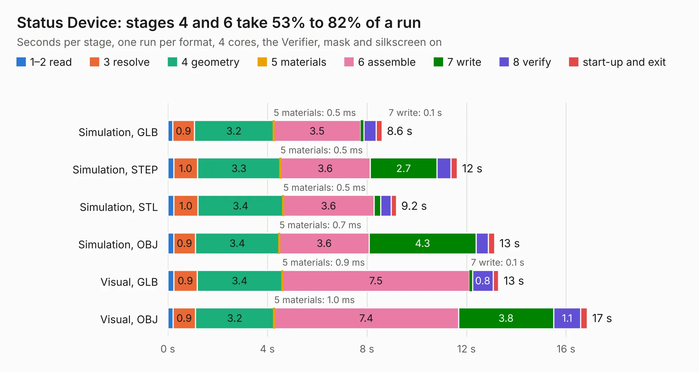

# 215. Status Device

Board 215 of the 3,122 of [Corpus Testing](../Corpus-Testing.md), on [Corpus Page 2](../CorpusTestingPages/Corpus-Testing-02.md#215-status-device).

| Mode and format | 1–2 read | 3 resolve | 4 geometry | 5 materials | 6 assemble | 7 write | 8 verify | start-up and exit | Total |
|---|---:|---:|---:|---:|---:|---:|---:|---:|---:|
| Simulation, GLB | 0.2 | 0.9 | 3.2 | 0.5&nbsp;ms | 3.5 | 0.1 | 0.5 | 0.2 | 8.6 |
| Simulation, STEP | 0.2 | 1.0 | 3.3 | 0.5&nbsp;ms | 3.6 | 2.7 | 0.6 | 0.3 | 11.6 |
| Simulation, STL | 0.2 | 1.0 | 3.4 | 0.5&nbsp;ms | 3.6 | 0.3 | 0.4 | 0.2 | 9.2 |
| Simulation, OBJ | 0.2 | 0.9 | 3.4 | 0.7&nbsp;ms | 3.6 | 4.3 | 0.5 | 0.2 | 13.1 |
| Visual, GLB | 0.2 | 0.9 | 3.4 | 0.9&nbsp;ms | 7.5 | 0.1 | 0.8 | 0.2 | 13.3 |
| Visual, OBJ | 0.2 | 0.9 | 3.2 | 1.0&nbsp;ms | 7.4 | 3.8 | 1.1 | 0.3 | 16.9 |

<table align="center"><tr><td valign="top">

| Board | Repo: [andrewpaterson/658-Computer](https://github.com/andrewpaterson/658-Computer) Board: `Status Device.kicad_pcb` |
|---|---|
| Folder | Kicad / Computer / Main / Status Device |
| Complexity | 258&nbsp;/&nbsp;1000 (size&nbsp;178, features&nbsp;80) |
| KESE&nbsp;features | through vias, rounded, trapezoid or chamfered pads, curved board outline, knockout text, stack-up, dielectric εr and tanδ |
| Tested | 9th November 2026 |
| Copper&nbsp;layers | 2 |
| File&nbsp;format | KiCad 9 (20241229) |
| Parts,&nbsp;tracks,&nbsp;vias | 33, 1,184, 228 |
| Triangles,&nbsp;simulation | 895,756 in 115 parts |
| Verifier | PASS in all six runs |

</td><td valign="top">

<table>
<tr><th>File type</th><th>File size</th><th>Peak memory used</th></tr>
<tr><th colspan="3" align="left">Simulation</th></tr>
<tr><td>GLB</td><td align="right">31&nbsp;MB</td><td align="right">416&nbsp;MB</td></tr>
<tr><td>STEP</td><td align="right">138&nbsp;MB</td><td align="right">539&nbsp;MB</td></tr>
<tr><td>STL</td><td align="right">45&nbsp;MB</td><td align="right">416&nbsp;MB</td></tr>
<tr><td>OBJ</td><td align="right">91&nbsp;MB</td><td align="right">783&nbsp;MB</td></tr>
<tr><th colspan="3" align="left">Visual</th></tr>
<tr><td>GLB</td><td align="right">26&nbsp;MB</td><td align="right">656&nbsp;MB</td></tr>
<tr><td>OBJ</td><td align="right">80&nbsp;MB</td><td align="right">705&nbsp;MB</td></tr>
</table>

</td></tr></table>

| Previous | Next |
|:---|---:|
| [214. Processor Small Device](b0214b_658-Computer_Processor-Small-Device.md) | [216. Triple MPU Clock Generator](b0216b_658-Computer_Triple-MPU-Clock-Generator.md) |
