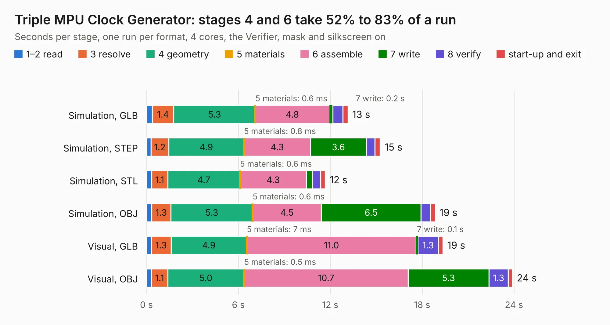

# 215. Triple MPU Clock Generator

Board 215 of the 3,109 of [Corpus Testing](../Corpus-Testing.md), on [Corpus Page 2](../CorpusTestingPages/Corpus-Testing-02.md#215-triple-mpu-clock-generator).

| Mode and format | 1–2 read | 3 resolve | 4 geometry | 5 materials | 6 assemble | 7 write | 8 verify | start-up and exit | Total |
|---|---:|---:|---:|---:|---:|---:|---:|---:|---:|
| Simulation, GLB | 0.4 | 1.4 | 5.3 | 0.6&nbsp;ms | 4.8 | 0.2 | 0.7 | 0.3 | 13.2 |
| Simulation, STEP | 0.3 | 1.2 | 4.9 | 0.8&nbsp;ms | 4.3 | 3.6 | 0.6 | 0.3 | 15.3 |
| Simulation, STL | 0.3 | 1.1 | 4.7 | 0.6&nbsp;ms | 4.3 | 0.4 | 0.5 | 0.3 | 11.7 |
| Simulation, OBJ | 0.3 | 1.3 | 5.3 | 0.6&nbsp;ms | 4.5 | 6.5 | 0.6 | 0.3 | 18.9 |
| Visual, GLB | 0.3 | 1.3 | 4.9 | 7&nbsp;ms | 11.0 | 0.1 | 1.3 | 0.3 | 19.4 |
| Visual, OBJ | 0.3 | 1.1 | 5.0 | 0.5&nbsp;ms | 10.7 | 5.3 | 1.3 | 0.3 | 23.9 |

<table align="center"><tr><td valign="top">

| Board | Repo: [andrewpaterson/658-Computer](https://github.com/andrewpaterson/658-Computer) Board: `Triple MPU Clock Generator.kicad_pcb` |
|---|---|
| Folder | Kicad / Computer / Main / Triple MPU Clock Generator |
| Complexity | 251&nbsp;/&nbsp;1000 (size&nbsp;181, features&nbsp;70) |
| KESE&nbsp;features | through vias, rounded, trapezoid or chamfered pads, knockout text, stack-up, dielectric εr and tanδ |
| Tested | 9th November 2026 |
| Copper&nbsp;layers | 2 |
| File&nbsp;format | KiCad 9 (20241229) |
| Parts,&nbsp;tracks,&nbsp;vias | 46, 1,232, 186 |
| Triangles,&nbsp;simulation | 947,040 in 148 parts |
| Verifier | PASS in all six runs |

</td><td valign="top">

<table>
<tr><th>File type</th><th>File size</th><th>Peak memory used</th></tr>
<tr><th colspan="3" align="left">Simulation</th></tr>
<tr><td>GLB</td><td align="right">32&nbsp;MB</td><td align="right">409&nbsp;MB</td></tr>
<tr><td>STEP</td><td align="right">147&nbsp;MB</td><td align="right">541&nbsp;MB</td></tr>
<tr><td>STL</td><td align="right">47&nbsp;MB</td><td align="right">414&nbsp;MB</td></tr>
<tr><td>OBJ</td><td align="right">96&nbsp;MB</td><td align="right">676&nbsp;MB</td></tr>
<tr><th colspan="3" align="left">Visual</th></tr>
<tr><td>GLB</td><td align="right">26&nbsp;MB</td><td align="right">597&nbsp;MB</td></tr>
<tr><td>OBJ</td><td align="right">80&nbsp;MB</td><td align="right">640&nbsp;MB</td></tr>
</table>

</td></tr></table>

| Previous | Next |
|:---|---:|
| [214. Status Device](b0214b_658-Computer_Status-Device.md) | [216. Memory 1MB](b0216b_658-Computer_Memory-1MB.md) |
