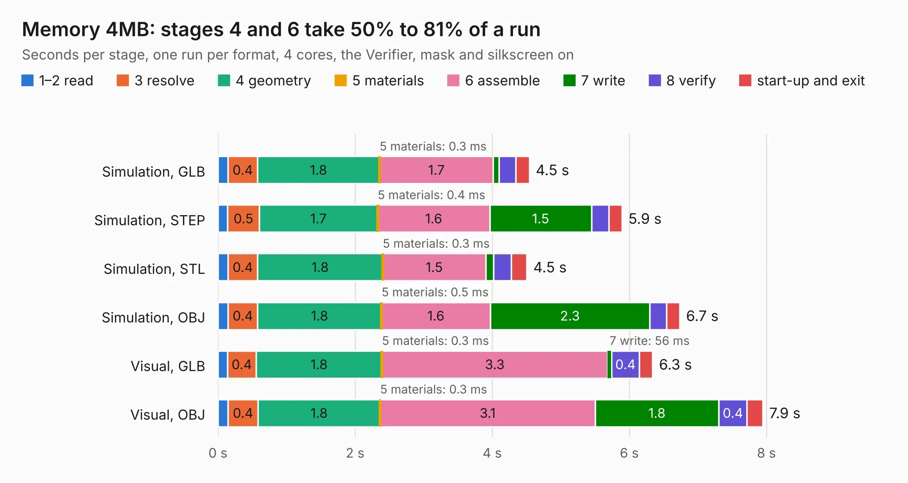

# 218. Memory 4MB

Board 218 of the 3,126 of [Corpus Testing](../Corpus-Testing.md), on [Corpus Page 3](../CorpusTestingPages/Corpus-Testing-03.md#218-memory-4mb).

| Mode and format | 1–2 read | 3 resolve | 4 geometry | 5 materials | 6 assemble | 7 write | 8 verify | start-up and exit | Total |
|---|---:|---:|---:|---:|---:|---:|---:|---:|---:|
| Simulation, GLB | 0.1 | 0.4 | 1.8 | 0.3&nbsp;ms | 1.7 | 83&nbsp;ms | 0.2 | 0.2 | 4.5 |
| Simulation, STEP | 0.1 | 0.5 | 1.7 | 0.4&nbsp;ms | 1.6 | 1.5 | 0.3 | 0.2 | 5.9 |
| Simulation, STL | 0.1 | 0.4 | 1.8 | 0.3&nbsp;ms | 1.5 | 0.1 | 0.3 | 0.2 | 4.5 |
| Simulation, OBJ | 0.1 | 0.4 | 1.8 | 0.5&nbsp;ms | 1.6 | 2.3 | 0.2 | 0.2 | 6.7 |
| Visual, GLB | 0.1 | 0.4 | 1.8 | 0.3&nbsp;ms | 3.3 | 56&nbsp;ms | 0.4 | 0.2 | 6.3 |
| Visual, OBJ | 0.1 | 0.4 | 1.8 | 0.3&nbsp;ms | 3.1 | 1.8 | 0.4 | 0.2 | 7.9 |

<table align="center"><tr><td valign="top">

| Board | Repo: [andrewpaterson/658-Computer](https://github.com/andrewpaterson/658-Computer) Board: `Memory 4MB.kicad_pcb` |
|---|---|
| Folder | Kicad / Computer / Memory / Memory 4MB |
| Complexity | 222&nbsp;/&nbsp;1000 (size&nbsp;152, features&nbsp;70) |
| KESE&nbsp;features | through vias, rounded, trapezoid or chamfered pads, knockout text, stack-up, dielectric εr and tanδ |
| Tested | 9th November 2026 |
| Copper&nbsp;layers | 2 |
| File&nbsp;format | KiCad 9 (20241229) |
| Parts,&nbsp;tracks,&nbsp;vias | 10, 536, 77 |
| Triangles,&nbsp;simulation | 456,748 in 64 parts |
| Verifier | PASS in all six runs |

</td><td valign="top">

<table>
<tr><th>File type</th><th>File size</th><th>Peak memory used</th></tr>
<tr><th colspan="3" align="left">Simulation</th></tr>
<tr><td>GLB</td><td align="right">15&nbsp;MB</td><td align="right">275&nbsp;MB</td></tr>
<tr><td>STEP</td><td align="right">68&nbsp;MB</td><td align="right">346&nbsp;MB</td></tr>
<tr><td>STL</td><td align="right">23&nbsp;MB</td><td align="right">277&nbsp;MB</td></tr>
<tr><td>OBJ</td><td align="right">46&nbsp;MB</td><td align="right">347&nbsp;MB</td></tr>
<tr><th colspan="3" align="left">Visual</th></tr>
<tr><td>GLB</td><td align="right">12&nbsp;MB</td><td align="right">353&nbsp;MB</td></tr>
<tr><td>OBJ</td><td align="right">36&nbsp;MB</td><td align="right">341&nbsp;MB</td></tr>
</table>

</td></tr></table>

| Previous | Next |
|:---|---:|
| [217. Memory 1MB](b0217b_658-Computer_Memory-1MB.md) | [219. Memory Board](b0219b_658-Computer_Memory-Board.md) |
