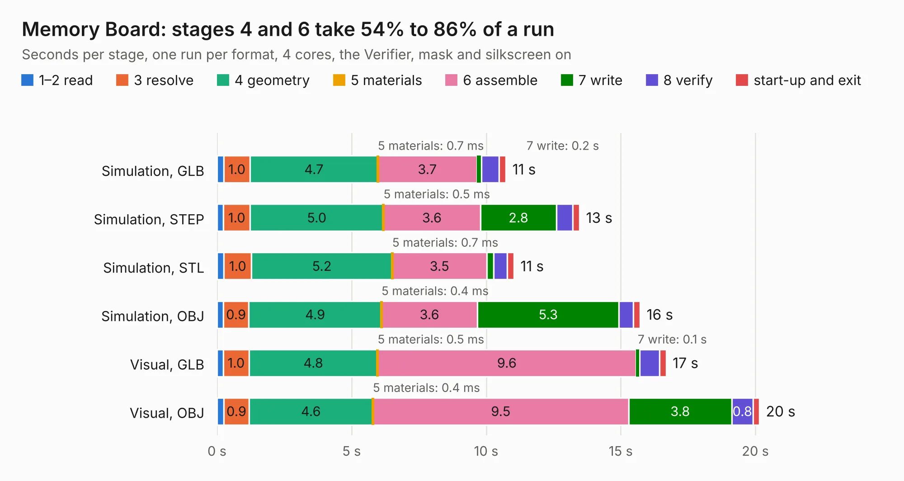

# 218. Memory Board

Board 218 of the 3,105 of [Corpus Testing](../Corpus-Testing.md), on [Corpus Page 3](../CorpusTestingPages/Corpus-Testing-03.md#218-memory-board).

| Mode and format | 1–2 read | 3 resolve | 4 geometry | 5 materials | 6 assemble | 7 write | 8 verify | start-up and exit | Total |
|---|---:|---:|---:|---:|---:|---:|---:|---:|---:|
| Simulation, GLB | 0.3 | 1.0 | 4.7 | 0.7&nbsp;ms | 3.7 | 0.2 | 0.7 | 0.3 | 10.7 |
| Simulation, STEP | 0.2 | 1.0 | 5.0 | 0.5&nbsp;ms | 3.6 | 2.8 | 0.6 | 0.3 | 13.5 |
| Simulation, STL | 0.3 | 1.0 | 5.2 | 0.7&nbsp;ms | 3.5 | 0.3 | 0.5 | 0.2 | 11.0 |
| Simulation, OBJ | 0.2 | 0.9 | 4.9 | 0.4&nbsp;ms | 3.6 | 5.3 | 0.5 | 0.3 | 15.7 |
| Visual, GLB | 0.2 | 1.0 | 4.8 | 0.5&nbsp;ms | 9.6 | 0.1 | 0.7 | 0.3 | 16.7 |
| Visual, OBJ | 0.3 | 0.9 | 4.6 | 0.4&nbsp;ms | 9.5 | 3.8 | 0.8 | 0.2 | 20.1 |

<table align="center"><tr><td valign="top">

| Board | Repo: [andrewpaterson/658-Computer](https://github.com/andrewpaterson/658-Computer) Board: `Memory Board.kicad_pcb` |
|---|---|
| Folder | Kicad / Computer / Memory / Memory Board |
| Complexity | 238&nbsp;/&nbsp;1000 (size&nbsp;158, features&nbsp;80) |
| KESE&nbsp;features | through vias, rounded, trapezoid or chamfered pads, curved board outline, knockout text, stack-up, dielectric εr and tanδ |
| Tested | 9th November 2026 |
| Copper&nbsp;layers | 2 |
| File&nbsp;format | KiCad 9 (20241229) |
| Parts,&nbsp;tracks,&nbsp;vias | 15, 699, 68 |
| Triangles,&nbsp;simulation | 1,006,212 in 144 parts |
| Verifier | PASS in all six runs |

</td><td valign="top">

<table>
<tr><th>File type</th><th>File size</th><th>Peak memory used</th></tr>
<tr><th colspan="3" align="left">Simulation</th></tr>
<tr><td>GLB</td><td align="right">34&nbsp;MB</td><td align="right">420&nbsp;MB</td></tr>
<tr><td>STEP</td><td align="right">148&nbsp;MB</td><td align="right">509&nbsp;MB</td></tr>
<tr><td>STL</td><td align="right">50&nbsp;MB</td><td align="right">441&nbsp;MB</td></tr>
<tr><td>OBJ</td><td align="right">102&nbsp;MB</td><td align="right">707&nbsp;MB</td></tr>
<tr><th colspan="3" align="left">Visual</th></tr>
<tr><td>GLB</td><td align="right">24&nbsp;MB</td><td align="right">641&nbsp;MB</td></tr>
<tr><td>OBJ</td><td align="right">74&nbsp;MB</td><td align="right">566&nbsp;MB</td></tr>
</table>

</td></tr></table>

| Previous | Next |
|:---|---:|
| [217. Memory 4MB](b0217b_658-Computer_Memory-4MB.md) | [219. Power and Reset](b0219b_658-Computer_Power-and-Reset.md) |
