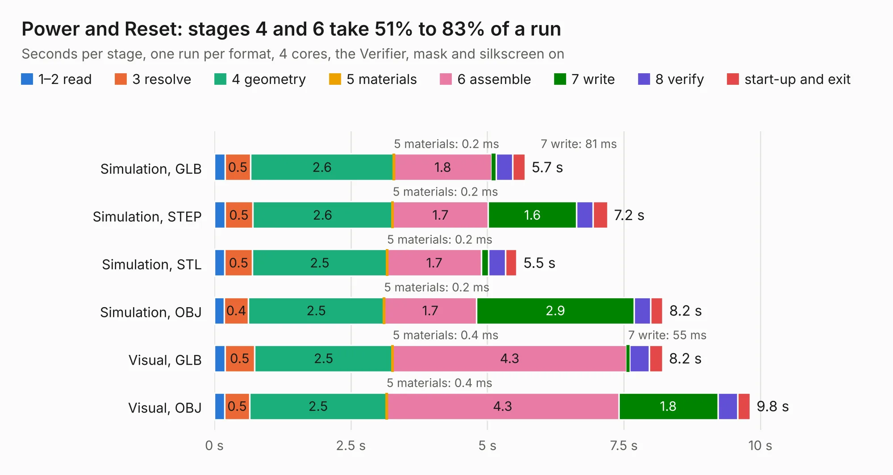

# 220. Power and Reset

Board 220 of the 3,126 of [Corpus Testing](../Corpus-Testing.md), on [Corpus Page 3](../CorpusTestingPages/Corpus-Testing-03.md#220-power-and-reset).

| Mode and format | 1–2 read | 3 resolve | 4 geometry | 5 materials | 6 assemble | 7 write | 8 verify | start-up and exit | Total |
|---|---:|---:|---:|---:|---:|---:|---:|---:|---:|
| Simulation, GLB | 0.2 | 0.5 | 2.6 | 0.2&nbsp;ms | 1.8 | 81&nbsp;ms | 0.3 | 0.2 | 5.7 |
| Simulation, STEP | 0.2 | 0.5 | 2.6 | 0.2&nbsp;ms | 1.7 | 1.6 | 0.3 | 0.3 | 7.2 |
| Simulation, STL | 0.2 | 0.5 | 2.5 | 0.2&nbsp;ms | 1.7 | 0.1 | 0.3 | 0.2 | 5.5 |
| Simulation, OBJ | 0.2 | 0.4 | 2.5 | 0.2&nbsp;ms | 1.7 | 2.9 | 0.3 | 0.2 | 8.2 |
| Visual, GLB | 0.2 | 0.5 | 2.5 | 0.4&nbsp;ms | 4.3 | 55&nbsp;ms | 0.4 | 0.2 | 8.2 |
| Visual, OBJ | 0.2 | 0.5 | 2.5 | 0.4&nbsp;ms | 4.3 | 1.8 | 0.4 | 0.2 | 9.8 |

<table align="center"><tr><td valign="top">

| Board | Repo: [andrewpaterson/658-Computer](https://github.com/andrewpaterson/658-Computer) Board: `Power and Reset.kicad_pcb` |
|---|---|
| Folder | Kicad / Computer / Power / Power and Reset |
| Complexity | 233&nbsp;/&nbsp;1000 (size&nbsp;148, features&nbsp;85) |
| KESE&nbsp;features | through vias, rounded, trapezoid or chamfered pads, filled zones, curved board outline, stack-up, dielectric εr and tanδ |
| Tested | 9th November 2026 |
| Copper&nbsp;layers | 2 |
| File&nbsp;format | KiCad 10 (20260206) |
| Parts,&nbsp;tracks,&nbsp;vias | 23, 285, 29 |
| Triangles,&nbsp;simulation | 503,998 in 51 parts |
| Verifier | PASS in all six runs |

</td><td valign="top">

<table>
<tr><th>File type</th><th>File size</th><th>Peak memory used</th></tr>
<tr><th colspan="3" align="left">Simulation</th></tr>
<tr><td>GLB</td><td align="right">17&nbsp;MB</td><td align="right">283&nbsp;MB</td></tr>
<tr><td>STEP</td><td align="right">70&nbsp;MB</td><td align="right">340&nbsp;MB</td></tr>
<tr><td>STL</td><td align="right">25&nbsp;MB</td><td align="right">292&nbsp;MB</td></tr>
<tr><td>OBJ</td><td align="right">50&nbsp;MB</td><td align="right">375&nbsp;MB</td></tr>
<tr><th colspan="3" align="left">Visual</th></tr>
<tr><td>GLB</td><td align="right">11&nbsp;MB</td><td align="right">342&nbsp;MB</td></tr>
<tr><td>OBJ</td><td align="right">34&nbsp;MB</td><td align="right">342&nbsp;MB</td></tr>
</table>

</td></tr></table>

| Previous | Next |
|:---|---:|
| [219. Memory Board](b0219b_658-Computer_Memory-Board.md) | [221. Address Decode V2 to V3](b0221b_658-Computer_Address-Decode-V2-to-V3.md) |
