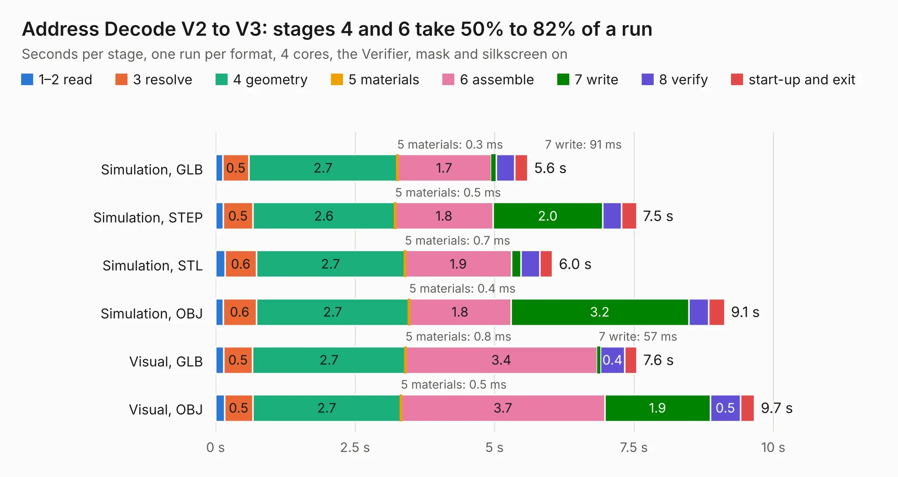

# 221. Address Decode V2 to V3

Board 221 of the 3,129 of [Corpus Testing](../Corpus-Testing.md), on [Corpus Page 3](../CorpusTestingPages/Corpus-Testing-03.md#221-address-decode-v2-to-v3).

| Mode and format | 1–2 read | 3 resolve | 4 geometry | 5 materials | 6 assemble | 7 write | 8 verify | start-up and exit | Total |
|---|---:|---:|---:|---:|---:|---:|---:|---:|---:|
| Simulation, GLB | 0.1 | 0.5 | 2.7 | 0.3&nbsp;ms | 1.7 | 91&nbsp;ms | 0.3 | 0.2 | 5.6 |
| Simulation, STEP | 0.1 | 0.5 | 2.6 | 0.5&nbsp;ms | 1.8 | 2.0 | 0.3 | 0.3 | 7.5 |
| Simulation, STL | 0.2 | 0.6 | 2.7 | 0.7&nbsp;ms | 1.9 | 0.2 | 0.3 | 0.2 | 6.0 |
| Simulation, OBJ | 0.1 | 0.6 | 2.7 | 0.4&nbsp;ms | 1.8 | 3.2 | 0.4 | 0.3 | 9.1 |
| Visual, GLB | 0.1 | 0.5 | 2.7 | 0.8&nbsp;ms | 3.4 | 57&nbsp;ms | 0.4 | 0.2 | 7.6 |
| Visual, OBJ | 0.2 | 0.5 | 2.7 | 0.5&nbsp;ms | 3.7 | 1.9 | 0.5 | 0.2 | 9.7 |

<table align="center"><tr><td valign="top">

| Board | Repo: [andrewpaterson/658-Computer](https://github.com/andrewpaterson/658-Computer) Board: `Address Decode V2 to V3.kicad_pcb` |
|---|---|
| Folder | Kicad / Computer / Processor / Address Decode V2 to V3 |
| Complexity | 162&nbsp;/&nbsp;1000 (size&nbsp;97, features&nbsp;65) |
| KESE&nbsp;features | rounded, trapezoid or chamfered pads, curved board outline, knockout text, stack-up, dielectric εr and tanδ |
| Tested | 9th November 2026 |
| Copper&nbsp;layers | 2 |
| File&nbsp;format | KiCad 9 (20241229) |
| Parts,&nbsp;tracks,&nbsp;vias | 2, 65, 0 |
| Triangles,&nbsp;simulation | 556,592 in 64 parts |
| Verifier | PASS in all six runs |

</td><td valign="top">

<table>
<tr><th>File type</th><th>File size</th><th>Peak memory used</th></tr>
<tr><th colspan="3" align="left">Simulation</th></tr>
<tr><td>GLB</td><td align="right">17&nbsp;MB</td><td align="right">297&nbsp;MB</td></tr>
<tr><td>STEP</td><td align="right">67&nbsp;MB</td><td align="right">347&nbsp;MB</td></tr>
<tr><td>STL</td><td align="right">28&nbsp;MB</td><td align="right">294&nbsp;MB</td></tr>
<tr><td>OBJ</td><td align="right">55&nbsp;MB</td><td align="right">409&nbsp;MB</td></tr>
<tr><th colspan="3" align="left">Visual</th></tr>
<tr><td>GLB</td><td align="right">10&nbsp;MB</td><td align="right">334&nbsp;MB</td></tr>
<tr><td>OBJ</td><td align="right">30&nbsp;MB</td><td align="right">336&nbsp;MB</td></tr>
</table>

</td></tr></table>

| Previous | Next |
|:---|---:|
| [220. Power and Reset](b0220b_658-Computer_Power-and-Reset.md) | [222. Clock Hold V1 to V2](b0222b_658-Computer_Clock-Hold-V1-to-V2.md) |
