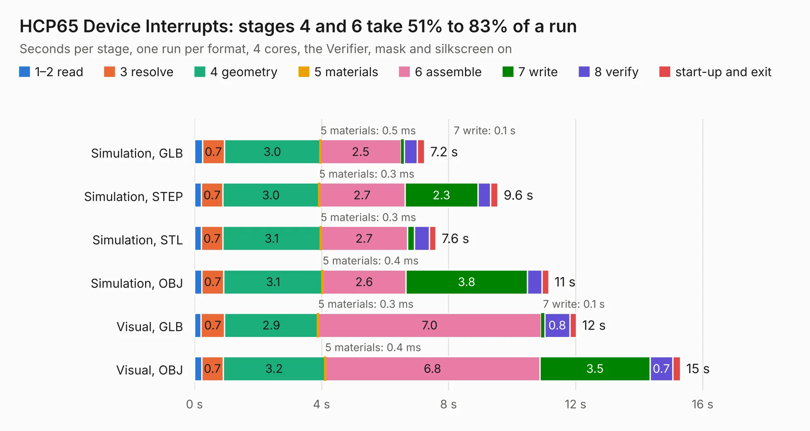

# 222. HCP65 Device Interrupts

Board 222 of the 3,103 of [Corpus Testing](../Corpus-Testing.md), on [Corpus Page 3](../CorpusTestingPages/Corpus-Testing-03.md#222-hcp65-device-interrupts).

| Mode and format | 1–2 read | 3 resolve | 4 geometry | 5 materials | 6 assemble | 7 write | 8 verify | start-up and exit | Total |
|---|---:|---:|---:|---:|---:|---:|---:|---:|---:|
| Simulation, GLB | 0.3 | 0.7 | 3.0 | 0.5&nbsp;ms | 2.5 | 0.1 | 0.4 | 0.2 | 7.2 |
| Simulation, STEP | 0.2 | 0.7 | 3.0 | 0.3&nbsp;ms | 2.7 | 2.3 | 0.4 | 0.2 | 9.6 |
| Simulation, STL | 0.2 | 0.7 | 3.1 | 0.3&nbsp;ms | 2.7 | 0.2 | 0.5 | 0.2 | 7.6 |
| Simulation, OBJ | 0.2 | 0.7 | 3.1 | 0.4&nbsp;ms | 2.6 | 3.8 | 0.5 | 0.2 | 11.2 |
| Visual, GLB | 0.2 | 0.7 | 2.9 | 0.3&nbsp;ms | 7.0 | 0.1 | 0.8 | 0.2 | 12.0 |
| Visual, OBJ | 0.2 | 0.7 | 3.2 | 0.4&nbsp;ms | 6.8 | 3.5 | 0.7 | 0.2 | 15.3 |

<table align="center"><tr><td valign="top">

| Board | Repo: [andrewpaterson/658-Computer](https://github.com/andrewpaterson/658-Computer) Board: `HCP65 Device Interrupts.kicad_pcb` |
|---|---|
| Folder | Kicad / Computer / Processor / HCP65 Device Interrupts |
| Complexity | 238&nbsp;/&nbsp;1000 (size&nbsp;168, features&nbsp;70) |
| KESE&nbsp;features | through vias, rounded, trapezoid or chamfered pads, knockout text, stack-up, dielectric εr and tanδ |
| Tested | 9th November 2026 |
| Copper&nbsp;layers | 2 |
| File&nbsp;format | KiCad 9 (20241229) |
| Parts,&nbsp;tracks,&nbsp;vias | 18, 1,070, 123 |
| Triangles,&nbsp;simulation | 656,798 in 59 parts |
| Verifier | PASS in all six runs |

</td><td valign="top">

<table>
<tr><th>File type</th><th>File size</th><th>Peak memory used</th></tr>
<tr><th colspan="3" align="left">Simulation</th></tr>
<tr><td>GLB</td><td align="right">23&nbsp;MB</td><td align="right">384&nbsp;MB</td></tr>
<tr><td>STEP</td><td align="right">112&nbsp;MB</td><td align="right">413&nbsp;MB</td></tr>
<tr><td>STL</td><td align="right">33&nbsp;MB</td><td align="right">359&nbsp;MB</td></tr>
<tr><td>OBJ</td><td align="right">67&nbsp;MB</td><td align="right">491&nbsp;MB</td></tr>
<tr><th colspan="3" align="left">Visual</th></tr>
<tr><td>GLB</td><td align="right">19&nbsp;MB</td><td align="right">533&nbsp;MB</td></tr>
<tr><td>OBJ</td><td align="right">59&nbsp;MB</td><td align="right">516&nbsp;MB</td></tr>
</table>

</td></tr></table>

| Previous | Next |
|:---|---:|
| [221. HCP65 Board Presence](b0221b_658-Computer_HCP65-Board-Presence.md) | [223. HCP65 Device Reset](b0223b_658-Computer_HCP65-Device-Reset.md) |
