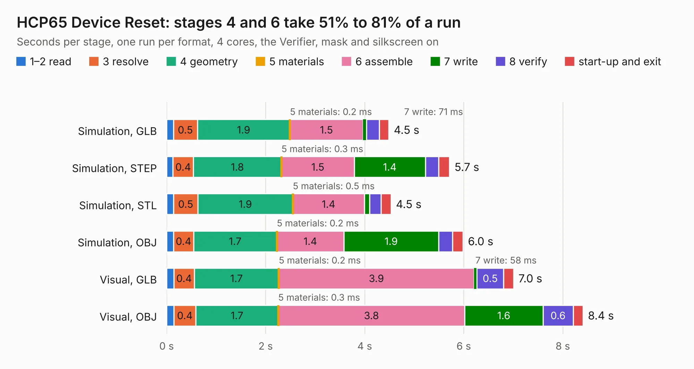

# 225. HCP65 Device Reset

Board 225 of the 3,122 of [Corpus Testing](../Corpus-Testing.md), on [Corpus Page 3](../CorpusTestingPages/Corpus-Testing-03.md#225-hcp65-device-reset).

| Mode and format | 1–2 read | 3 resolve | 4 geometry | 5 materials | 6 assemble | 7 write | 8 verify | start-up and exit | Total |
|---|---:|---:|---:|---:|---:|---:|---:|---:|---:|
| Simulation, GLB | 0.1 | 0.5 | 1.9 | 0.2&nbsp;ms | 1.5 | 71&nbsp;ms | 0.3 | 0.2 | 4.5 |
| Simulation, STEP | 0.1 | 0.4 | 1.8 | 0.3&nbsp;ms | 1.5 | 1.4 | 0.3 | 0.2 | 5.7 |
| Simulation, STL | 0.1 | 0.5 | 1.9 | 0.5&nbsp;ms | 1.4 | 0.1 | 0.2 | 0.2 | 4.5 |
| Simulation, OBJ | 0.1 | 0.4 | 1.7 | 0.2&nbsp;ms | 1.4 | 1.9 | 0.3 | 0.2 | 6.0 |
| Visual, GLB | 0.1 | 0.4 | 1.7 | 0.2&nbsp;ms | 3.9 | 58&nbsp;ms | 0.5 | 0.2 | 7.0 |
| Visual, OBJ | 0.1 | 0.4 | 1.7 | 0.3&nbsp;ms | 3.8 | 1.6 | 0.6 | 0.2 | 8.4 |

<table align="center"><tr><td valign="top">

| Board | Repo: [andrewpaterson/658-Computer](https://github.com/andrewpaterson/658-Computer) Board: `HCP65 Device Reset.kicad_pcb` |
|---|---|
| Folder | Kicad / Computer / Processor / HCP65 Device Reset |
| Complexity | 228&nbsp;/&nbsp;1000 (size&nbsp;158, features&nbsp;70) |
| KESE&nbsp;features | through vias, rounded, trapezoid or chamfered pads, knockout text, stack-up, dielectric εr and tanδ |
| Tested | 9th November 2026 |
| Copper&nbsp;layers | 2 |
| File&nbsp;format | KiCad 9 (20241229) |
| Parts,&nbsp;tracks,&nbsp;vias | 14, 677, 74 |
| Triangles,&nbsp;simulation | 490,122 in 61 parts |
| Verifier | PASS in all six runs |

</td><td valign="top">

<table>
<tr><th>File type</th><th>File size</th><th>Peak memory used</th></tr>
<tr><th colspan="3" align="left">Simulation</th></tr>
<tr><td>GLB</td><td align="right">17&nbsp;MB</td><td align="right">309&nbsp;MB</td></tr>
<tr><td>STEP</td><td align="right">81&nbsp;MB</td><td align="right">349&nbsp;MB</td></tr>
<tr><td>STL</td><td align="right">25&nbsp;MB</td><td align="right">310&nbsp;MB</td></tr>
<tr><td>OBJ</td><td align="right">50&nbsp;MB</td><td align="right">377&nbsp;MB</td></tr>
<tr><th colspan="3" align="left">Visual</th></tr>
<tr><td>GLB</td><td align="right">14&nbsp;MB</td><td align="right">392&nbsp;MB</td></tr>
<tr><td>OBJ</td><td align="right">41&nbsp;MB</td><td align="right">388&nbsp;MB</td></tr>
</table>

</td></tr></table>

| Previous | Next |
|:---|---:|
| [224. HCP65 Device Interrupts](b0224b_658-Computer_HCP65-Device-Interrupts.md) | [226. HCP65 Hold Count](b0226b_658-Computer_HCP65-Hold-Count.md) |
