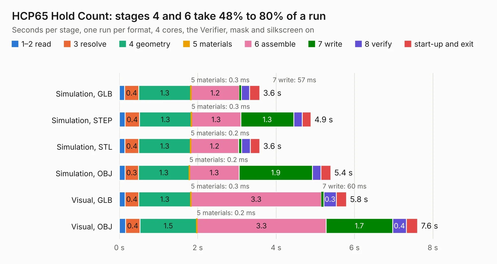

# 226. HCP65 Hold Count

Board 226 of the 3,138 of [Corpus Testing](../Corpus-Testing.md), on [Corpus Page 3](../CorpusTestingPages/Corpus-Testing-03.md#226-hcp65-hold-count).

| Mode and format | 1–2 read | 3 resolve | 4 geometry | 5 materials | 6 assemble | 7 write | 8 verify | start-up and exit | Total |
|---|---:|---:|---:|---:|---:|---:|---:|---:|---:|
| Simulation, GLB | 0.1 | 0.4 | 1.3 | 0.3&nbsp;ms | 1.2 | 57&nbsp;ms | 0.2 | 0.3 | 3.6 |
| Simulation, STEP | 0.1 | 0.4 | 1.3 | 0.3&nbsp;ms | 1.3 | 1.3 | 0.2 | 0.2 | 4.9 |
| Simulation, STL | 0.1 | 0.4 | 1.3 | 0.2&nbsp;ms | 1.2 | 82&nbsp;ms | 0.2 | 0.2 | 3.6 |
| Simulation, OBJ | 0.1 | 0.3 | 1.3 | 0.2&nbsp;ms | 1.3 | 1.9 | 0.2 | 0.2 | 5.4 |
| Visual, GLB | 0.1 | 0.4 | 1.3 | 0.3&nbsp;ms | 3.3 | 60&nbsp;ms | 0.3 | 0.3 | 5.8 |
| Visual, OBJ | 0.2 | 0.4 | 1.5 | 0.2&nbsp;ms | 3.3 | 1.7 | 0.4 | 0.3 | 7.6 |

<table align="center"><tr><td valign="top">

| Board | Repo: [andrewpaterson/658-Computer](https://github.com/andrewpaterson/658-Computer) Board: `HCP65 Hold Count.kicad_pcb` |
|---|---|
| Folder | Kicad / Computer / Processor / HCP65 Hold Count |
| Complexity | 217&nbsp;/&nbsp;1000 (size&nbsp;147, features&nbsp;70) |
| KESE&nbsp;features | through vias, rounded, trapezoid or chamfered pads, knockout text, stack-up, dielectric εr and tanδ |
| Tested | 9th November 2026 |
| Copper&nbsp;layers | 2 |
| File&nbsp;format | KiCad 9 (20241229) |
| Parts,&nbsp;tracks,&nbsp;vias | 12, 344, 56 |
| Triangles,&nbsp;simulation | 316,504 in 40 parts |
| Verifier | PASS in all six runs |

</td><td valign="top">

<table>
<tr><th>File type</th><th>File size</th><th>Peak memory used</th></tr>
<tr><th colspan="3" align="left">Simulation</th></tr>
<tr><td>GLB</td><td align="right">11&nbsp;MB</td><td align="right">244&nbsp;MB</td></tr>
<tr><td>STEP</td><td align="right">49&nbsp;MB</td><td align="right">273&nbsp;MB</td></tr>
<tr><td>STL</td><td align="right">16&nbsp;MB</td><td align="right">245&nbsp;MB</td></tr>
<tr><td>OBJ</td><td align="right">32&nbsp;MB</td><td align="right">245&nbsp;MB</td></tr>
<tr><th colspan="3" align="left">Visual</th></tr>
<tr><td>GLB</td><td align="right">9.0&nbsp;MB</td><td align="right">284&nbsp;MB</td></tr>
<tr><td>OBJ</td><td align="right">27&nbsp;MB</td><td align="right">279&nbsp;MB</td></tr>
</table>

</td></tr></table>

| Previous | Next |
|:---|---:|
| [225. HCP65 Device Reset](b0225b_658-Computer_HCP65-Device-Reset.md) | [227. HCP65 Instruction Code](b0227b_658-Computer_HCP65-Instruction-Code.md) |
