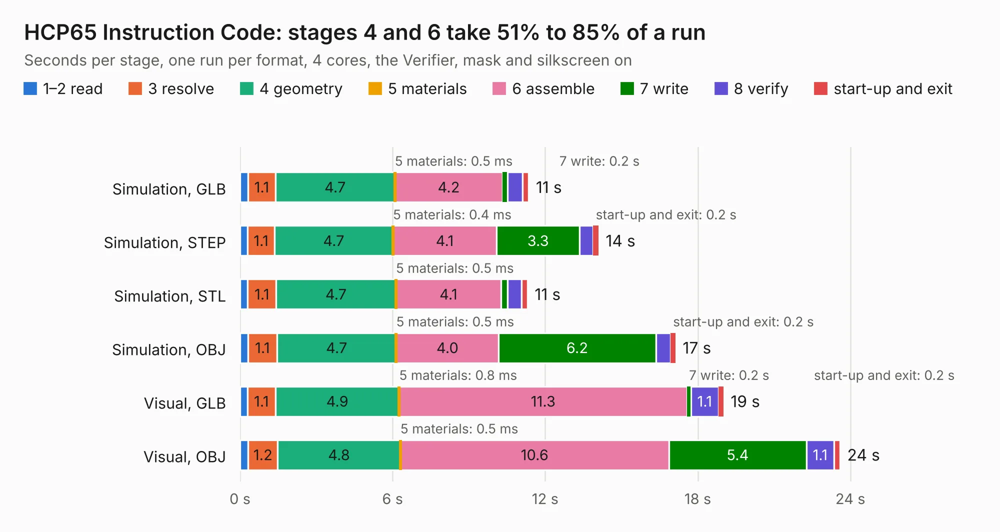

# 226. HCP65 Instruction Code

Board 226 of the 3,109 of [Corpus Testing](../Corpus-Testing.md), on [Corpus Page 3](../CorpusTestingPages/Corpus-Testing-03.md#226-hcp65-instruction-code).

| Mode and format | 1–2 read | 3 resolve | 4 geometry | 5 materials | 6 assemble | 7 write | 8 verify | start-up and exit | Total |
|---|---:|---:|---:|---:|---:|---:|---:|---:|---:|
| Simulation, GLB | 0.3 | 1.1 | 4.7 | 0.5&nbsp;ms | 4.2 | 0.2 | 0.6 | 0.3 | 11.4 |
| Simulation, STEP | 0.3 | 1.1 | 4.7 | 0.4&nbsp;ms | 4.1 | 3.3 | 0.5 | 0.2 | 14.1 |
| Simulation, STL | 0.3 | 1.1 | 4.7 | 0.5&nbsp;ms | 4.1 | 0.3 | 0.5 | 0.2 | 11.3 |
| Simulation, OBJ | 0.3 | 1.1 | 4.7 | 0.5&nbsp;ms | 4.0 | 6.2 | 0.6 | 0.2 | 17.1 |
| Visual, GLB | 0.3 | 1.1 | 4.9 | 0.8&nbsp;ms | 11.3 | 0.2 | 1.1 | 0.2 | 19.0 |
| Visual, OBJ | 0.3 | 1.2 | 4.8 | 0.5&nbsp;ms | 10.6 | 5.4 | 1.1 | 0.2 | 23.6 |

<table align="center"><tr><td valign="top">

| Board | Repo: [andrewpaterson/658-Computer](https://github.com/andrewpaterson/658-Computer) Board: `HCP65 Instruction Code.kicad_pcb` |
|---|---|
| Folder | Kicad / Computer / Processor / HCP65 Instruction Code |
| Complexity | 255&nbsp;/&nbsp;1000 (size&nbsp;185, features&nbsp;70) |
| KESE&nbsp;features | through vias, rounded, trapezoid or chamfered pads, knockout text, stack-up, dielectric εr and tanδ |
| Tested | 9th November 2026 |
| Copper&nbsp;layers | 2 |
| File&nbsp;format | KiCad 9 (20241229) |
| Parts,&nbsp;tracks,&nbsp;vias | 36, 2,035, 222 |
| Triangles,&nbsp;simulation | 1,150,168 in 107 parts |
| Verifier | PASS in all six runs |

</td><td valign="top">

<table>
<tr><th>File type</th><th>File size</th><th>Peak memory used</th></tr>
<tr><th colspan="3" align="left">Simulation</th></tr>
<tr><td>GLB</td><td align="right">40&nbsp;MB</td><td align="right">533&nbsp;MB</td></tr>
<tr><td>STEP</td><td align="right">194&nbsp;MB</td><td align="right">631&nbsp;MB</td></tr>
<tr><td>STL</td><td align="right">58&nbsp;MB</td><td align="right">534&nbsp;MB</td></tr>
<tr><td>OBJ</td><td align="right">118&nbsp;MB</td><td align="right">790&nbsp;MB</td></tr>
<tr><th colspan="3" align="left">Visual</th></tr>
<tr><td>GLB</td><td align="right">35&nbsp;MB</td><td align="right">759&nbsp;MB</td></tr>
<tr><td>OBJ</td><td align="right">106&nbsp;MB</td><td align="right">768&nbsp;MB</td></tr>
</table>

</td></tr></table>

| Previous | Next |
|:---|---:|
| [225. HCP65 Hold Count](b0225b_658-Computer_HCP65-Hold-Count.md) | [227. HCP65 Kernal Mode](b0227b_658-Computer_HCP65-Kernal-Mode.md) |
