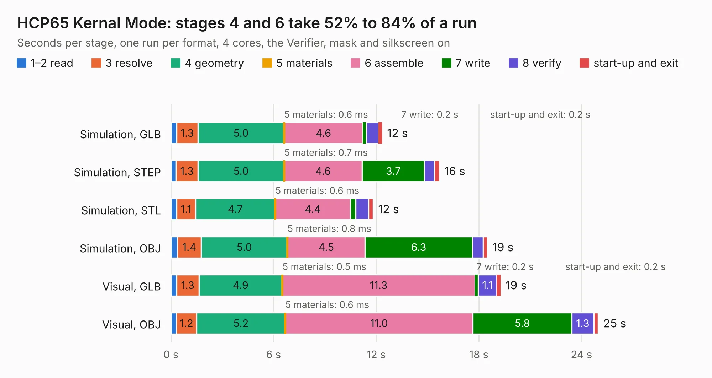

# 227. HCP65 Kernal Mode

Board 227 of the 3,110 of [Corpus Testing](../Corpus-Testing.md), on [Corpus Page 3](../CorpusTestingPages/Corpus-Testing-03.md#227-hcp65-kernal-mode).

| Mode and format | 1–2 read | 3 resolve | 4 geometry | 5 materials | 6 assemble | 7 write | 8 verify | start-up and exit | Total |
|---|---:|---:|---:|---:|---:|---:|---:|---:|---:|
| Simulation, GLB | 0.3 | 1.3 | 5.0 | 0.6&nbsp;ms | 4.6 | 0.2 | 0.7 | 0.2 | 12.3 |
| Simulation, STEP | 0.3 | 1.3 | 5.0 | 0.7&nbsp;ms | 4.6 | 3.7 | 0.6 | 0.3 | 15.7 |
| Simulation, STL | 0.3 | 1.1 | 4.7 | 0.6&nbsp;ms | 4.4 | 0.3 | 0.7 | 0.3 | 11.8 |
| Simulation, OBJ | 0.4 | 1.4 | 5.0 | 0.8&nbsp;ms | 4.5 | 6.3 | 0.6 | 0.3 | 18.5 |
| Visual, GLB | 0.3 | 1.3 | 4.9 | 0.5&nbsp;ms | 11.3 | 0.2 | 1.1 | 0.2 | 19.3 |
| Visual, OBJ | 0.3 | 1.2 | 5.2 | 0.6&nbsp;ms | 11.0 | 5.8 | 1.3 | 0.2 | 25.0 |

<table align="center"><tr><td valign="top">

| Board | Repo: [andrewpaterson/658-Computer](https://github.com/andrewpaterson/658-Computer) Board: `HCP65 Kernal Mode.kicad_pcb` |
|---|---|
| Folder | Kicad / Computer / Processor / HCP65 Kernal Mode |
| Complexity | 253&nbsp;/&nbsp;1000 (size&nbsp;183, features&nbsp;70) |
| KESE&nbsp;features | through vias, rounded, trapezoid or chamfered pads, knockout text, stack-up, dielectric εr and tanδ |
| Tested | 9th November 2026 |
| Copper&nbsp;layers | 2 |
| File&nbsp;format | KiCad 9 (20241229) |
| Parts,&nbsp;tracks,&nbsp;vias | 30, 1,942, 242 |
| Triangles,&nbsp;simulation | 1,154,594 in 103 parts |
| Verifier | PASS in all six runs |

</td><td valign="top">

<table>
<tr><th>File type</th><th>File size</th><th>Peak memory used</th></tr>
<tr><th colspan="3" align="left">Simulation</th></tr>
<tr><td>GLB</td><td align="right">40&nbsp;MB</td><td align="right">554&nbsp;MB</td></tr>
<tr><td>STEP</td><td align="right">188&nbsp;MB</td><td align="right">622&nbsp;MB</td></tr>
<tr><td>STL</td><td align="right">58&nbsp;MB</td><td align="right">527&nbsp;MB</td></tr>
<tr><td>OBJ</td><td align="right">118&nbsp;MB</td><td align="right">832&nbsp;MB</td></tr>
<tr><th colspan="3" align="left">Visual</th></tr>
<tr><td>GLB</td><td align="right">35&nbsp;MB</td><td align="right">746&nbsp;MB</td></tr>
<tr><td>OBJ</td><td align="right">106&nbsp;MB</td><td align="right">732&nbsp;MB</td></tr>
</table>

</td></tr></table>

| Previous | Next |
|:---|---:|
| [226. HCP65 Instruction Code](b0226b_658-Computer_HCP65-Instruction-Code.md) | [228. HCP65 Main Memory Address](b0228b_658-Computer_HCP65-Main-Memory-Address.md) |
