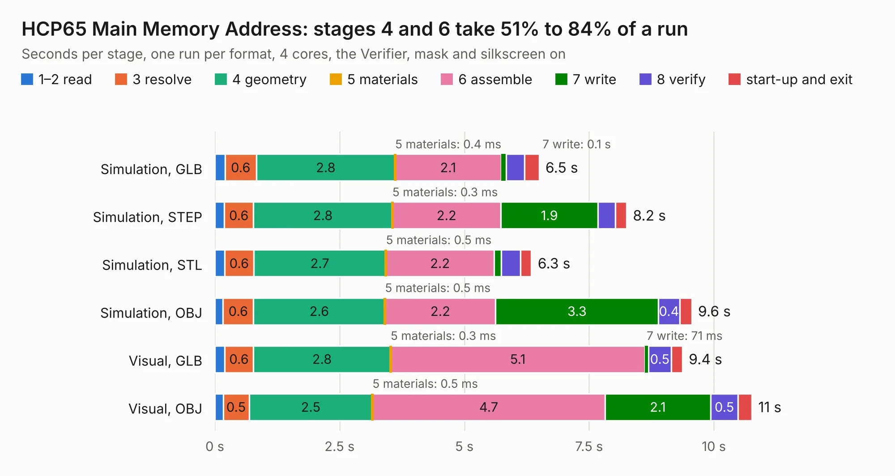

# 229. HCP65 Main Memory Address

Board 229 of the 3,139 of [Corpus Testing](../Corpus-Testing.md), on [Corpus Page 3](../CorpusTestingPages/Corpus-Testing-03.md#229-hcp65-main-memory-address).

| Mode and format | 1–2 read | 3 resolve | 4 geometry | 5 materials | 6 assemble | 7 write | 8 verify | start-up and exit | Total |
|---|---:|---:|---:|---:|---:|---:|---:|---:|---:|
| Simulation, GLB | 0.2 | 0.6 | 2.8 | 0.4&nbsp;ms | 2.1 | 0.1 | 0.4 | 0.3 | 6.5 |
| Simulation, STEP | 0.2 | 0.6 | 2.8 | 0.3&nbsp;ms | 2.2 | 1.9 | 0.3 | 0.2 | 8.2 |
| Simulation, STL | 0.2 | 0.6 | 2.7 | 0.5&nbsp;ms | 2.2 | 0.1 | 0.4 | 0.2 | 6.3 |
| Simulation, OBJ | 0.2 | 0.6 | 2.6 | 0.5&nbsp;ms | 2.2 | 3.3 | 0.4 | 0.2 | 9.6 |
| Visual, GLB | 0.2 | 0.6 | 2.8 | 0.3&nbsp;ms | 5.1 | 71&nbsp;ms | 0.5 | 0.2 | 9.4 |
| Visual, OBJ | 0.2 | 0.5 | 2.5 | 0.5&nbsp;ms | 4.7 | 2.1 | 0.5 | 0.3 | 10.8 |

<table align="center"><tr><td valign="top">

| Board | Repo: [andrewpaterson/658-Computer](https://github.com/andrewpaterson/658-Computer) Board: `HCP65 Main Memory Address.kicad_pcb` |
|---|---|
| Folder | Kicad / Computer / Processor / HCP65 Main Memory Address |
| Complexity | 222&nbsp;/&nbsp;1000 (size&nbsp;152, features&nbsp;70) |
| KESE&nbsp;features | through vias, rounded, trapezoid or chamfered pads, knockout text, stack-up, dielectric εr and tanδ |
| Tested | 9th November 2026 |
| Copper&nbsp;layers | 2 |
| File&nbsp;format | KiCad 9 (20241229) |
| Parts,&nbsp;tracks,&nbsp;vias | 12, 559, 48 |
| Triangles,&nbsp;simulation | 548,882 in 78 parts |
| Verifier | PASS in all six runs |

</td><td valign="top">

<table>
<tr><th>File type</th><th>File size</th><th>Peak memory used</th></tr>
<tr><th colspan="3" align="left">Simulation</th></tr>
<tr><td>GLB</td><td align="right">19&nbsp;MB</td><td align="right">313&nbsp;MB</td></tr>
<tr><td>STEP</td><td align="right">93&nbsp;MB</td><td align="right">376&nbsp;MB</td></tr>
<tr><td>STL</td><td align="right">27&nbsp;MB</td><td align="right">297&nbsp;MB</td></tr>
<tr><td>OBJ</td><td align="right">56&nbsp;MB</td><td align="right">417&nbsp;MB</td></tr>
<tr><th colspan="3" align="left">Visual</th></tr>
<tr><td>GLB</td><td align="right">13&nbsp;MB</td><td align="right">385&nbsp;MB</td></tr>
<tr><td>OBJ</td><td align="right">40&nbsp;MB</td><td align="right">375&nbsp;MB</td></tr>
</table>

</td></tr></table>

| Previous | Next |
|:---|---:|
| [228. HCP65 Kernal Mode](b0228b_658-Computer_HCP65-Kernal-Mode.md) | [230. HCP65 Main Memory Data](b0230b_658-Computer_HCP65-Main-Memory-Data.md) |
